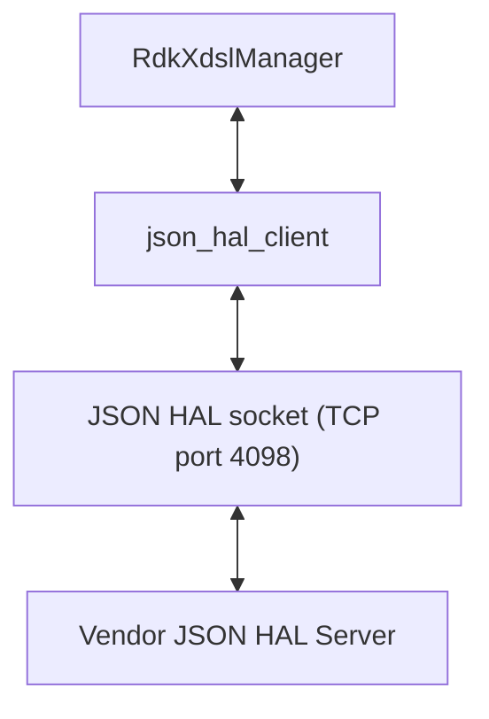

# RdkXdslManager

`RdkXdslManager` is the RDK-B middleware component for xDSL, the copper broadband access family
running from ADSL through VDSL2 and G.fast. It owns the DSL and transport parameter trees in the
RDK-B TR-181 data model, backs each of them with a CCSP data-model plugin, and translates every
parameter read, write and status notification into a message exchange with the vendor's DSL
software.

**Vendor-Facing Contract:** The contract this repository defines is a JSON HAL carried over a TCP
socket, not a C header, which is why there is no `rdkb-halif-xdsl` repository: the interface
definition is [`hal_schema/xdsl_hal_schema.json`](hal_schema/xdsl_hal_schema.json), and everything
else here is the manager middleware in front of it.

## Documentation

This page is the manager overview. The HAL contract is specified in the documents below, which are
its authority:

| Document | What it covers |
| --- | --- |
| [`docs/pages/halSpec.md`](docs/pages/halSpec.md) | The HAL interface specification: architecture, runtime execution requirements, threading and process model, memory model, asynchronous notification, blocking behaviour, error handling, the non-functional requirements, and the API surface. Start here when writing against the HAL rather than against the manager. |
| [`docs/pages/halSpecDetailed.md`](docs/pages/halSpecDetailed.md) | The per-parameter reference: every parameter definition with its type, constraint, access and description, plus the object index, the enumeration appendix, worked message examples per protocol workflow, and the known contract defects. This is to the schema what inline Doxygen is to a C header. |
| [`CHANGELOG.md`](CHANGELOG.md) | Release history, and the distinction between the repository release tag and the HAL schema version. |

The documentation is generated by `docs/generate_docs.sh`, which clones the `hal-doxygen` generator
at tag `1.2.0` into `docs/build` and writes HTML into `docs/output/html`. Both directories are
excluded from version control [`docs/.gitignore`], so the Markdown sources above are the files to
read.

## Architecture

The diagram below describes the high-level software architecture of the manager and the HAL boundary
it sits on.

`hal_schema/xdsl_hal_schema.json` is consumed by `RdkXdslManager` and by no other component: WAN
Manager and other RDK-B components reach DSL state through the TR-181 data model this manager
publishes. A developer integrating against the xDSL HAL is therefore normally working inside this
manager rather than opening the socket directly.

Internally the component is three layers, and the directory names follow them:

- **SSP Host:** `source/RdkXdslManager/` — process startup, D-Bus message bus registration and
  the data-model plugin entry points.
- **Data-Model Layer:** `source/TR-181/middle_layer_src/` — the CCSP/COSA code that backs each
  TR-181 parameter with a get and set handler.
- **HAL Integration Layer:** `source/TR-181/integration_src.shared/` — the JSON HAL client
  integration that turns those handlers into messages on the socket. `xdsl_hal.c` brings the client
  up in a fixed order: `json_hal_client_init()` against the configuration path, then
  `json_hal_client_run()`, then a bounded connectivity poll, then event subscription.

## JSON HAL contract

**Module Identity:** Five values fix the contract on a device, and a mismatch in any of them leaves
the manager unable to reach the vendor server. The current release tag, recorded in
[`CHANGELOG.md`](CHANGELOG.md), is `v1.6.0`.

| Property | Value | Established by |
| --- | --- | --- |
| Module name | `xdslhal` | [`hal_schema/xdsl_hal_schema.json`](hal_schema/xdsl_hal_schema.json), `definitions.moduleName.const` |
| Schema version | `0.0.1`, a constant that must not be modified and that advances independently of the repository release tag; the manager and the vendor server must agree on it | [`hal_schema/xdsl_hal_schema.json`](hal_schema/xdsl_hal_schema.json), `definitions.schemaVersion.const` |
| Client configuration file | `/etc/rdk/conf/xdsl_manager_conf.json` | `source/TR-181/integration_src.shared/xdsl_hal.c`, macro `XDSL_JSON_CONF_PATH` |
| Schema path on the device | `/etc/rdk/schemas/xdsl_hal_schema.json` | [`config/xdsl_manager_conf.json`](config/xdsl_manager_conf.json), key `hal_schema_path` |
| Server port | `4098` | [`config/xdsl_manager_conf.json`](config/xdsl_manager_conf.json), key `server_port` |

**Object Tree:** The schema defines parameters under four TR-181 families: `Device.DSL`,
`Device.FAST`, `Device.ATM` and `Device.PTM`. The ATM and PTM trees carry a DSL line into the WAN
data path, and the G.fast tree is a separate line technology.

| TR-181 family | Parameter definitions | What it covers |
| --- | --- | --- |
| `Device.DSL` | 241 | Lines, channels, bonding groups and line diagnostics |
| `Device.FAST` | 61 | G.fast lines and their statistics |
| `Device.ATM` | 45 | ATM links, QoS and link statistics |
| `Device.PTM` | 22 | PTM links and link statistics |

Because 20 of these 369 parameter definitions use regular expression alternation, they bind 512
definition-to-path pairs, which resolve to 511 distinct paths since two definitions claim the same
path. [`docs/pages/halSpecDetailed.md`](docs/pages/halSpecDetailed.md) sets out every definition,
including the schema's 25 object definitions and eleven enumerated value lists.

**Actions:** Every message carries the same four required envelope fields — `module`, `version`,
`action` and `reqId` — and `action` is drawn from an eleven-member vocabulary: `getSchema`,
`getParameters`, `getParametersResponse`, `setParameters`, `subscribeEvent`,
`getActiveSubscriptions`, `getActiveSubscriptionsResponse`, `getSchemaResponse`, `publishEvent`,
`deleteObject` and `result`. There is no `setParametersResponse`: a write is acknowledged by the
generic `result` action.

**Transport:** The interface is carried by the `json-hal-library` client and server, which are the
authority for the message envelope and the client semantics:
[rdkcentral/json-hal-library@`86a0a300`](https://github.com/rdkcentral/json-hal-library/tree/86a0a300b976f8e3295064af8fb3fd1c793c9e64).

## Repository layout

| Path | Contents |
| --- | --- |
| `hal_schema/` | The interface definition, `xdsl_hal_schema.json`, and ten example messages |
| `config/` | `xdsl_manager_conf.json`, the client configuration read on the device, and `RdkXdslManager.xml`, the TR-181 data model that binds 34 objects and 336 parameters to their C accessor functions |
| `source/RdkXdslManager/` | The CCSP SSP host described under `Architecture` |
| `source/TR-181/middle_layer_src/` | The CCSP/COSA data-model layer |
| `source/TR-181/integration_src.shared/` | The JSON HAL client integration, covering both the DSL lines and the ATM and PTM transport layers |
| `source/TR-181/include/` | The interface headers the layers share: `xdsl_apis.h`, `xtm_apis.h` and `xdsl_event_queue.h` |
| `source/test/` | The gtest sources |
| `cfg/`, `Makefile.am`, `configure.ac` | The Autotools build scaffolding |
| `docs/` | The documentation described above |

## Building

The component is an Autoconf, Automake and Libtool project:

- The package is `RdkXdslManager-rdkb` [`configure.ac`] and the deliverable is an executable named
  `xdslmanager` [`source/RdkXdslManager/Makefile.am`].
- The root `Makefile.am` descends into a single subdirectory, `SUBDIRS = source`, and `cfg/` is the
  Autoconf macro directory [`configure.ac`].
- D-Bus is required: `PKG_CHECK_MODULES([DBUS],[dbus-1 >= 1.6.18])` [`configure.ac`].
- `configure.ac` offers two switches: `--enable-gtestapp` adds the gtest binary under
  `source/test/`, and `--enable-notify` enables systemd notification.

The component is built as part of the surrounding RDK-B build, which supplies the libraries it
links — `libccsp_common`, `librdkloggers`, `libcm_mgnt`, `libsyscfg`, `libsysevent`,
`libhal_platform`, `libjson_hal_client`, `libjson-c` and `libavro` among them
[`source/RdkXdslManager/Makefile.am`, `source/TR-181/integration_src.shared/Makefile.am`] — and the
`$(top_srcdir)/hal/include` include directory. A developer building it standalone supplies the same.

## Known contract defects

[`docs/pages/halSpecDetailed.md`](docs/pages/halSpecDetailed.md#contract-defects) carries the
schema-level inventory. The shipped example messages add four defects of their own: six of the ten
in `hal_schema/` are usable as they stand, and **four are not**. Three fail schema validation —
`example_configureObject_msg.json` uses the action `configureObject`,
`example_getParametersResponse_msg.json` omits the required `type` on its entries, and
`example_getSchema_msg.json` names the module `xslhal` — and `example_getSchemaResponse_msg.json`,
though valid, returns a schema path that differs from the one `config/xdsl_manager_conf.json`
configures. [`docs/pages/halSpecDetailed.md`](docs/pages/halSpecDetailed.md#the-shipped-fixtures)
publishes corrected forms of all four.

## Contributing

Contributions are made by forking the repository and opening a pull request; RDK requires a signed
RDK Contributor License Agreement before code is accepted into the project
[[`CONTRIBUTING.md`](CONTRIBUTING.md)]. Review is routed to `@rdkcentral/wanmanager-maintainers`,
the default owner for every path in the repository [`.github/CODEOWNERS`].

## Licence

This component is licensed under the Apache License, Version 2.0. The full text is in
[`LICENSE`](LICENSE), with `COPYING` and `NOTICE` alongside it.
