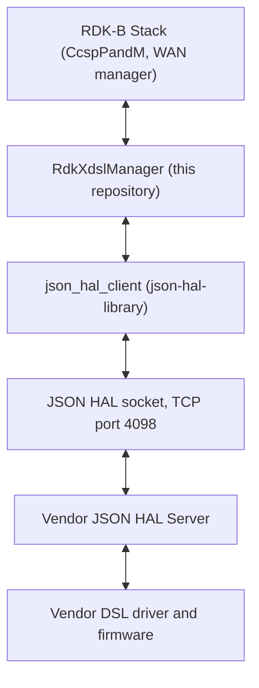

# RdkXdslManager

`RdkXdslManager` is the RDK-B middleware component for xDSL, the copper broadband access family
running from ADSL through VDSL2 and G.fast. It owns the DSL and transport parameter trees in the
RDK-B TR-181 data model, backs each of them with a CCSP data-model plugin, and translates every
parameter read, write and status notification into a message exchange with the vendor's DSL
software.

**The vendor-facing contract this repository defines is a JSON HAL carried over a TCP socket, not a
C header.** That is the orienting fact for a developer arriving from any other RDK-B HAL, and it is
why there is no `rdkb-halif-xdsl` repository: the interface definition is
[`hal_schema/xdsl_hal_schema.json`](hal_schema/xdsl_hal_schema.json), and everything else here is
the manager middleware in front of it.

## Documentation

This page is the manager overview — what the component is, what contract it speaks, and where
things live. The contract itself is specified separately, and the technical depth belongs there
rather than here.

| Document | What it covers |
| --- | --- |
| [`docs/pages/halSpec.md`](docs/pages/halSpec.md) | The HAL interface specification: architecture, runtime execution requirements, threading and process model, memory model, asynchronous notification, blocking behaviour, error handling, the non-functional requirements, and the API surface. Start here when writing against the HAL rather than against the manager. |
| [`docs/pages/halSpecDetailed.md`](docs/pages/halSpecDetailed.md) | The per-parameter reference: every parameter definition with its type, constraint, access and description, plus the object index, the enumeration appendix, worked message examples per protocol workflow, and the known contract defects. This is to the schema what inline Doxygen is to a C header. |

The transport both documents cite as their authority, rather than restating it, is
`json-hal-library`, pinned in the containing workspace at
[rdkcentral/json-hal-library@`86a0a300`](https://github.com/rdkcentral/json-hal-library/tree/86a0a300b976f8e3295064af8fb3fd1c793c9e64).

**Building the documentation.** `cd docs && ./generate_docs.sh` clones the pinned `hal-doxygen`
generator into `docs/build` and writes the generated site to `docs/output/html`. Both directories
are generated artefacts, are excluded from version control, and are never committed. Diagrams on
these pages are fenced Mermaid, which renders on GitHub; it does not render in the generated
Doxygen HTML, which is a known and accepted limitation of the generator rather than a defect in
the pages.

**A note on sourcing.** Every factual claim on this page names the file that establishes it. Where
this repository establishes nothing, the text says so rather than filling the gap with a plausible
guess — a guess reads exactly like a fact, and this page is read by developers writing code and
tests against the component.

## Architecture

The diagram below describes the high-level software architecture of the manager and the HAL boundary
it sits on.

`RdkXdslManager` is the owning middleware service for this interface: the workspace inventory in the
superproject `README.md` pairs the DSL HAL with `RdkXdslManager` and with no other component, so
nothing sits between the RDK-B stack and this manager. A developer integrating against the xDSL HAL
is therefore normally working inside this manager rather than opening the socket directly.

Internally the component is three layers, and the directory names follow them:

- **The SSP host**, `source/RdkXdslManager/` — process startup, D-Bus message bus registration and
  the data-model plugin entry points.
- **The data-model layer**, `source/TR-181/middle_layer_src/` — the CCSP/COSA code that backs each
  TR-181 parameter with a get and set handler.
- **The HAL integration layer**, `source/TR-181/integration_src.shared/` — the JSON HAL client
  integration that turns those handlers into messages on the socket. `xdsl_hal.c` brings the client
  up in a fixed order: `json_hal_client_init()` against the configuration path, then
  `json_hal_client_run()`, then a bounded connectivity poll, then event subscription
  (`xdsl_hal.c:189`, `:196`, `:210`).

## The JSON HAL contract

Five values fix the contract on a device. Each is stated by a file in this repository rather than by
convention, and a mismatch in any of them leaves the manager unable to reach the vendor server.

| Property | Value | Established by |
| --- | --- | --- |
| Module name | `xdslhal` | [`hal_schema/xdsl_hal_schema.json`](hal_schema/xdsl_hal_schema.json), `definitions.moduleName.const` |
| Schema version | `0.0.1` | [`hal_schema/xdsl_hal_schema.json`](hal_schema/xdsl_hal_schema.json), `definitions.schemaVersion.const` |
| Client configuration file | `/etc/rdk/conf/xdsl_manager_conf.json` | `source/TR-181/integration_src.shared/xdsl_hal.c:52`, macro `XDSL_JSON_CONF_PATH` |
| Schema path on the device | `/etc/rdk/schemas/xdsl_hal_schema.json` | [`config/xdsl_manager_conf.json`](config/xdsl_manager_conf.json), key `hal_schema_path` |
| Server port | `4098` | [`config/xdsl_manager_conf.json`](config/xdsl_manager_conf.json), key `server_port` |

**The schema version is not a release version.** The `schemaVersion` definition states that its
value must not be modified, because HAL operation cannot be performed unless the client and the
vendor server agree on it. It advances independently of this repository's release tag, which is
`v1.6.0`.

Every message carries the same four required envelope fields — `module`, `version`, `action` and
`reqId` — and `action` is drawn from an eleven-member vocabulary: `getSchema`, `getParameters`,
`getParametersResponse`, `setParameters`, `subscribeEvent`, `getActiveSubscriptions`,
`getActiveSubscriptionsResponse`, `getSchemaResponse`, `publishEvent`, `deleteObject` and `result`.
Note what the vocabulary does not contain: there is no `setParametersResponse`, because a write is
acknowledged by the generic `result` action.

### Four TR-181 families, not one

The shipped schema defines parameters under four families rather than one. A reader who has seen
this HAL described elsewhere — including in the workspace inventory in the superproject
`README.md` — as a `Device.DSL` interface should treat that description as incomplete. The ATM and
PTM trees are how a DSL line is carried into the WAN data path, and the G.fast tree is a separate
line technology; where a description and the schema disagree, the schema is the contract.

| TR-181 family | Parameter definitions | What it covers |
| --- | --- | --- |
| `Device.DSL` | 241 | Lines, channels, bonding groups and line diagnostics |
| `Device.FAST` | 61 | G.fast lines and their statistics |
| `Device.ATM` | 45 | ATM links, QoS and link statistics |
| `Device.PTM` | 22 | PTM links and link statistics |

Those 369 parameter definitions cover **512 logical TR-181 paths**, because 20 of them use regular
expression alternation and so match more than one path each. Alongside them the schema defines 25
object definitions and eleven enumerated value lists. Every definition, with its expansion where it
alternates, its type, its constraint and its access, is set out in
[`docs/pages/halSpecDetailed.md`](docs/pages/halSpecDetailed.md).

## Repository layout

| Path | Contents |
| --- | --- |
| `hal_schema/` | The interface definition, `xdsl_hal_schema.json`, and ten example messages |
| `config/` | `xdsl_manager_conf.json`, the client configuration read on the device, and `RdkXdslManager.xml`, the TR-181 data model that binds 34 objects and 336 parameters to their C accessor functions |
| `source/RdkXdslManager/` | The CCSP SSP host described under **Architecture** |
| `source/TR-181/middle_layer_src/` | The CCSP/COSA data-model layer |
| `source/TR-181/integration_src.shared/` | The JSON HAL client integration, covering both the DSL lines and the ATM and PTM transport layers |
| `source/TR-181/include/` | The interface headers the layers share: `xdsl_apis.h`, `xtm_apis.h` and `xdsl_event_queue.h` |
| `source/test/` | The gtest sources, built only when `--enable-gtestapp` is given |
| `cfg/`, `Makefile.am`, `configure.ac` | The Autotools build scaffolding |
| `docs/` | The documentation described above |

### The shipped example messages carry four known defects

`hal_schema/` ships ten example messages, and the workspace inventory recommends them as
request and response fixtures. **Four of the ten cannot be used as they stand.** A reader adopting
them unchecked would encode either a message the vendor server rejects or a path the device does not
use.

| Example message | Defect |
| --- | --- |
| `example_configureObject_msg.json` | `action` is `configureObject`, which is not one of the eleven enumerated actions, so the message fails validation |
| `example_getParametersResponse_msg.json` | Both `params` entries omit the required `type` property, so the message fails validation |
| `example_getSchema_msg.json` | `module` reads `xslhal` where the schema requires the constant `xdslhal`, so the message fails validation |
| `example_getSchemaResponse_msg.json` | Valid against the schema, but it returns `/etc/sky/hal_schemas/xdsl_hal_schema.json`, which is not the schema path `config/xdsl_manager_conf.json` names |

The remaining six validate cleanly. Corrected forms of all four, together with one worked exchange
per protocol workflow, are published in
[`docs/pages/halSpecDetailed.md`](docs/pages/halSpecDetailed.md). The example files themselves are
left exactly as they are, because they are inputs that other work may already depend on.

## Building the component

The component is an Autoconf, Automake and Libtool project. What its build files establish:

- The package is `RdkXdslManager-rdkb` (`configure.ac:23`) and the deliverable is an executable
  named `xdslmanager` (`source/RdkXdslManager/Makefile.am:20`).
- The root `Makefile.am` descends into a single subdirectory, `SUBDIRS = source`, and `cfg/` is the
  Autoconf macro directory (`configure.ac:26`).
- The one dependency the build declares a version for is D-Bus:
  `PKG_CHECK_MODULES([DBUS],[dbus-1 >= 1.6.18])` (`configure.ac:106`).
- Two configure switches exist. `--enable-gtestapp` (`configure.ac:33`) adds the gtest binary under
  `source/test/`, and `--enable-notify` (`configure.ac:80`) enables systemd notification.

**This repository documents no end-to-end build recipe, and none is invented here.** It ships no
bootstrap or autogen script and no CMake project. Its remaining dependencies are named only as
linker flags — `libccsp_common`, `librdkloggers`, `libcm_mgnt`, `libsyscfg`, `libsysevent`,
`libhal_platform`, `libjson_hal_client`, `libjson-c` and `libavro` among them
(`source/RdkXdslManager/Makefile.am:35`, `source/TR-181/integration_src.shared/Makefile.am:34`) —
with no version declared for any of them, and one of the compiler include paths,
`$(top_srcdir)/hal/include`, points at a directory this repository does not ship. The component is
therefore built as part of the surrounding RDK-B build, which supplies that context; a developer
building it in isolation should expect to supply the same. Generating the documentation is
independent of the component build and adds nothing to these files.

## Contributing, licence and history

- [`CONTRIBUTING.md`](CONTRIBUTING.md) gives the contribution route: fork the repository, send a
  pull request, and sign the RDK Contributor License Agreement before the code is accepted. It
  states no branch-naming convention; changes made under the HAL documentation effort use the branch
  and pull request name `feature/hal_documentation_project`.
- `.github/CODEOWNERS` makes `@rdkcentral/wanmanager-maintainers` the reviewer for every path in
  this repository.
- [`CHANGELOG.md`](CHANGELOG.md) records the release history. The current release tag is `v1.6.0`,
  and the HAL schema version it carries is `0.0.1`; the two advance independently.
- [`LICENSE`](LICENSE) is the Apache License, Version 2.0, with `COPYING` and `NOTICE` alongside it.
