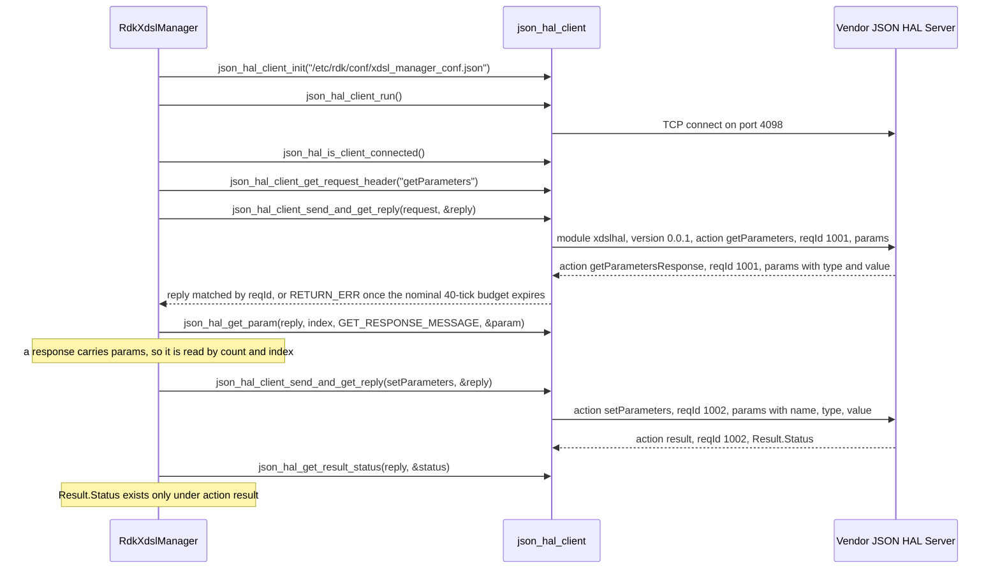
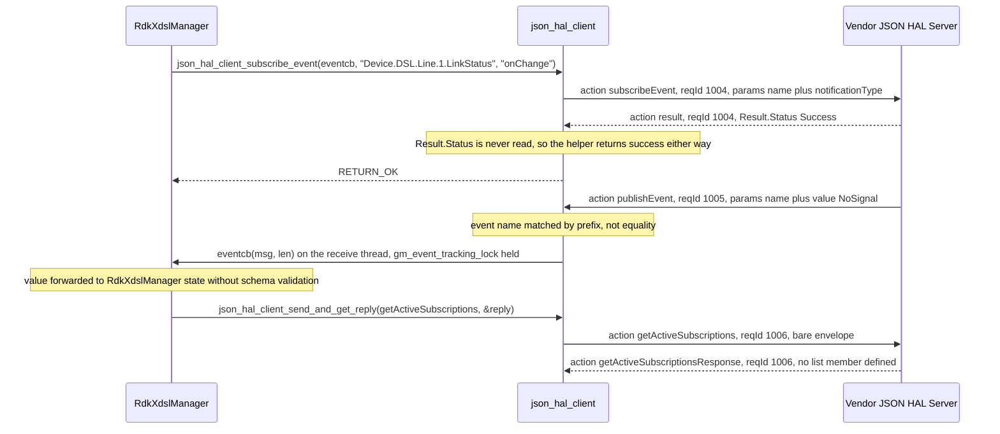

# xDSL HAL Detailed API Reference

## Purpose

This document is the per-parameter reference for the xDSL `JSON` HAL: it stands to
`hal_schema/xdsl_hal_schema.json` as inline Doxygen stands to a C header, giving for each parameter
definition the `TR-181` path it binds, the datatype and constraint the schema enforces, whether it may
be written, and what it means. [halSpec.md](halSpec.md) carries the contract narrative — architecture,
lifecycle, threading, blocking behaviour, error handling and the protocol summary.

`hal_schema/xdsl_hal_schema.json` is the only schema this repository ships, and `RdkXdslManager` is its
sole consumer: `RdkXdslManager` reaches the vendor JSON HAL server that implements the schema through
`json_hal_client`, configured by `config/xdsl_manager_conf.json`. No build option selects another schema.

The schema is a draft-07 document carrying 422 definitions in four classes.

| Definition class | Count | What it contributes |
| --- | --- | --- |
| Parameter definitions | 369 | A leaf `TR-181` parameter: a `name` (a `const` path or a `pattern`), a `type` and a `value` constraint. Every row of the Parameter Reference is one of these. |
| Object definitions | 25 | An instance path ending in `.`, declaring `name` only. These name a table row rather than a value, and they are indexed separately in Object Index. |
| Enumerations | 11 | A named `enum` list: the protocol lists `action`, `notificationType` and `resultStatusEnumList`, and eight data-model lists referenced by `$ref` from parameters. Enumeration Appendix lists them. |
| Envelope and protocol definitions | 17 | `moduleName`, `schemaVersion`, `typeHex`, the nine per-action definitions from `getSchema` to `result`, and the five get, set and subscribe reference lists. Transport and Protocol describes them. |

**A definition is not a path:** Twenty of the 369 parameter definitions bind an alternating `pattern`
and cover 163 paths between them, so the 369 definitions bind **512 name slots**. These resolve to
**511 distinct paths**, because `dslADSLLineTestACTATPds` and `dslADSLLineTestACTATPus` both bind
`^Device\.DSL\.Diagnostics\.ADSLLineTest\.ACTATPds$` (`D5` under `Contract Defects`). Five object
definitions also alternate, expanding the 25 object definitions to 40 instance paths.

**Data-model reference:** Parameter meanings are taken from the Broadband Forum `Device:2.13` data
model, published as the
[`Device:2.13` model report](https://cwmp-data-models.broadband-forum.org/tr-181-2-13-0-cwmp.html) and
listed in the [Broadband Forum CWMP data model index](https://cwmp-data-models.broadband-forum.org/).
Twenty-one of the 511 paths have no counterpart in the model: nineteen are RDK vendor extensions or
local declarations of `RdkXdslManager`, and two are the duplicate-bound and mis-keyed definitions of
`D5` and `D6`.

## Transport and Protocol

Every message is a single `JSON` object carrying a four-field envelope, the same in both directions
and for every action. The schema root requires all four fields.

| Field | Schema definition | Constraint |
| --- | --- | --- |
| `module` | `moduleName` | JSON `string`; const `xdslhal`. |
| `version` | `schemaVersion` | JSON `string`; const `0.0.1`. The definition's description forbids modifying the value: HAL operation cannot be performed without the correct supported version. |
| `action` | `action` | JSON `string`; one of the eleven members listed below. |
| `reqId` | inline | JSON `string`; pattern `^[0-9]+$` — **a decimal string, not a number**. Keep it to at most 63 digits: the server stores it in a 64-byte field without guaranteed termination, and the schema sets no `maxLength`. |

The root declares `properties` for these four fields only and sets no `additionalProperties: false`, so
any further top-level member is accepted unvalidated and carries no meaning.

**Payloads are bound by action:** The schema's `allOf` holds eight `if action == X then …` branches,
each naming and requiring the member the payload travels in. The six that bind `params` constrain it
to a `uniqueItems` array with `minItems` 1 whose items must satisfy an item-level `required` list and
an ordered `anyOf` over the reference lists: **for these six, an empty `params` array, and two
identical entries in one array, are invalid**. `result` and `getSchemaResponse` bind an object
instead — `Result` and `SchemaInfo` respectively — and leave `params` unconstrained.

| Action | Direction | Bound member and required fields | `anyOf` resolves to |
| --- | --- | --- | --- |
| `getSchema` | `RdkXdslManager` to vendor server | none | — |
| `getSchemaResponse` | vendor server to `RdkXdslManager` | `SchemaInfo` (object, `additionalProperties` false), requiring `FilePath` matching `^(.+)/([^/]+)$` | — |
| `getParameters` | `RdkXdslManager` to vendor server | `params`, each item requiring `name` | `getParameterSupportedList`, `getParameterOptionalList` |
| `getParametersResponse` | vendor server to `RdkXdslManager` | `params`, each item requiring `name`, `type`, `value` | `getParameterSupportedList`, `getParameterOptionalList` |
| `setParameters` | `RdkXdslManager` to vendor server | `params`, each item requiring `name`, `type`, `value` | `setParameterSupportedList`, `setParameterOptionalList` |
| `result` | vendor server to `RdkXdslManager` | `Result` (object, `additionalProperties` false), requiring `Status`, a `resultStatusEnumList` member | — |
| `subscribeEvent` | `RdkXdslManager` to vendor server | `params`, each item requiring `name`, `notificationType` | `subscribeEventSupportedList` |
| `publishEvent` | vendor server to `RdkXdslManager` | `params`, each item requiring `name`, `value` | `subscribeEventSupportedList` |
| `deleteObject` | `RdkXdslManager` to vendor server | `params`, each item requiring `name` | `dslLineObjectName` |
| `getActiveSubscriptions` | `RdkXdslManager` to vendor server | none | — |
| `getActiveSubscriptionsResponse` | vendor server to `RdkXdslManager` | none | — |

The item-level `required` list is the only source of mandatory entry fields: no parameter or object
definition declares a `required` of its own, and only `result` and `getSchemaResponse` do.

- **There is no `setParametersResponse`:** A write is acknowledged by the generic `result` action,
  which also acknowledges `subscribeEvent` and `deleteObject`.
- **The `publishEvent` action binds the same reference list as `subscribeEvent`:** Only
  `Device.DSL.Line.{i}.LinkStatus` and `Device.FAST.Line.{i}.LinkStatus` can be subscribed or
  published (Event Model).
- **The `deleteObject` action is instantiable here:** Its `anyOf` resolves to `dslLineObjectName`, so a
  schema-valid delete names a `Device.DSL.Line.{i}.` instance and nothing else — unlike the GPON and
  voice HALs, whose `deleteObject` carries an empty `anyOf`.
- **The three unbound actions leave `params` unconstrained:** A `params` member sent with `getSchema`,
  `getActiveSubscriptions` or `getActiveSubscriptionsResponse` is accepted with any contents, and
  `getActiveSubscriptionsResponse` has no schema member for a subscription list.
- **The `json_hal_client_get_request_header` function adds an empty `params` array to every action whose name does
  not begin with `getSchema`:** Populate it before sending an action that binds `params`: an empty
  array fails `minItems` 1.
- **The two get actions validate only within the first 39 references of
  `getParameterSupportedList`:** Its entries 40 and 41 are undefined, so most `getParameters` and
  `getParametersResponse` entries end in a reference error rather than a verdict (`D1`).
  The set, delete, subscribe and publish lists validate cleanly.

**Nothing frames messages on the wire:** No length prefix or delimiter is used in either direction.
The server parses each `recv` as one complete request, so a request split across reads is lost. The
client accumulates reads only while each fills its 16384-byte buffer, parses on the first shorter
read, and parses the accumulated text only up to its first NUL. A fragmented reply can therefore reach
the parser truncated at any size, and a read that exactly fills the buffer leaves the reply unparsed,
and the waiting call blocked without a deadline, until more data arrives (Error Handling).

Every bound action has the same request/response shape: `RdkXdslManager` sends an envelope, the vendor
JSON HAL server answers with the matching `reqId`, and `RdkXdslManager` reads the payload or the status
from the reply.



**Read each reply with the helper that matches its payload:** `getParametersResponse` carries `params`
and no `Result`, so read it with `json_hal_get_total_param_count` and `json_hal_get_param` per index.
`json_hal_get_result_status` applies only to `result`; on any other reply it returns `RETURN_ERR` and
leaves the caller's flag unwritten.

**Transport constants:** `json-rpc-common/json_rpc_common.h` in `json-hal-library` covers the protocol
only partly:

- Seven actions have a constant — `JSON_RPC_ACTION_GET_PARAM`, `JSON_RPC_ACTION_GET_PARAM_RESPONSE`,
  `JSON_RPC_ACTION_RESULT`, `JSON_RPC_ACTION_GET_SCHEMA`, `JSON_RPC_ACTION_GET_SCHEMA_RESPONSE`,
  `JSON_RPC_SUBSCRIBE_EVENT_ACTION_NAME` and `JSON_RPC_PUBLISH_EVENT_ACTION_NAME`. Pass `setParameters`,
  `deleteObject`, `getActiveSubscriptions` and `getActiveSubscriptionsResponse` as literals.
- Three result statuses have a constant — `JSON_RPC_STATUS_SUCCESS`, `JSON_RPC_STATUS_FAILED` and
  `JSON_RPC_STATUS_NOT_SUPPORTED`. Compare `Invalid Argument` as a literal string.
- `JSON_RPC_FIELD_CONFIGURE_OBJECT` names `configureObject`, which is **not** an `action` member; a
  message using it is rejected (Worked Message Examples).
- `JSON_RPC_FIELD_PARAM_NOTIFICATION_TYPE_ON_CHANGE_SYNC` and its timeout companion name `onChangeSync`
  and `onChangeSyncTimeout`, which are **not** `notificationType` members here: only `interval` and
  `onChange` validate.

**Numeric values cross the parameter helpers through signed conversions:** `json_hal_get_param` reads
`unsignedInt` through `json_object_get_int` and `unsignedLong` through `json_object_get_int64`, and
`json_hal_add_param` builds both from `atoll`, with no range or format check: a value above the signed
maximum is not representable, and a non-numeric value becomes `0`. The helpers also return `RETURN_OK`
for these inputs:

| Input | Result |
| --- | --- |
| An entry with no `value`, labelled `boolean`, `int`, `unsignedInt`, `long` or `unsignedLong` | `param->value` is empty and converts to `0`, indistinguishable from a real zero. Labelled `string`, `hexBinary` or `base64`, the same entry returns `RETURN_ERR`. |
| A datatype label matching none of the eight `eParamType` members | `param->type` stays `0`, which `eParamType` does not assign, and no value is set. |
| An `eActionType` other than the four handled | A zeroed `hal_param_t`. |
| Construction with `param->type` `0` | An entry carrying `name` only, invalid for every `params`-bearing action. |

Check `param->type` against the expected `eParamType` rather than trusting `RETURN_OK`, treat an empty
`param->value` as absent, and read a value beyond the signed range directly from the reply with
`json_object_object_get_ex` and the accessor matching the schema type.

## Deployment contract

| Element | Value | Set by |
| --- | --- | --- |
| Module name in every message | `xdslhal` | `definitions.moduleName.const` |
| Schema version in every message | `0.0.1` | `definitions.schemaVersion.const` |
| Client configuration file | `/etc/rdk/conf/xdsl_manager_conf.json` | `XDSL_JSON_CONF_PATH` in `RdkXdslManager`, passed to `json_hal_client_init` |
| Schema path | `/etc/rdk/schemas/xdsl_hal_schema.json` | `hal_schema_path` in `config/xdsl_manager_conf.json` |
| Server port | `4098` | `server_port` in `config/xdsl_manager_conf.json` |
| Schema consumer | `RdkXdslManager` | `hal_schema/xdsl_hal_schema.json` is this repository's only schema file; no build flag selects another |

A deployment installs `hal_schema/xdsl_hal_schema.json` at the schema path above, and a
`getSchemaResponse` returns that path. The shipped `getSchemaResponse` fixture names a different path,
corrected under Worked Message Examples.

## Object Index

Twenty-five definitions describe an object rather than a value. Each declares only a `name` whose
pattern ends in `.`: an object entry identifies a table row and carries no datatype and no value. Five
alternate, so the twenty-five definitions cover forty instance paths.

Object definitions are **open** — none sets `additionalProperties` — while every parameter definition
sets `additionalProperties: false`, so an entry naming an object path accepts further members
unchecked (Error Handling, Validation boundary). An object definition is the payload of a
`deleteObject`, whose `anyOf` admits `dslLineObjectName` alone; a get-list entry, through which
`getParameters` asks for the instance rather than a value; and, for `atmLinkObjectName` and
`ptmLinkObjectName`, a set-list entry (`D4`).

| Object definition | Instance paths | List membership | Shape |
| --- | --- | --- | --- |
| `^Device\.ATM\.Diagnostics\.F5Loopback\.$` · `atmDiagnosticsF5LoopbackObjectName` | 1 | Read-Only, optional | declares `name` only |
| `^Device\.ATM\.Link\.\d+\.$` · `atmLinkObjectName` | 1 | Read-Write | declares `name` only |
| `^Device\.ATM\.Link\.\d+\.QoS\.$` · `atmLinkQoSObjectName` | 1 | Read-Only | declares `name` only |
| `^Device\.ATM\.Link\.\d+\.Stats\.$` · `atmLinkStatsObjectName` | 1 | Read-Only | declares `name` only |
| `^Device\.DSL\.BondingGroup\.\d+\.$` · `dslBondingGroupObjectName` | 1 | Read-Only | declares `name` only |
| `^Device\.DSL\.BondingGroup\.\d+\.BondedChannel\.\d+\.$` · `dslBondedChannelObjectName` | 1 | Read-Only | declares `name` only |
| `^Device\.DSL\.BondingGroup\.\d+\.Stats\.$` · `dslBondingGroupStatsObjectName` | 1 | Read-Only | declares `name` only |
| `^Device\.DSL\.BondingGroup\.\d+\.Stats\.(Total\|CurrentDay\|QuarterHour)\.$` · `bondingGroupStatsAllObjectName` · **3 instance paths** | 3 | Read-Only | declares `name` only |
| `^Device\.DSL\.Channel\.\d+\.$` · `dslChannelObjectName` | 1 | Read-Only | declares `name` only |
| `^Device\.DSL\.Channel\.\d+\.Stats\.(Total\|Showtime\|LastShowtime\|CurrentDay\|QuarterHour)\.$` · `channelStatsAllObjectName` · **5 instance paths** | 5 | Read-Only | declares `name` only |
| `^Device\.DSL\.Diagnostics\.ADSLLineTest\.$` · `dslDiagnosticsADSLLineTestObjectName` | 1 | Read-Only | declares `name` only |
| `^Device\.DSL\.Diagnostics\.SELTP\.$` · `dslDiagnosticsSeltpObjectName` | 1 | Read-Only | declares `name` only |
| `^Device\.DSL\.Diagnostics\.SELTQLN\.$` · `dslDiagnosticsSeltqlnObjectName` | 1 | Read-Only | declares `name` only |
| `^Device\.DSL\.Diagnostics\.SELTUER\.$` · `dslDiagnosticsSeltuerObjectName` | 1 | Read-Only | declares `name` only |
| `^Device\.DSL\.Line\.\d+\.$` · `dslLineObjectName` | 1 | Read-Only | declares `name` only |
| `^Device\.DSL\.Line\.\d+\.DataGathering\.$` · `dslLineDataGatheringObjectName` | 1 | Read-Only, optional | declares `name` only |
| `^Device\.DSL\.(Line\|Channel)\.\d+\.Stats\.$` · `dslLineChannelStatsObjectName` · **2 instance paths** | 2 | Read-Only | declares `name` only |
| `^Device\.DSL\.Line\.\d+\.Stats\.(Total\|Showtime\|LastShowtime\|CurrentDay\|QuarterHour)\.$` · `dslLineStatsAllObjectName` · **5 instance paths** | 5 | Read-Only | declares `name` only |
| `^Device\.DSL\.Line\.\d+\.TestParams\.$` · `dslLineTestParamsObjectName` | 1 | Read-Only | declares `name` only |
| `^Device\.FAST\.Line\.\d+\.$` · `fastLineObjectName` | 1 | Read-Only | declares `name` only |
| `^Device\.FAST\.Line\.\d+\.Stats\.$` · `fastLineStatsObjectName` | 1 | Read-Only | declares `name` only |
| `^Device\.FAST\.Line\.\d+\.Stats\.(Total\|Showtime\|LastShowtime\|CurrentDay\|QuarterHour)\.$` · `fastLineStatsAllObjectName` · **5 instance paths** | 5 | Read-Only | declares `name` only |
| `^Device\.FAST\.Line\.\d+\.TestParams\.$` · `fastLineTestParamsObjectName` | 1 | Read-Only | declares `name` only |
| `^Device\.PTM\.Link\.\d+\.$` · `ptmLinkObjectName` | 1 | Read-Write | declares `name` only |
| `^Device\.PTM\.Link\.\d+\.Stats\.$` · `ptmLinkStatsObjectName` | 1 | Read-Only | declares `name` only |

## Parameter Reference

Each table has four columns:

- `TR-181 Parameter · definition key` — the path or paths the definition's `name` binds, with `{i}`
  for each `\d+` instance index, then ` · ` and the schema definition key. An alternating definition
  carries every path it matches or, where it binds more than a handful, the exact pattern with every
  alternative enumerated; its path count follows the key.
- `Type and Constraint` — the `type.const` the entry's `type` member carries (the `type` enumeration
  for the three definitions of `D10`), then the `value` constraint: `JSON` and the value's JSON type
  with its `minimum`, `maximum`, `minLength`, `maxLength`, `pattern`, `one of`, `default` or `examples`
  keywords, or `values from` and the enumeration it references. A cell that gives only the JSON type
  has no further constraint.
- `Access` — `Read-Write` for a definition in `setParameterSupportedList` or
  `setParameterOptionalList`, `Read-Only` otherwise; `optional` marks a definition only the optional
  list for that direction references, `subscribable` a member of `subscribeEventSupportedList`, and
  **not listed** a definition no list references. The schema carries no `(Access = …)` markers. Of the
  369 definitions, 305 are `Read-Only` (2 of them subscribable), 39 `Read-Only, optional`, 16
  `Read-Write`, 6 `Read-Write, optional` and 3 **not listed**.
- `Description` — the parameter's meaning. `[Device:2.13]` marks a description from the data model;
  *[schema]* marks the three taken from the schema itself (`dslSeltuerUER`, `fastLineLinkStatus` and
  `atmLinkVCSearchList`). The 19 rows with no data-model counterpart name their declaration in
  `RdkXdslManager.xml` or `xdsl_apis.h` and are marked **underived:** treat such a row as a value of
  the stated type with no asserted semantics.

A pipe inside a pattern in a table cell is escaped as `\|`; delete the backslash when copying the
pattern. The fenced patterns under Alternating path expansions and Long value patterns are the exact
schema strings.

The definitions are presented in nine sections, one per object family. Totals are given as
*definitions* and as *name slots*, because an alternating definition binds more than one path.

| Section | Definitions | Name slots |
| --- | --- | --- |
| `Device.DSL.Line` | 113 | 136 |
| `Device.DSL.Channel` | 25 | 55 |
| `Device.DSL.BondingGroup` | 40 | 71 |
| `Device.DSL.Diagnostics` | 62 | 62 |
| `Device.DSL.X_RDK_NLNM` | 1 | 1 |
| `Device.FAST.Line` | 61 | 120 |
| `Device.ATM.Link` | 36 | 36 |
| `Device.ATM.Diagnostics` | 9 | 9 |
| `Device.PTM.Link` | 22 | 22 |
| **Total** | **369** | **512** |

The 512 name slots resolve to **511 distinct paths** (Purpose). All four `TR-181` families this HAL
exposes are covered: `Device.DSL`, `Device.FAST`, `Device.ATM` and `Device.PTM`. The thirteen
`Device.DSL.(Line|Channel).…` statistics definitions span two objects and are listed once, under
`Device.DSL.Line`, with both paths in the cell.

### Writable surface

The two set lists carry 24 references: **22 writable leaf parameters** and **2 open object-name
definitions**. Neither set list contains a dangling reference.

**22 writable leaf parameters:** sixteen through `setParameterSupportedList` and six through
`setParameterOptionalList`. These are the only values a schema-valid `setParameters` may carry.

| TR-181 path | Definition key | Set list | Type and Constraint |
| --- | --- | --- | --- |
| `Device.ATM.Diagnostics.F5Loopback.DiagnosticsState` | `atmDiagF5LoopbackDiagnosticsState` | `setParameterOptionalList` | `string`; JSON `string`; one of `None`, `Requested`, `Canceled`, `Complete`, `Error`, `Error_Internal`, `Error_Other` |
| `Device.ATM.Diagnostics.F5Loopback.Interface` | `atmDiagF5LoopbackInterface` | `setParameterOptionalList` | `string`; JSON `string`; maxLength 256 |
| `Device.ATM.Diagnostics.F5Loopback.NumberOfRepetitions` | `atmDiagF5LoopbackNumberOfRepetitions` | `setParameterOptionalList` | `unsignedInt`; JSON `integer`; minimum 0 |
| `Device.ATM.Diagnostics.F5Loopback.Timeout` | `atmDiagF5LoopbackTimeout` | `setParameterOptionalList` | `unsignedInt`; JSON `integer`; minimum 0 |
| `Device.ATM.Link.{i}.DestinationAddress` | `atmLinkDestinationAddress` | `setParameterSupportedList` | `string`; JSON `string`; maxLength 256; pattern `^(d+/d+)$`; `examples` "0/35 or 8/23" (**a string, not an array**) |
| `Device.ATM.Link.{i}.Enable` | `atmLinkEnable` | `setParameterSupportedList` | `boolean`; JSON `boolean` |
| `Device.ATM.Link.{i}.Encapsulation` | `atmLinkEncapsulation` | `setParameterSupportedList` | `string`; JSON `string`; one of `LLC`, `VCMUX` |
| `Device.ATM.Link.{i}.FCSPreserved` | `atmLinkFCSPreserved` | `setParameterSupportedList` | `boolean`; JSON `boolean` |
| `Device.ATM.Link.{i}.Name` | `atmLinkName` | `setParameterSupportedList` | `string`; JSON `string`; maxLength 64 |
| `Device.ATM.Link.{i}.QoS.MaximumBurstSize` | `atmLinkQoSMaximumBurstSize` | `setParameterSupportedList` | `unsignedInt`; JSON `integer`; minimum 0 |
| `Device.ATM.Link.{i}.QoS.PeakCellRate` | `atmLinkQoSPeakCellRate` | `setParameterSupportedList` | `unsignedInt`; JSON `integer`; minimum 0 |
| `Device.ATM.Link.{i}.QoS.QoSClass` | `atmLinkQoSQoSClass` | `setParameterSupportedList` | `string`; JSON `string`; one of `UBR`, `CBR`, `GFR`, `VBR-nrt`, `VBR-rt`, `UBR+`, `ABR` |
| `Device.ATM.Link.{i}.QoS.SustainableCellRate` | `atmLinkQoSSustainableCellRate` | `setParameterSupportedList` | `unsignedInt`; JSON `integer`; minimum 0 |
| `Device.ATM.Link.{i}.VCSearchList` | `atmLinkVCSearchList` | `setParameterSupportedList` | `string`; JSON `string`; maxLength 256; `examples` "0/35, 8/35, 1/35" (**a string, not an array**) |
| `Device.DSL.Diagnostics.ADSLLineTest.DiagnosticsState` | `dslADSLLineTestDiagnosticsState` | `setParameterOptionalList` | `string`; values from `dslDiagnosticsStateEnumList` |
| `Device.DSL.Channel.{i}.Enable` | `dslChannelEnable` | `setParameterSupportedList` | `boolean`; JSON `boolean` |
| `Device.DSL.Line.{i}.AllowedProfiles` | `dslLineAllowedProfiles` | `setParameterSupportedList` | `string`; JSON `string`; pattern `` ^(8a\|8b\|8c\|8d\|12a\|12b\|17a\|17b\|30a\|35b)(,(8a\|8b\|8c\|8d\|12a\|12b\|17a\|17b\|30a\|35b))*$ `` |
| `Device.DSL.Line.{i}.Enable` | `dslLineEnable` | `setParameterSupportedList` | `boolean`; JSON `boolean` |
| `Device.DSL.Line.{i}.EnableDataGathering` | `dslLineEnableDataGathering` | `setParameterOptionalList` | `boolean`; JSON `boolean` |
| `Device.DSL.Line.{i}.StandardsSupported` | `dslLineStandardsSupported` | `setParameterSupportedList` | `string`; JSON `string`; no `maxLength`; `pattern` anchored, an alternation over 26 transmission-system labels, comma-separable — every alternative and the exact expression are given under Long value patterns at the end of this section |
| `Device.PTM.Link.{i}.Enable` | `ptmLinkEnable` | `setParameterSupportedList` | `boolean`; JSON `boolean` |
| `Device.PTM.Link.{i}.Name` | `ptmLinkName` | `setParameterSupportedList` | `string`; JSON `string`; maxLength 64 |

**2 open object-name definitions**, both in `setParameterSupportedList`. Neither describes a writable
leaf value: a write naming either is schema-valid, and the schema fixes neither its datatype nor its
value (`D4`).

| Object path | Definition key | Set list | Shape |
| --- | --- | --- | --- |
| `Device.ATM.Link.{i}.` | `atmLinkObjectName` | `setParameterSupportedList` | declares `name` only, open |
| `Device.PTM.Link.{i}.` | `ptmLinkObjectName` | `setParameterSupportedList` | declares `name` only, open |

The four reference lists:

| List | References | Note |
| --- | --- | --- |
| `getParameterSupportedList` | 348 | contains the two dangling entries at positions 40 and 41; only the first 39 are reachable |
| `getParameterOptionalList` | 45 | no dangling entry |
| `setParameterSupportedList` | 18 | 16 leaf parameters plus the 2 object-name definitions |
| `setParameterOptionalList` | 6 | 6 leaf parameters |

That is 393 read references and 24 write references. The two dangling references,
`#/definitions/dslLineXTURVersion` and `#/definitions/dslLineXTURSerial`, sit in
`getParameterSupportedList` only and are not parameters of this contract (`D1`).

### Device.DSL.Line

*113 parameter definitions binding 136 name paths.*

| TR-181 Parameter · definition key | Type and Constraint | Access | Description |
| --- | --- | --- | --- |
| `Device.DSL.Line.{i}.ACTINPROCds` · `dslLineACTINPROCds` | `unsignedInt`; JSON `integer`; minimum 0 | Read-Only, optional | This parameter reports the actual impulse noise protection (INP) of the robust overhead channel (ROC) in the downstream direction. `[Device:2.13]` |
| `Device.DSL.Line.{i}.ACTINPROCus` · `dslLineACTINPROCus` | `unsignedInt`; JSON `integer`; minimum 0 | Read-Only, optional | This parameter reports the actual impulse noise protection (INP) of the robust overhead channel (ROC) in the upstream direction. `[Device:2.13]` |
| `Device.DSL.Line.{i}.ACTRAMODEds` · `dslLineACTRAMODEds` | `unsignedInt`; JSON `integer`; minimum 1; maximum 4 | Read-Only, optional | This parameter indicates the actual active rate adaptation mode in the downstream direction. If this parameter equals 1, the link is operating in RA-MODE 1 (MANUAL). If this parameter equals 2, the link is operating in RA-MODE 2 (AT_INIT). If this parameter equals 3, the link is operating in RA-MODE 3 (DYNAMIC). If this parameter equals 4, the link is operating in RA-MODE 4 (DYNAMIC with SOS). Defined as ACT-RA-MODEds in Clause 7.5.1.33.1 of ITU-T G.997.1. `[Device:2.13]` |
| `Device.DSL.Line.{i}.ACTRAMODEus` · `dslLineACTRAMODEus` | `unsignedInt`; JSON `integer`; minimum 1; maximum 4 | Read-Only, optional | This parameter indicates the actual active rate adaptation mode in the upstream direction. If this parameter equals 1, the link is operating in RA-MODE 1 (MANUAL). If this parameter equals 2, the link is operating in RA-MODE 2 (AT_INIT). If this parameter equals 3, the link is operating in RA-MODE 3 (DYNAMIC). If this parameter equals 4, the link is operating in RA-MODE 4 (DYNAMIC with SOS). Defined as ACT-RA-MODEus in Clause 7.5.1.33.2 of ITU-T G.997.1. `[Device:2.13]` |
| `Device.DSL.Line.{i}.ACTSNRMODEds` · `dslLineACTSNRMODEds` | `unsignedInt`; JSON `integer`; minimum 0; maximum 2 | Read-Only | Reports whether the OPTIONAL virtual noise mechanism is in use in the downstream direction. `[Device:2.13]` |
| `Device.DSL.Line.{i}.ACTSNRMODEus` · `dslLineACTSNRMODEus` | `unsignedInt`; JSON `integer`; minimum 0 | Read-Only | Reports whether the OPTIONAL virtual noise mechanism is in use in the upstream direction. A value of 1 indicates the virtual noise mechanism is not in use, and a value of 2 indicates the virtual noise mechanism is in use. `[Device:2.13]` |
| `Device.DSL.Line.{i}.ACTUALCE` · `dslLineACTUALCE` | `unsignedInt`; JSON `integer`; minimum 0 | Read-Only, optional | Reports the actual cyclic extension, as the value of m, in use for the connection. Note: See ITU-T Recommendation G.997.1. `[Device:2.13]` |
| `Device.DSL.Line.{i}.AllowedProfiles` · `dslLineAllowedProfiles` | `string`; JSON `string`; pattern `` ^(8a\|8b\|8c\|8d\|12a\|12b\|17a\|17b\|30a\|35b)(,(8a\|8b\|8c\|8d\|12a\|12b\|17a\|17b\|30a\|35b))*$ `` | Read-Write | Comma-separated list. List items indicate which VDSL2 profiles are allowed on the line. Note: In G.997.1, this parameter is called PROFILES. See ITU-T Recommendation G.997.1. `[Device:2.13]` |
| `Device.DSL.Line.{i}.CurrentProfile` · `dslLineCurrentProfile` | `string`; values from `allowedProfilesEnumList` | Read-Only | Indicates which VDSL2 profile is currently in use on the line. Note: This parameter is OPTIONAL at the G and S/T interfaces in G.997.1 Amendment 1. `[Device:2.13]` |
| `Device.DSL.Line.{i}.DataGathering.ActLoggingDepthReportingR` · `lineDataGatheringActLoggingDepthReportingR` | `unsignedInt`; JSON `integer`; minimum 0 | Read-Only, optional | This parameter is actual logging depth that is used for reporting the VTU-R event trace buffer over the eoc channel, in number of records, where each of the records consists of 6 bytes indicating a data gathering event as defined in G.993.2. Units: records. `[Device:2.13]` |
| `Device.DSL.Line.{i}.DataGathering.EventTraceBufferR` · `lineDataGatheringEventTraceBufferR` | `string`; JSON `string`; maxLength 256 | Read-Only, optional | This parameter identifies the log file of the data gathering event trace buffer containing the event records that originated at the VTU-R. The value is the path name of the row of the device's vendor log file table that holds that buffer, and is an empty string once the referenced row is deleted; the buffer itself is retrieved by uploading the identified vendor log file rather than through this HAL. Defined as EVENT_TRACE_BUFFER_R in Clause 7.5.3.6 of ITU-T G.997.1 and Clause 11.5 of ITU-T G.993.2. `[Device:2.13]` |
| `Device.DSL.Line.{i}.DataGathering.LoggingDepthR` · `lineDataGatheringLoggingDepthR` | `unsignedInt`; JSON `integer`; minimum 0 | Read-Only, optional | This parameter is the maximum depth of the entire data gathering event buffer at the VTU-R, in number of records, where each of the records consists of 6 bytes indicating a data gathering event as defined in G.993.2. Units: records. `[Device:2.13]` |
| `Device.DSL.Line.{i}.DownstreamAttenuation` · `dslLineDownstreamAttenuation` | `int`; JSON `integer` | Read-Only | The current downstream signal loss (expressed in 0.1dB). Doesn't apply to VDSL2 G.993.2. Otherwise has the same value as the single element of TestParams.SATNds. Units: 0.1dB. `[Device:2.13]` |
| `Device.DSL.Line.{i}.DownstreamMaxBitRate` · `dslLineDownstreamMaxBitRate` | `unsignedInt`; JSON `integer`; minimum 0 | Read-Only | The current maximum attainable data rate downstream (expressed in Kbps). Note: This parameter is related to the G.997.1 parameter ATTNDRds, which is measured in bits/s. Units: Kbps. `[Device:2.13]` |
| `Device.DSL.Line.{i}.DownstreamNoiseMargin` · `dslLineDownstreamNoiseMargin` | `int`; JSON `integer`; minimum -64; maximum 63 | Read-Only | The current signal-to-noise ratio margin (expressed in 0.1dB) in the downstream direction. Note: In G.997.1, this parameter is called SNRMds. Units: 0.1dB. `[Device:2.13]` |
| `Device.DSL.Line.{i}.DownstreamPower` · `dslLineDownstreamPower` | `int`; JSON `integer` | Read-Only | The current received power at the CPE's DSL line (expressed in 0.1dBmV). Units: 0.1dBmV. `[Device:2.13]` |
| `Device.DSL.Line.{i}.Enable` · `dslLineEnable` | `boolean`; JSON `boolean` | Read-Write | Enables or disables the DSL line. This parameter is based on ifAdminStatus from RFC2863. `[Device:2.13]` |
| `Device.DSL.Line.{i}.EnableDataGathering` · `dslLineEnableDataGathering` | `boolean`; JSON `boolean` | Read-Write, optional | Enables or disables data gathering on the DSL line. `[Device:2.13]` |
| `Device.DSL.Line.{i}.FirmwareVersion` · `dslLineFirmwareVersion` | `string`; JSON `string`; maxLength 64 | Read-Only | A string identifying the version of the modem firmware currently installed for this interface. `[Device:2.13]` |
| `Device.DSL.Line.{i}.INMCCds` · `dslLineINMCCds` | `unsignedInt`; JSON `integer`; minimum 0; maximum 64 | Read-Only | The Impulse Noise Monitoring (INM) Cluster Continuation value, measured in DMT symbols, that the xTU receiver uses in the cluster indication process. `[Device:2.13]` |
| `Device.DSL.Line.{i}.INMIATOds` · `dslLineINMIATOds` | `unsignedInt`; JSON `integer`; minimum 3; maximum 511 | Read-Only | The Impulse Noise Monitoring (INM) Inter Arrival Time (IAT) Offset, measured in DMT symbols, that the xTU receiver uses to determine in which bin of the IAT histogram the IAT is reported. `[Device:2.13]` |
| `Device.DSL.Line.{i}.INMIATSds` · `dslLineINMIATSds` | `unsignedInt`; JSON `integer`; minimum 0; maximum 7 | Read-Only | The Impulse Noise Monitoring (INM) Inter Arrival Time (IAT) Step that the xTU receiver uses to determine in which bin of the IAT histogram the IAT is reported. `[Device:2.13]` |
| `Device.DSL.Line.{i}.INMINPEQMODEds` · `dslLineINMINPEQMODEds` | `unsignedInt`; JSON `integer`; minimum 0; maximum 3 | Read-Only | The Impulse Noise Monitoring (INM) Equivalent Impulse Noise Protection (INP) Mode that the xTU receiver uses in the computation of the Equivalent INP. Note: In G.997.1, this parameter is called INM_INPEQ_MODE. See ITU-T Recommendation G.997.1. `[Device:2.13]` |
| `Device.DSL.Line.{i}.LIMITMASK` · `dslLineLIMITMASK` | `unsignedInt`; JSON `integer`; minimum 0 | Read-Only, optional | Indicates the enabled VDSL2 Limit PSD mask of the selected PSD mask class. Bit mask as specified in ITU-T Recommendation G.997.1. `[Device:2.13]` |
| `Device.DSL.Line.{i}.LastChange` · `dslLineLastChange` | `unsignedInt`; JSON `integer`; minimum 0 | Read-Only | The accumulated time in seconds since the DSL line entered its current operational state. Units: seconds. `[Device:2.13]` |
| `Device.DSL.Line.{i}.LastStateTransmittedDownstream` · `dslLineLastStateTransmittedDownstream` | `unsignedInt`; JSON `integer`; minimum 0 | Read-Only, optional | This parameter represents the last successful transmitted initialization state in the downstream direction in the last full initialization performed on the line. `[Device:2.13]` |
| `Device.DSL.Line.{i}.LastStateTransmittedUpstream` · `dslLineLastStateTransmittedUpstream` | `unsignedInt`; JSON `integer`; minimum 0 | Read-Only, optional | This parameter represents the last successful transmitted initialization state in the upstream direction in the last full initialization performed on the line. `[Device:2.13]` |
| `Device.DSL.Line.{i}.LineEncoding` · `dslLineLineEncoding` | `string`; values from `lineEncodingEnumList` | Read-Only | The line encoding method used in establishing the Layer 1 DSL connection between the CPE and the DSLAM. Note: Generally speaking, this variable does not change after provisioning. `[Device:2.13]` |
| `Device.DSL.Line.{i}.LineNumber` · `dslLineLineNumber` | `int`; JSON `integer`; minimum 1 | Read-Only | Signifies the line pair that the modem is using to connection. this parameter = 1 is the innermost pair. `[Device:2.13]` |
| `Device.DSL.Line.{i}.LinkStatus` · `dslLineLinkStatus` | `string`; values from `linkStatusEnumList` | Read-Only, subscribable | Status of the DSL physical link. When this parameter is Up, Status is expected to be Up. When this parameter is Initializing or EstablishingLink or NoSignal or Disabled, Status is expected to be Down. `[Device:2.13]` |
| `Device.DSL.Line.{i}.MREFPSDds` · `dslLineMREFPSDds` | `base64`; JSON `string`; maxLength 145 | Read-Only, optional | This parameter SHALL contain the set of breakpoints exchanged in the MREFPSDds fields of the O-PRM message of G.993.2. `[Device:2.13]` |
| `Device.DSL.Line.{i}.MREFPSDus` · `dslLineMREFPSDus` | `base64`; JSON `string`; maxLength 145 | Read-Only, optional | This parameter SHALL contain the set of breakpoints exchanged in the MREFPSDus fields of the R-PRM message of G.993.2. `[Device:2.13]` |
| `Device.DSL.Line.{i}.Name` · `dslLineName` | `string`; JSON `string`; maxLength 64 | Read-Only | The textual name of the DSL line as assigned by the CPE. `[Device:2.13]` |
| `Device.DSL.Line.{i}.PowerManagementState` · `dslLinePowerManagementState` | `string`; values from `powerManagementStateEnumList` | Read-Only | The power management state of the line. Note: See ITU-T Recommendation G.997.1. `[Device:2.13]` |
| `Device.DSL.Line.{i}.RXTHRSHds` · `dslLineRXTHRSHds` | `int`; JSON `integer`; minimum -640; maximum 0 | Read-Only, optional | UPBO downstream receiver signal level threshold. This parameter reports the downstream received signal level threshold value used in the alternative electrical length estimation method (ELE-M1). Units: 0.1 dB. `[Device:2.13]` |
| `Device.DSL.Line.{i}.SNRMROCds` · `dslLineSNRMROCds` | `unsignedInt`; JSON `integer`; minimum 0 | Read-Only, optional | This parameter reports the actual signal-to-noise margin of the robust overhead channel (ROC) in the downstream direction (expressed in 0.1 dB). Units: 0.1 dB. `[Device:2.13]` |
| `Device.DSL.Line.{i}.SNRMROCus` · `dslLineSNRMROCus` | `unsignedInt`; JSON `integer`; minimum 0 | Read-Only, optional | This parameter reports the actual signal-to-noise margin of the robust overhead channel (ROC) in the upstream direction (expressed in 0.1 dB). Units: 0.1 dB. `[Device:2.13]` |
| `Device.DSL.Line.{i}.SNRMpbds` · `dslLineSNRMpbds` | `string`; JSON `string`; maxLength 24 | Read-Only | Comma-separated list. Indicates the current signal-to-noise ratio margin of each band. Interpretation of the values is as defined in ITU-T Rec. G.997.1. `[Device:2.13]` |
| `Device.DSL.Line.{i}.SNRMpbus` · `dslLineSNRMpbus` | `string`; JSON `string`; maxLength 24 | Read-Only | Comma-separated list. Indicates the current signal-to-noise ratio margin of each upstream band. `[Device:2.13]` |
| `Device.DSL.Line.{i}.StandardUsed` · `dslLineStandardUsed` | `string`; values from `standardsSupportedEnumList` | Read-Only | Indicates the standard that this object instance is using for the connection. Note: In G.997.1, this parameter is called "xDSL Transmission system". `[Device:2.13]` |
| `Device.DSL.Line.{i}.StandardsSupported` · `dslLineStandardsSupported` | `string`; JSON `string`; no `maxLength`; `pattern` anchored, an alternation over 26 transmission-system labels, comma-separable — every alternative and the exact expression are given under Long value patterns at the end of this section | Read-Write | Comma-separated list. List items indicate which DSL standards and recommendations are supported by this object instance. `[Device:2.13]` |
| `Device.DSL.Line.{i}.Stats.BytesReceived`, `Device.DSL.Channel.{i}.Stats.BytesReceived` · `dslLineChannelStatsBytesReceived` · **2 paths** | `unsignedLong`; JSON `integer`; minimum 0 | Read-Only | The total number of bytes received on the interface, including framing characters. `[Device:2.13]` |
| `Device.DSL.Line.{i}.Stats.BytesSent`, `Device.DSL.Channel.{i}.Stats.BytesSent` · `dslLineChannelStatsBytesSent` · **2 paths** | `unsignedLong`; JSON `integer`; minimum 0 | Read-Only | The total number of bytes transmitted out of the interface, including framing characters. `[Device:2.13]` |
| `Device.DSL.Line.{i}.Stats.CurrentDay.X_RDK_InitErrors` · `dslLineStatsCurrentDayX_RDK_InitErrors` | `unsignedInt`; JSON `integer`; minimum 0 | Read-Only, optional | RDK vendor extension declared in `RdkXdslManager.xml` and `xdsl_apis.h`. Semantics **underived**. |
| `Device.DSL.Line.{i}.Stats.CurrentDay.X_RDK_InitTimeouts` · `dslLineStatsCurrentDayX_RDK_InitTimeouts` | `unsignedInt`; JSON `integer`; minimum 0 | Read-Only, optional | RDK vendor extension declared in `RdkXdslManager.xml` and `xdsl_apis.h`. Semantics **underived**. |
| `Device.DSL.Line.{i}.Stats.CurrentDay.X_RDK_LinkRetrain`, `Device.DSL.Line.{i}.Stats.QuarterHour.X_RDK_LinkRetrain` · `dslLineStatsCurDayQHourX_RDK_LinkRetrain` · **2 paths** | `unsignedInt`; JSON `integer`; minimum 0 | Read-Only, optional | RDK vendor extension declared in `RdkXdslManager.xml` and `xdsl_apis.h`. Semantics **underived**. |
| `Device.DSL.Line.{i}.Stats.CurrentDay.X_RDK_SuccessfulRetrains` · `dslLineStatsCurrentDayX_RDK_SuccessfulRetrains` | `unsignedInt`; JSON `integer`; minimum 0 | Read-Only, optional | RDK vendor extension declared in `RdkXdslManager.xml` and `xdsl_apis.h`. Semantics **underived**. |
| `Device.DSL.Line.{i}.Stats.CurrentDayStart`, `Device.DSL.Channel.{i}.Stats.CurrentDayStart` · `dslLineChannelStatsCurrentDayStart` · **2 paths** | `unsignedInt`; JSON `integer`; minimum 0 | Read-Only | DSL-specific statistic. The Number of seconds since the beginning of the period used for collection of CurrentDay statistics. Units: seconds. `[Device:2.13]` |
| `Device.DSL.Line.{i}.Stats.DiscardPacketsReceived`, `Device.DSL.Channel.{i}.Stats.DiscardPacketsReceived` · `dslLineChannelStatsDiscardPacketsReceived` · **2 paths** | `unsignedInt`; JSON `integer`; minimum 0 | Read-Only | The total number of inbound packets which were chosen to be discarded even though no errors had been detected to prevent their being delivered. `[Device:2.13]` |
| `Device.DSL.Line.{i}.Stats.DiscardPacketsSent`, `Device.DSL.Channel.{i}.Stats.DiscardPacketsSent` · `dslLineChannelStatsDiscardPacketsSent` · **2 paths** | `unsignedInt`; JSON `integer`; minimum 0 | Read-Only | The total number of outbound packets which were chosen to be discarded even though no errors had been detected to prevent their being transmitted. `[Device:2.13]` |
| `Device.DSL.Line.{i}.Stats.ErrorsReceived`, `Device.DSL.Channel.{i}.Stats.ErrorsReceived` · `dslLineChannelStatsErrorsReceived` · **2 paths** | `unsignedInt`; JSON `integer`; minimum 0 | Read-Only | The total number of inbound packets that contained errors preventing them from being delivered to a higher-layer protocol. `[Device:2.13]` |
| `Device.DSL.Line.{i}.Stats.ErrorsSent`, `Device.DSL.Channel.{i}.Stats.ErrorsSent` · `dslLineChannelStatsErrorsSent` · **2 paths** | `unsignedLong`; JSON `integer`; minimum 0 | Read-Only | The total number of outbound packets that could not be transmitted because of errors. `[Device:2.13]` |
| `Device.DSL.Line.{i}.Stats.LastShowtimeStart`, `Device.DSL.Channel.{i}.Stats.LastShowtimeStart` · `dslLineChannelStatsLastShowtimeStart` · **2 paths** | `unsignedInt`; JSON `integer`; minimum 0 | Read-Only | DSL-specific statistic. The Number of seconds since the second most recent DSL Showtime-the beginning of the period used for collection of LastShowtime statistics. Units: seconds. `[Device:2.13]` |
| `Device.DSL.Line.{i}.Stats.PacketsReceived`, `Device.DSL.Channel.{i}.Stats.PacketsReceived` · `dslLineChannelStatsPacketsReceived` · **2 paths** | `unsignedLong`; JSON `integer`; minimum 0 | Read-Only | The total number of packets received on the interface. `[Device:2.13]` |
| `Device.DSL.Line.{i}.Stats.PacketsSent`, `Device.DSL.Channel.{i}.Stats.PacketsSent` · `dslLineChannelStatsPacketsSent` · **2 paths** | `unsignedLong`; JSON `integer`; minimum 0 | Read-Only | The total number of packets transmitted out of the interface. `[Device:2.13]` |
| `Device.DSL.Line.{i}.Stats.QuarterHourStart`, `Device.DSL.Channel.{i}.Stats.QuarterHourStart` · `dslLineChannelStatsQuarterHourStart` · **2 paths** | `unsignedInt`; JSON `integer`; minimum 0 | Read-Only | DSL-specific statistic. The Number of seconds since the beginning of the period used for collection of QuarterHour statistics. Units: seconds. `[Device:2.13]` |
| `Device.DSL.Line.{i}.Stats.ShowtimeStart`, `Device.DSL.Channel.{i}.Stats.ShowtimeStart` · `dslLineChannelStatsShowtimeStart` · **2 paths** | `unsignedInt`; JSON `integer`; minimum 0 | Read-Only | DSL-specific statistic. The Number of seconds since the most recent DSL Showtime - the beginning of the period used for collection of Showtime statistics. Units: seconds. `[Device:2.13]` |
| `^Device\.DSL\.Line\.\d+\.Stats\.(Total\|Showtime\|LastShowtime\|CurrentDay\|QuarterHour)\.(ErroredSecs\|SeverelyErroredSecs)$` · `dslLineStatsAllErroredSecs` · **10 paths** | `unsignedInt`; JSON `integer`; minimum 0 | Read-Only | Total number of errored seconds (ES-L as defined in ITU-T Rec. G.997.1). Note: This parameter is OPTIONAL at the G and S/T interfaces in G.997.1 Amendment 1. **Expansion — 10 paths:** the five interval segments (`Total`, `Showtime`, `LastShowtime`, `CurrentDay`, `QuarterHour`) × the two counters (`ErroredSecs`, `SeverelyErroredSecs`). `[Device:2.13]` |
| `Device.DSL.Line.{i}.Stats.TotalStart`, `Device.DSL.Channel.{i}.Stats.TotalStart` · `dslLineChannelStatsTotalStart` · **2 paths** | `unsignedInt`; JSON `integer`; minimum 0 | Read-Only | DSL-specific statistic. The Number of seconds since the beginning of the period used for collection of Total statistics. Units: seconds. `[Device:2.13]` |
| `Device.DSL.Line.{i}.Status` · `dslLineStatus` | `string`; values from `lineStatusEnumList` | Read-Only | The current operational state of the DSL line (see TR-181i2). When Enable is false then this parameter SHOULD normally be Down (or NotPresent or Error if there is a fault condition on the interface). `[Device:2.13]` |
| `Device.DSL.Line.{i}.SuccessFailureCause` · `dslLineSuccessFailureCause` | `unsignedInt`; JSON `integer`; minimum 0; maximum 6 | Read-Only | The success failure cause of the initialization. An enumeration of the following integer values: \* 0: Successful \* 1: Configuration error. `[Device:2.13]` |
| `Device.DSL.Line.{i}.TRELLISds` · `dslLineTRELLISds` | `int`; JSON `integer` | Read-Only | Reports whether trellis coding is enabled in the downstream direction. A value of 1 indicates that trellis coding is in use, and a value of 0 indicates that the trellis is disabled. `[Device:2.13]` |
| `Device.DSL.Line.{i}.TRELLISus` · `dslLineTRELLISus` | `int`; JSON `integer` | Read-Only | Reports whether trellis coding is enabled in the upstream direction. A value of 1 indicates that trellis coding is in use, and a value of 0 indicates that the trellis is disabled. `[Device:2.13]` |
| `Device.DSL.Line.{i}.TestParams.HLOGGds` · `dslLineTestParamsHLOGGds` | `unsignedInt`; JSON `integer`; minimum 0 | Read-Only | Number of sub-carriers per sub-carrier group in the downstream direction for HLOGpsds. Valid values are 1, 2, 4, 8, and 16. `[Device:2.13]` |
| `Device.DSL.Line.{i}.TestParams.HLOGGus` · `dslLineTestParamsHLOGGus` | `unsignedInt`; JSON `integer`; minimum 0 | Read-Only | Number of sub-carriers per sub-carrier group in the upstream direction for HLOGpsus. Valid values are 1, 2, 4, and 8. `[Device:2.13]` |
| `Device.DSL.Line.{i}.TestParams.HLOGMTds` · `dslLineTestParamsHLOGMTds` | `unsignedInt`; JSON `integer`; minimum 0 | Read-Only | Indicates the number of symbols over which HLOGpsds was measured. Note: See ITU-T Recommendation G.997.1. `[Device:2.13]` |
| `Device.DSL.Line.{i}.TestParams.HLOGMTus` · `dslLineTestParamsHLOGMTus` | `unsignedInt`; JSON `integer`; minimum 0 | Read-Only | Indicates the number of symbols over which HLOGpsus was measured. Note: See ITU-T Recommendation G.997.1. `[Device:2.13]` |
| `Device.DSL.Line.{i}.TestParams.HLOGpsds` · `dslLineTestParamsHLOGpsds` | `string`; JSON `string`; maxLength 2559; **exceeds `hal_param_t.value`** | Read-Only | Comma-separated list. Indicates the downstream logarithmic line characteristics per sub-carrier group. `[Device:2.13]` |
| `Device.DSL.Line.{i}.TestParams.HLOGpsus` · `dslLineTestParamsHLOGpsus` | `string`; JSON `string`; maxLength 2559; **exceeds `hal_param_t.value`** | Read-Only | Comma-separated list. Indicates the upstream logarithmic line characteristics per sub-carrier group. `[Device:2.13]` |
| `Device.DSL.Line.{i}.TestParams.LATNds` · `dslLineTestParamsLATNds` | `string`; JSON `string`; maxLength 35 | Read-Only | Comma-separated list. Indicates the downstream line attenuation averaged across all sub-carriers in the frequency band, as computed during initialization. `[Device:2.13]` |
| `Device.DSL.Line.{i}.TestParams.LATNus` · `dslLineTestParamsLATNus` | `string`; JSON `string`; maxLength 35 | Read-Only | Comma-separated list. Indicates the upstream line attenuation averaged across all sub-carriers in the frequency band, as computed during initialization. `[Device:2.13]` |
| `Device.DSL.Line.{i}.TestParams.QLNGds` · `dslLineTestParamsQLNGds` | `unsignedInt`; JSON `integer`; minimum 0 | Read-Only | Number of sub-carriers per sub-carrier group in the downstream direction for QLNpsds. Valid values are 1, 2, 4, 8, and 16. `[Device:2.13]` |
| `Device.DSL.Line.{i}.TestParams.QLNGus` · `dslLineTestParamsQLNGus` | `unsignedInt`; JSON `integer`; minimum 0 | Read-Only | Number of sub-carriers per sub-carrier group in the upstream direction for QLNpsus. Valid values are 1, 2, 4, and 8. `[Device:2.13]` |
| `Device.DSL.Line.{i}.TestParams.QLNMTds` · `dslLineTestParamsQLNMTds` | `unsignedInt`; JSON `integer`; minimum 0 | Read-Only | Indicates the number of symbols over which QLNpsds was measured. Note: See ITU-T Recommendation G.997.1. `[Device:2.13]` |
| `Device.DSL.Line.{i}.TestParams.QLNMTus` · `dslLineTestParamsQLNMTus` | `unsignedInt`; JSON `integer`; minimum 0 | Read-Only | Indicates the number of symbols over which QLNpsus was measured. Note: See ITU-T Recommendation G.997.1. `[Device:2.13]` |
| `Device.DSL.Line.{i}.TestParams.QLNpsds` · `dslLineTestParamsQLNpsds` | `string`; JSON `string`; maxLength 2047 | Read-Only | Comma-separated list. Indicates the downstream quiet line noise per subcarrier group. The maximum number of elements is 256 for G.992.3 and G.992.5. `[Device:2.13]` |
| `Device.DSL.Line.{i}.TestParams.QLNpsus` · `dslLineTestParamsQLNpsus` | `string`; JSON `string`; maxLength 2047 | Read-Only | Comma-separated list. Indicates the upstream quiet line noise per subcarrier group. The maximum number of elements is 64 for G.992.3 and G.992.5. `[Device:2.13]` |
| `Device.DSL.Line.{i}.TestParams.SATNds` · `dslLineTestParamsSATNds` | `string`; JSON `string`; maxLength 35 | Read-Only | Comma-separated list. Indicates the downstream signal attenuation averaged across all active sub-carriers in the frequency band, as computed during the L0 (i.e., Showtime) state. `[Device:2.13]` |
| `Device.DSL.Line.{i}.TestParams.SATNus` · `dslLineTestParamsSATNus` | `string`; JSON `string`; maxLength 35 | Read-Only | Comma-separated list. Indicates the upstream signal attenuation averaged across all active sub-carriers in the frequency band, as computed during the L0 (i.e., Showtime) state. `[Device:2.13]` |
| `Device.DSL.Line.{i}.TestParams.SNRGds` · `dslLineTestParamsSNRGds` | `unsignedInt`; JSON `integer`; minimum 0 | Read-Only | Number of sub-carriers per sub-carrier group in the downstream direction for SNRpsds. Valid values are 1, 2, 4, 8, and 16. `[Device:2.13]` |
| `Device.DSL.Line.{i}.TestParams.SNRGus` · `dslLineTestParamsSNRGus` | `unsignedInt`; JSON `integer`; minimum 0 | Read-Only | Number of sub-carriers per sub-carrier group in the upstream direction for SNRpsus. Valid values are 1, 2, 4, and 8. `[Device:2.13]` |
| `Device.DSL.Line.{i}.TestParams.SNRMTds` · `dslLineTestParamsSNRMTds` | `unsignedInt`; JSON `integer`; minimum 0 | Read-Only | Indicates the number of symbols over which SNRpsds was measured. Note: See ITU-T Recommendation G.997.1. `[Device:2.13]` |
| `Device.DSL.Line.{i}.TestParams.SNRMTus` · `dslLineTestParamsSNRMTus` | `unsignedInt`; JSON `integer`; minimum 0 | Read-Only | Indicates the number of symbols over which SNRpsus was measured. Note: See ITU-T Recommendation G.997.1. `[Device:2.13]` |
| `Device.DSL.Line.{i}.TestParams.SNRpsds` · `dslLineTestParamsSNRpsds` | `string`; JSON `string`; maxLength 2047 | Read-Only | Comma-separated list. Indicates the downstream SNR per subcarrier group. The maximum number of elements is 256 for G.992.3, and 512 for G.992.5. `[Device:2.13]` |
| `Device.DSL.Line.{i}.TestParams.SNRpsus` · `dslLineTestParamsSNRpsus` | `string`; JSON `string`; maxLength 2047 | Read-Only | Comma-separated list. Indicates the upstream SNR per subcarrier group. The maximum number of elements is 64 for G.992.3 and G.992.5. `[Device:2.13]` |
| `Device.DSL.Line.{i}.UPBOKLE` · `dslLineUPBOKLE` | `unsignedInt`; JSON `integer`; minimum 0; maximum 1280 | Read-Only | This parameter contains the estimated electrical loop length expressed in 0.1dB at 1MHz (see O-UPDATE in section 12.2.4.2.1.2/G.993.2). Units: 0.1dB. `[Device:2.13]` |
| `Device.DSL.Line.{i}.UPBOKLEPb` · `dslLineUPBOKLEPb` | `string`; JSON `string` | Read-Only, optional | VTU-O estimated upstream power back-off electrical length per band. Units: 0.1 dB. `[Device:2.13]` |
| `Device.DSL.Line.{i}.UPBOKLER` · `dslLineUPBOKLER` | `unsignedInt`; JSON `integer`; minimum 0; maximum 1280 | Read-Only, optional | This parameter contains the estimated electrical loop length estimated by the VTU-R expressed in 0.1 dB at 1MHz (see O-UPDATE in section 12.2.4.2.1.2/G.993.2). Units: 0.1 dB. `[Device:2.13]` |
| `Device.DSL.Line.{i}.UPBOKLERPb` · `dslLineUPBOKLERPb` | `string`; JSON `string` | Read-Only, optional | VTU-R estimated upstream power back-off electrical length per band. Units: 0.1 dB. `[Device:2.13]` |
| `Device.DSL.Line.{i}.US0MASK` · `dslLineUS0MASK` | `unsignedInt`; JSON `integer`; minimum 0 | Read-Only, optional | Indicates the allowed VDSL2 US0 PSD masks for Annex A operation. Bit mask as specified in see ITU-T Recommendation G.997.1. `[Device:2.13]` |
| `Device.DSL.Line.{i}.Upstream` · `dslLineUpstream` | `boolean`; JSON `boolean` | Read-Only | Indicates whether the interface points towards the Internet (true) or towards End Devices (false). `[Device:2.13]` |
| `Device.DSL.Line.{i}.UpstreamAttenuation` · `dslLineUpstreamAttenuation` | `int`; JSON `integer` | Read-Only | The current upstream signal loss (expressed in 0.1dB). Doesn't apply to VDSL2 G.993.2. Otherwise has the same value as the single element of TestParams.SATNus. Units: 0.1dB. `[Device:2.13]` |
| `Device.DSL.Line.{i}.UpstreamMaxBitRate` · `dslLineUpstreamMaxBitRate` | `unsignedInt`; JSON `integer`; minimum 0 | Read-Only | The current maximum attainable data rate upstream (expressed in Kbps). Note: This parameter is related to the G.997.1 parameter ATTNDRus, which is measured in bits/s. Units: Kbps. `[Device:2.13]` |
| `Device.DSL.Line.{i}.UpstreamNoiseMargin` · `dslLineUpstreamNoiseMargin` | `int`; JSON `integer`; minimum -64; maximum 63 | Read-Only | The current signal-to-noise ratio margin (expressed in 0.1dB) in the upstream direction. Note: In G.997.1, this parameter is called SNRMus. Units: 0.1dB. `[Device:2.13]` |
| `Device.DSL.Line.{i}.UpstreamPower` · `dslLineUpstreamPower` | `int`; JSON `integer` | Read-Only | The current output power at the CPE's DSL line (expressed in 0.1dBmV). Units: 0.1dBmV. `[Device:2.13]` |
| `Device.DSL.Line.{i}.VirtualNoisePSDds` · `dslLineVirtualNoisePSDds` | `base64`; JSON `string`; maxLength 97 | Read-Only, optional | Reports the virtual noise PSD for the downstream direction. Base64 encoded of the binary representation defined in G.997.1 by the parameter called TXREFVNds (maximum length is 97 octets, which requires 132 bytes for Base64 encoding). `[Device:2.13]` |
| `Device.DSL.Line.{i}.VirtualNoisePSDus` · `dslLineVirtualNoisePSDus` | `base64`; JSON `string`; maxLength 49 | Read-Only, optional | Reports the virtual noise PSD for the upstream direction. Base64 encoded of the binary representation defined in G.997.1by the parameter called TXREFVNus (maximum length is 49 octets, which requires 68 bytes for Base64 encoding). `[Device:2.13]` |
| `Device.DSL.Line.{i}.XTSE` · `dslLineXTSE` | `hexBinary`; values from `typeHex`; minLength 16; maxLength 16 | Read-Only | This configuration parameter defines the transmission system types to be allowed by the xTU on this this object instance. `[Device:2.13]` |
| `Device.DSL.Line.{i}.XTSUsed` · `dslLineXTSUsed` | `hexBinary`; values from `typeHex`; minLength 16; maxLength 16 | Read-Only | This parameter indicates which DSL standard and recommendation are currently in use by this object instance. `[Device:2.13]` |
| `Device.DSL.Line.{i}.XTUCANSIRev` · `dslLineXTUCANSIRev` | `unsignedInt`; JSON `integer`; minimum 0 | Read-Only | xTU-C Vendor Revision Number as defined in T1.413 Issue 2. When T1.413 modulation is not in use, the parameter value SHOULD be 0. `[Device:2.13]` |
| `Device.DSL.Line.{i}.XTUCANSIStd` · `dslLineXTUCANSIStd` | `unsignedInt`; JSON `integer`; minimum 0 | Read-Only | xTU-C T1.413 Revision Number as defined in T1.413 Issue 2. When T1.413 modulation is not in use, the parameter value SHOULD be 0. `[Device:2.13]` |
| `Device.DSL.Line.{i}.XTUCCountry` · `dslLineXTUCCountry` | `hexBinary`; values from `typeHex`; minLength 4; maxLength 4 | Read-Only | T.35 country code of the xTU-C vendor as defined in G.994.1, where the two-octet value defined in G.994.1 MUST be represented as four hexadecimal digits. `[Device:2.13]` |
| `Device.DSL.Line.{i}.XTUCSerial` · `dslLineXTUCSerial` | `hexBinary`; values from `typeHex`; minLength 32; maxLength 32 | Read-Only | Declared as `XTUCSerial` in `RdkXdslManager.xml` and as a 33-byte string in `xdsl_apis.h`. Semantics **underived**. |
| `Device.DSL.Line.{i}.XTUCSystemVendorId` · `dslLineXTUCSystemVendorId` | `hexBinary`; values from `typeHex`; minLength 8; maxLength 8 | **not listed** | Declared as a 17-byte string in `xdsl_apis.h` only. Unreachable: no reference list names it (`D7`). Semantics **underived**. |
| `Device.DSL.Line.{i}.XTUCVendor` · `dslLineXTUCVendor` | `hexBinary`; values from `typeHex`; minLength 8; maxLength 8 | Read-Only | xTU-C vendor identifier as defined in G.994.1 and T1.413. In the case of G.994.1 this corresponds to the four-octet provider code, which MUST be represented as eight hexadecimal digits. `[Device:2.13]` |
| `Device.DSL.Line.{i}.XTUCVendorSpecific` · `dslLineXTUCVendorSpecific` | `hexBinary`; values from `typeHex`; minLength 2; maxLength 2 | Read-Only | Declared as `XTUCVendorSpecific` in `RdkXdslManager.xml` and as a 5-byte string in `xdsl_apis.h`. Semantics **underived**. |
| `Device.DSL.Line.{i}.XTUCVersion` · `dslLineXTUCVersion` | `hexBinary`; values from `typeHex`; minLength 16; maxLength 16 | Read-Only | Declared as `XTUCVersion` in `RdkXdslManager.xml` and `xdsl_apis.h`. Semantics **underived**. |
| `Device.DSL.Line.{i}.XTURANSIRev` · `dslLineXTURANSIRev` | `unsignedInt`; JSON `integer`; minimum 0 | Read-Only | xTU-R Vendor Revision Number as defined in T1.413 Issue 2. When T1.413 modulation is not in use, the parameter value SHOULD be 0. `[Device:2.13]` |
| `Device.DSL.Line.{i}.XTURANSIStd` · `dslLineXTURANSIStd` | `unsignedInt`; JSON `integer`; minimum 0 | Read-Only | xTU-R T1.413 Revision Number as defined in T1.413 Issue 2. When T1.413 modulation is not in use, the parameter value SHOULD be 0. `[Device:2.13]` |
| `Device.DSL.Line.{i}.XTURCountry` · `dslLineXTURCountry` | `hexBinary`; values from `typeHex`; minLength 4; maxLength 4 | Read-Only | T.35 country code of the xTU-R vendor as defined in G.994.1, where the two-octet value defined in G.994.1 MUST be represented as four hexadecimal digits. `[Device:2.13]` |
| `Device.DSL.Line.{i}.XTURSystemVendorId` · `dslLineXTURSystemVendorId` | `hexBinary`; values from `typeHex`; minLength 8; maxLength 8 | **not listed** | Declared as `XTURSystemVendorId` in `RdkXdslManager.xml`. Unreachable: no reference list names it (`D7`). Semantics **underived**. |
| `Device.DSL.Line.{i}.XTURVendor` · `dslLineXTURVendor` | `hexBinary`; values from `typeHex`; minLength 8; maxLength 8 | Read-Only | xTU-R vendor identifier as defined in G.994.1 and T1.413. In the case of G.994.1 this corresponds to the four-octet provider code, which MUST be represented as eight hexadecimal digits. `[Device:2.13]` |
| `Device.DSL.Line.{i}.XTURVendorSpecific` · `dslLineXTURVendorSpecific` | `hexBinary`; values from `typeHex`; minLength 2; maxLength 2 | **not listed** | Declared as `XTURVendorSpecific` in `RdkXdslManager.xml` and `xdsl_apis.h`. Unreachable: no reference list names it (`D7`). Semantics **underived**. |

### Device.DSL.Channel

*25 parameter definitions binding 55 name paths.*

| TR-181 Parameter · definition key | Type and Constraint | Access | Description |
| --- | --- | --- | --- |
| `Device.DSL.Channel.{i}.ACTINP` · `dslChannelACTINP` | `int`; JSON `integer` | Read-Only | Reports the actual impulse noise protection (INP) provided by the latency path indicated in LPATH. The value is the actual INP in the L0 (i.e., Showtime) state. `[Device:2.13]` |
| `Device.DSL.Channel.{i}.ACTINPREIN` · `dslChannelACTINPREIN` | `unsignedInt`; JSON `integer`; minimum 0; maximum 255 | Read-Only, optional | Actual impulse noise protection against REIN, expressed in 0.1 DMT symbols. Units: 0.1 DMT symbols. `[Device:2.13]` |
| `Device.DSL.Channel.{i}.ACTNDR` · `dslChannelACTNDR` | `unsignedInt`; JSON `integer`; minimum 0 | Read-Only, optional | Actual net data rate expressed in Kbps. Units: Kbps. `[Device:2.13]` |
| `Device.DSL.Channel.{i}.ActualInterleavingDelay` · `dslChannelActualInterleavingDelay` | `unsignedInt`; JSON `integer`; minimum 0 | Read-Only | Reports the actual delay, in milliseconds, of the latency path due to interleaving. Note: In G.997.1, this parameter is called "Actual Interleaving Delay." See ITU-T Recommendation G.997.1. Units: milliseconds. `[Device:2.13]` |
| `Device.DSL.Channel.{i}.DownstreamCurrRate` · `dslChannelDownstreamCurrRate` | `unsignedInt`; JSON `integer`; minimum 0 | Read-Only | The current physical layer aggregate data rate (expressed in Kbps) of the downstream DSL connection. Units: Kbps. `[Device:2.13]` |
| `Device.DSL.Channel.{i}.Enable` · `dslChannelEnable` | `boolean`; JSON `boolean` | Read-Write | Enables or disables the channel. This parameter is based on ifAdminStatus from RFC2863. `[Device:2.13]` |
| `Device.DSL.Channel.{i}.INPREPORT` · `dslChannelINPREPORT` | `boolean`; JSON `boolean` | Read-Only | Reports whether the value reported in ACTINP was computed assuming the receiver does not use erasure decoding. `[Device:2.13]` |
| `Device.DSL.Channel.{i}.INTLVBLOCK` · `dslChannelINTLVBLOCK` | `int`; JSON `integer` | Read-Only | Reports the interleaver block length in use on the latency path indicated in LPATH. Note: See ITU-T Recommendation G.997.1. `[Device:2.13]` |
| `Device.DSL.Channel.{i}.INTLVDEPTH` · `dslChannelINTLVDEPTH` | `unsignedInt`; JSON `integer`; minimum 0 | Read-Only | Reports the interleaver depth D for the latency path indicated in LPATH. Note: See ITU-T Recommendation G.997.1. `[Device:2.13]` |
| `Device.DSL.Channel.{i}.LPATH` · `dslChannelLPATH` | `unsignedInt`; JSON `integer`; minimum 0; maximum 3 | Read-Only | Reports the index of the latency path supporting the bearer channel. Note: See ITU-T Recommendation G.997.1. `[Device:2.13]` |
| `Device.DSL.Channel.{i}.LSYMB` · `dslChannelLSYMB` | `int`; JSON `integer` | Read-Only | Reports the number of bits per symbol assigned to the latency path indicated in LPATH. This value does not include overhead due to trellis coding. `[Device:2.13]` |
| `Device.DSL.Channel.{i}.LastChange` · `dslChannelLastChange` | `unsignedInt`; JSON `integer`; minimum 0 | Read-Only | The accumulated time in seconds since the channel entered its current operational state. Units: seconds. `[Device:2.13]` |
| `Device.DSL.Channel.{i}.LinkEncapsulationSupported` · `dslChannelLinkEncapsulationSupported` | `string`; JSON `string`; no `maxLength`; `pattern` anchored, a repetition over five encapsulation labels with no separator between them, which admits the empty string and rejects every comma — every label, the exact expression and the measured verdicts are under Long value patterns at the end of this section | Read-Only | Comma-separated list. List items indicate which link encapsulation standards and recommendations are supported by this object instance. `[Device:2.13]` |
| `Device.DSL.Channel.{i}.LinkEncapsulationUsed` · `dslChannelLinkEncapsulationUsed` | `string`; values from `linkEncapsulationEnumList` | Read-Only | Indicates the link encapsulation standard that this object instance is using for the connection. `[Device:2.13]` |
| `Device.DSL.Channel.{i}.NFEC` · `dslChannelNFEC` | `int`; JSON `integer` | Read-Only | Reports the size, in octets, of the Reed-Solomon codeword in use on the latency path indicated in LPATH. Note: See ITU-T Recommendation G.997.1. Units: octets. `[Device:2.13]` |
| `Device.DSL.Channel.{i}.Name` · `dslChannelName` | `string`; JSON `string`; maxLength 64 | Read-Only | The textual name of the channel as assigned by the CPE. `[Device:2.13]` |
| `Device.DSL.Channel.{i}.RFEC` · `dslChannelRFEC` | `int`; JSON `integer` | Read-Only | Reports the number of redundancy bytes per Reed-Solomon codeword on the latency path indicated in LPATH. Note: See ITU-T Recommendation G.997.1. `[Device:2.13]` |
| `Device.DSL.Channel.{i}.Stats.CurrentDay.X_RDK_ErroredSecs` · `dslChannelStatsCurrentDayX_RDK_ErroredSecs` | `unsignedInt`; JSON `integer`; minimum 0 | Read-Only, optional | RDK vendor extension declared in `RdkXdslManager.xml` and `xdsl_apis.h`; do not assume it equals the `Device:2.13` `ErroredSecs` of the same interval object. Semantics **underived**. |
| `Device.DSL.Channel.{i}.Stats.CurrentDay.X_RDK_InitErrors` · `dslChannelStatsCurrentDayX_RDK_InitErrors` | `unsignedInt`; JSON `integer`; minimum 0 | Read-Only, optional | RDK vendor extension declared in `RdkXdslManager.xml` and `xdsl_apis.h`. Semantics **underived**. |
| `Device.DSL.Channel.{i}.Stats.CurrentDay.X_RDK_InitTimeouts` · `dslChannelStatsCurrentDayX_RDK_InitTimeouts` | `unsignedInt`; JSON `integer`; minimum 0 | Read-Only, optional | RDK vendor extension declared in `RdkXdslManager.xml` and `xdsl_apis.h`. Semantics **underived**. |
| `Device.DSL.Channel.{i}.Stats.CurrentDay.X_RDK_LinkRetrain`, `Device.DSL.Channel.{i}.Stats.QuarterHour.X_RDK_LinkRetrain` · `dslChannelStatsCurDayQHourX_RDK_LinkRetrain` · **2 paths** | `unsignedInt`; JSON `integer`; minimum 0 | Read-Only, optional | RDK vendor extension declared in `RdkXdslManager.xml` and `xdsl_apis.h`. Semantics **underived**. |
| `Device.DSL.Channel.{i}.Stats.CurrentDay.X_RDK_SeverelyErroredSecs` · `dslChannelStatsCurrentDayX_RDK_SeverelyErroredSecs` | `unsignedInt`; JSON `integer`; minimum 0 | Read-Only, optional | RDK vendor extension declared in `RdkXdslManager.xml` and `xdsl_apis.h`; do not assume it equals the `Device:2.13` `SeverelyErroredSecs` of the same interval object. Semantics **underived**. |
| `^Device\.DSL\.Channel\.\d+\.Stats\.(Total\|Showtime\|LastShowtime\|CurrentDay\|QuarterHour)\.(XTURFECErrors\|XTUCFECErrors\|XTURHECErrors\|XTUCHECErrors\|XTURCRCErrors\|XTUCCRCErrors)$` · `channelStatsAllErrors` · **30 paths** · every path is listed under Alternating path expansions | `unsignedInt`; JSON `integer`; minimum 0 | Read-Only | Total number of FEC errors detected (FEC-C as defined in ITU-T Rec. G.997.1). Note: If the parameter is implemented but no value is available, its value MUST be 4294967295 (the maximum for its data type). **Expansion — 30 paths:** the five interval segments (`Total`, `Showtime`, `LastShowtime`, `CurrentDay`, `QuarterHour`) × the six error counters (`XTURFECErrors`, `XTUCFECErrors`, `XTURHECErrors`, `XTUCHECErrors`, `XTURCRCErrors`, `XTUCCRCErrors`). `[Device:2.13]` |
| `Device.DSL.Channel.{i}.Status` · `dslChannelStatus` | `string`; values from `lineStatusEnumList` | Read-Only | The current operational state of the channel (see TR-181i2). When Enable is false then this parameter SHOULD normally be Down (or NotPresent or Error if there is a fault condition on the interface). `[Device:2.13]` |
| `Device.DSL.Channel.{i}.UpstreamCurrRate` · `dslChannelUpstreamCurrRate` | `unsignedInt`; JSON `integer`; minimum 0 | Read-Only | The current physical layer aggregate data rate (expressed in Kbps) of the upstream DSL connection. Units: Kbps. `[Device:2.13]` |

### Device.DSL.BondingGroup

*40 parameter definitions binding 71 name paths.*

| TR-181 Parameter · definition key | Type and Constraint | Access | Description |
| --- | --- | --- | --- |
| `Device.DSL.BondingGroup.{i}.BondScheme` · `dslBondingGroupBondScheme` | `type` one of `ATM`/`Ethernet`/`TDIM`; JSON `string` | Read-Only | Currently operating bonding scheme. Corresponds to TR-159 aGroupOperBondScheme. `[Device:2.13]` |
| `Device.DSL.BondingGroup.{i}.BondSchemesSupported` · `dslBondingGroupBondSchemesSupported` | `type` one of `ATM`/`Ethernet`/`TDIM`; JSON `string` | Read-Only | Comma-separated list. Supported DSL bonding schemes. Corresponds to TR-159 oBondingGroup.aGroupBondSchemesSupported. `[Device:2.13]` |
| `Device.DSL.BondingGroup.{i}.BondedChannel.{i}.Channel` · `dslBondedChannelChannel` | `string`; JSON `string`; maxLength 256 | Read-Only | This is the channel that is being bonded. This is read-only because bonding is expected to be configured by the CPE, not by the Controller. `[Device:2.13]` |
| `Device.DSL.BondingGroup.{i}.BondedChannelNumberOfEntries` · `dslBondingGroupBondedChannelNumberOfEntries` | `unsignedInt`; JSON `integer`; minimum 1; maximum 32 | Read-Only | The number of entries in the corresponding table. Corresponds to TR-159 oBondingGroup.aGroupNumChannels. `[Device:2.13]` |
| `Device.DSL.BondingGroup.{i}.DownstreamDifferentialDelayTolerance` · `dslBondingGroupDownstreamDifferentialDelayTolerance` | `unsignedInt`; JSON `integer`; minimum 0 | Read-Only | The maximum downstream differential delay in milliseconds among member links in a bonding group. Units: milliseconds. `[Device:2.13]` |
| `Device.DSL.BondingGroup.{i}.Enable` · `dslBondingGroupEnable` | `boolean`; JSON `boolean` | Read-Only | Enables or disables the bonding group. This parameter is based on ifAdminStatus from RFC2863. `[Device:2.13]` |
| `Device.DSL.BondingGroup.{i}.GroupCapacity` · `dslBondingGroupGroupCapacity` | `unsignedInt`; JSON `integer`; minimum 1; maximum 32 | Read-Only | DSL bonding group capacity, i.e. the maximum number of channels that can be bonded in this group. `[Device:2.13]` |
| `Device.DSL.BondingGroup.{i}.GroupID` · `dslBondingGroupGroupID` | `unsignedInt`; JSON `integer`; minimum 0 | Read-Only | DSL bonding group ID. Corresponds to TR-159 oBondingGroup.aGroupID. `[Device:2.13]` |
| `Device.DSL.BondingGroup.{i}.GroupStatus` · `dslBondingGroupGroupStatus` | `type` one of `NoPeer`/`PeerPowerLoss`/`PeerBondSchemeMismatch`/`LowRate`; JSON `string` | Read-Only | Comma-separated list. Indicates the current fault status of the DSL bonding group. Corresponds to TR-159 oBondingGroup.aGroupStatus. `[Device:2.13]` |
| `Device.DSL.BondingGroup.{i}.LastChange` · `dslBondingGroupLastChange` | `unsignedInt`; JSON `integer`; minimum 0 | Read-Only | The accumulated time in seconds since the bonding group entered its current operational state. Units: seconds. `[Device:2.13]` |
| `Device.DSL.BondingGroup.{i}.Name` · `dslBondingGroupName` | `string`; JSON `string`; maxLength 64 | Read-Only | The textual name of the bonding group as assigned by the CPE. `[Device:2.13]` |
| `Device.DSL.BondingGroup.{i}.RunningTime` · `dslBondingGroupRunningTime` | `unsignedInt`; JSON `integer`; minimum 0 | Read-Only | The accumulated time in seconds for which this bonding group has been operationally up. Corresponds to G.998.1 Group Running Time. Units: seconds. `[Device:2.13]` |
| `Device.DSL.BondingGroup.{i}.Stats.BroadcastPacketsReceived` · `bondingGroupStatsBroadcastPacketsReceived` | `unsignedLong`; JSON `integer`; minimum 0 | Read-Only | The total number of received packets, delivered by this layer to a higher layer, which were addressed to a broadcast address at this layer. `[Device:2.13]` |
| `Device.DSL.BondingGroup.{i}.Stats.BroadcastPacketsSent` · `bondingGroupStatsBroadcastPacketsSent` | `unsignedLong`; JSON `integer`; minimum 0 | Read-Only | The total number of packets that higher-level protocols requested for transmission and which were addressed to a broadcast address at this layer, including those that were discarded or not sent. `[Device:2.13]` |
| `Device.DSL.BondingGroup.{i}.Stats.BytesReceived` · `bondingGroupStatsBytesReceived` | `unsignedLong`; JSON `integer`; minimum 0 | Read-Only | The total number of bytes received on the interface, including framing characters. `[Device:2.13]` |
| `Device.DSL.BondingGroup.{i}.Stats.BytesSent` · `bondingGroupStatsBytesSent` | `unsignedLong`; JSON `integer`; minimum 0 | Read-Only | The total number of bytes transmitted out of the interface, including framing characters. `[Device:2.13]` |
| `Device.DSL.BondingGroup.{i}.Stats.CurrentDayStart` · `bondingGroupStatsCurrentDayStart` | `unsignedInt`; JSON `integer`; minimum 0 | Read-Only | DSL-specific statistic. The Number of seconds since the beginning of the period used for collection of CurrentDay statistics. Units: seconds. `[Device:2.13]` |
| `Device.DSL.BondingGroup.{i}.Stats.DiscardPacketsReceived` · `bondingGroupStatsDiscardPacketsReceived` | `unsignedInt`; JSON `integer`; minimum 0 | Read-Only | The total number of inbound packets which were chosen to be discarded even though no errors had been detected to prevent their being delivered. `[Device:2.13]` |
| `Device.DSL.BondingGroup.{i}.Stats.DiscardPacketsSent` · `bondingGroupStatsDiscardPacketsSent` | `unsignedInt`; JSON `integer`; minimum 0 | Read-Only | The total number of outbound packets which were chosen to be discarded even though no errors had been detected to prevent their being transmitted. `[Device:2.13]` |
| `Device.DSL.BondingGroup.{i}.Stats.ErrorsReceived` · `bondingGroupStatsErrorsReceived` | `unsignedInt`; JSON `integer`; minimum 0 | Read-Only | The total number of inbound packets that contained errors preventing them from being delivered to a higher-layer protocol. `[Device:2.13]` |
| `Device.DSL.BondingGroup.{i}.Stats.ErrorsSent` · `bondingGroupStatsErrorsSent` | `unsignedInt`; JSON `integer`; minimum 0 | Read-Only | The total number of outbound packets that could not be transmitted because of errors. `[Device:2.13]` |
| `Device.DSL.BondingGroup.{i}.Stats.LastShowtimeStart` · `bondingGroupStatsLastShowtimeStart` | `unsignedInt`; JSON `integer`; minimum 0 | Read-Only | Declared as `LastShowtimeStart` under the bonding-group statistics object in `RdkXdslManager.xml` and `xdsl_apis.h`. Semantics **underived**. |
| `Device.DSL.BondingGroup.{i}.Stats.MulticastPacketsReceived` · `bondingGroupStatsMulticastPacketsReceived` | `unsignedLong`; JSON `integer`; minimum 0 | Read-Only | The total number of received packets, delivered by this layer to a higher layer, which were addressed to a multicast address at this layer. `[Device:2.13]` |
| `Device.DSL.BondingGroup.{i}.Stats.MulticastPacketsSent` · `bondingGroupStatsMulticastPacketsSent` | `unsignedLong`; JSON `integer`; minimum 0 | Read-Only | The total number of packets that higher-level protocols requested for transmission and which were addressed to a multicast address at this layer, including those that were discarded or not sent. `[Device:2.13]` |
| `Device.DSL.BondingGroup.{i}.Stats.PacketsReceived` · `bondingGroupStatsPacketsReceived` | `unsignedLong`; JSON `integer`; minimum 0 | Read-Only | The total number of packets received on the interface. `[Device:2.13]` |
| `Device.DSL.BondingGroup.{i}.Stats.PacketsSent` · `bondingGroupStatsPacketsSent` | `unsignedLong`; JSON `integer`; minimum 0 | Read-Only | The total number of packets transmitted out of the interface. `[Device:2.13]` |
| `Device.DSL.BondingGroup.{i}.Stats.QuarterHourStart` · `bondingGroupStatsQuarterHourStart` | `unsignedInt`; JSON `integer`; minimum 0 | Read-Only | DSL-specific statistic. The Number of seconds since the beginning of the period used for collection of QuarterHour statistics. Units: seconds. `[Device:2.13]` |
| `Device.DSL.BondingGroup.{i}.Stats.ShowtimeStart` · `bondingGroupStatsShowtimeStart` | `unsignedInt`; JSON `integer`; minimum 0 | Read-Only | Declared as `ShowtimeStart` under the bonding-group statistics object in `RdkXdslManager.xml` and as `DML_XDSL_BONDING_GROUP_STATS.ShowtimeStart` in `xdsl_apis.h`. Semantics **underived**. |
| `Device.DSL.BondingGroup.{i}.Stats.Total.FailureReasons`, `Device.DSL.BondingGroup.{i}.Stats.CurrentDay.FailureReasons`, `Device.DSL.BondingGroup.{i}.Stats.QuarterHour.FailureReasons` · `bondingGroupStatsAllErrorsFailureReasons` · **3 paths** | `unsignedInt`; JSON `string`; one of `LowRate`, `ExcessiveDelay`, `InsufficientBuffers`, `Other` | Read-Only | Comma-separated list. Indicates the failure conditions that have occurred during the accumulation period. `[Device:2.13]` |
| `^Device\.DSL\.BondingGroup\.\d+\.Stats\.(Total\|CurrentDay\|QuarterHour)\.(UpstreamRate\|DownstreamRate\|UpstreamPacketLoss\|DownstreamPacketLoss\|UpstreamDifferentialDelay\|DownstreamDifferentialDelay\|FailureCount\|ErroredSeconds\|SeverelyErroredSeconds\|UnavailableSeconds)$` · `bondingGroupStatsAllErrors` · **30 paths** · every path is listed under Alternating path expansions | `unsignedInt`; JSON `integer`; minimum 0 | Read-Only | The achieved upstream data rate in bits per second (which might change subject to dynamic link usage conditions). Units: bits per second. **Expansion — 30 paths:** the three interval segments (`Total`, `CurrentDay`, `QuarterHour`) × the ten metrics (`UpstreamRate`, `DownstreamRate`, `UpstreamPacketLoss`, `DownstreamPacketLoss`, `UpstreamDifferentialDelay`, `DownstreamDifferentialDelay`, `FailureCount`, `ErroredSeconds`, `SeverelyErroredSeconds`, `UnavailableSeconds`). `[Device:2.13]` |
| `Device.DSL.BondingGroup.{i}.Stats.TotalStart` · `bondingGroupStatsTotalStart` | `unsignedInt`; JSON `integer`; minimum 0 | Read-Only | DSL-specific statistic. The Number of seconds since the beginning of the period used for collection of Total statistics. Units: seconds. `[Device:2.13]` |
| `Device.DSL.BondingGroup.{i}.Stats.UnicastPacketsReceived` · `bondingGroupStatsUnicastPacketsReceived` | `unsignedLong`; JSON `integer`; minimum 0 | Read-Only | The total number of received packets, delivered by this layer to a higher layer, which were not addressed to a multicast or broadcast address at this layer. `[Device:2.13]` |
| `Device.DSL.BondingGroup.{i}.Stats.UnicastPacketsSent` · `bondingGroupStatsUnicastPacketsSent` | `unsignedLong`; JSON `integer`; minimum 0 | Read-Only | The total number of packets requested for transmission which were not addressed to a multicast or broadcast address at this layer, including those that were discarded or not sent. `[Device:2.13]` |
| `Device.DSL.BondingGroup.{i}.Stats.UnknownProtoPacketsReceived` · `bondingGroupStatsUnknownProtoPacketsReceived` | `unsignedInt`; JSON `integer`; minimum 0 | Read-Only | The total number of packets received via the interface which were discarded because of an unknown or unsupported protocol. `[Device:2.13]` |
| `Device.DSL.BondingGroup.{i}.Status` · `dslBondingGroupStatus` | `string`; values from `lineStatusEnumList` | Read-Only | The current operational state of the bonding group (see TR-181i2). When Enable is false then this parameter SHOULD normally be Down (or NotPresent or Error if there is a fault condition on the interface). `[Device:2.13]` |
| `Device.DSL.BondingGroup.{i}.TargetDownRate` · `dslBondingGroupTargetDownRate` | `unsignedInt`; JSON `integer`; minimum 0 | Read-Only | Desired downstream data rate in bits per second for DSL bonding group (zero indicates best effort). Units: bits per second. `[Device:2.13]` |
| `Device.DSL.BondingGroup.{i}.TargetUpRate` · `dslBondingGroupTargetUpRate` | `unsignedInt`; JSON `integer`; minimum 0 | Read-Only | Desired upstream data rate in bits per second for this DSL bonding group (zero indicates best effort). Units: bits per second. `[Device:2.13]` |
| `Device.DSL.BondingGroup.{i}.ThreshLowDownRate` · `dslBondingGroupThreshLowDownRate` | `unsignedInt`; JSON `integer`; minimum 0 | Read-Only | Threshold downstream data rate in bits per second for this DSL bonding group. GroupStatus will include LowRate whenever the downstream rate is less than this threshold. Units: bits per second. `[Device:2.13]` |
| `Device.DSL.BondingGroup.{i}.ThreshLowUpRate` · `dslBondingGroupThreshLowUpRate` | `unsignedInt`; JSON `integer`; minimum 0 | Read-Only | Threshold upstream data rate in bits per second for this DSL bonding group. GroupStatus will include LowRate whenever the upstream rate is less than this threshold. Units: bits per second. `[Device:2.13]` |
| `Device.DSL.BondingGroup.{i}.UpstreamDifferentialDelayTolerance` · `dslBondingGroupUpstreamDifferentialDelayTolerance` | `unsignedInt`; JSON `integer`; minimum 0 | Read-Only | The maximum upstream differential delay in milliseconds among member links in a bonding group. Units: milliseconds. `[Device:2.13]` |

### Device.DSL.Diagnostics

*62 parameter definitions, each binding one path.*

| TR-181 Parameter · definition key | Type and Constraint | Access | Description |
| --- | --- | --- | --- |
| `Device.DSL.Diagnostics.ADSLLineTest.ACTATPds` · `dslADSLLineTestACTATPds` | `int`; JSON `integer`; minimum 0 | Read-Only | Downstream actual aggregate transmitter power. Interpretation of the value is as defined in ITU-T Rec. G.997.1. This path is bound twice, by this definition and by `dslADSLLineTestACTATPus` (see `D5`). `[Device:2.13]` |
| `Device.DSL.Diagnostics.ADSLLineTest.ACTATPds` · `dslADSLLineTestACTATPus` | `int`; JSON `integer`; minimum 0 | Read-Only | Downstream actual aggregate transmitter power. Interpretation of the value is as defined in ITU-T Rec. G.997.1. **This definition binds the downstream path:** its `name` pattern is identical to `dslADSLLineTestACTATPds`, so the description above is the one `Device:2.13` gives for `ACTATPds`. The upstream parameter this definition was named for, `ACTATPus`, is therefore not expressible in any schema-valid message; `D5` states the absent path in full and the test exclusion it forces. `[Device:2.13]` |
| `Device.DSL.Diagnostics.ADSLLineTest.ACTPSDds` · `dslADSLLineTestACTPSDds` | `int`; JSON `integer`; minimum 0 | Read-Only | Downstream actual power spectral density. Interpretation of the value is as defined in ITU-T Rec. G.997.1. `[Device:2.13]` |
| `Device.DSL.Diagnostics.ADSLLineTest.ACTPSDus` · `dslADSLLineTestACTPSDus` | `int`; JSON `integer`; minimum 0 | Read-Only | Upstream actual power spectral density. Interpretation of the value is as defined in ITU-T Rec. G.997.1. `[Device:2.13]` |
| `Device.DSL.Diagnostics.ADSLLineTest.BITSpsds` · `dslADSLLineTestBITSpsds` | `string`; JSON `string`; maxLength 61430; **exceeds `hal_param_t.value`** | Read-Only | Comma-separated list. List items represent downstream bit allocation per subcarrier group. Maximum number of elements is 256 for G.992.3, 512 for G.992.5. `[Device:2.13]` |
| `Device.DSL.Diagnostics.ADSLLineTest.BITSpsus` · `dslADSLLineTestBITSpsus` | `string`; JSON `string`; maxLength 61430; **exceeds `hal_param_t.value`** | Read-Only | Comma-separated list. List items represent upstream bit allocation per subcarrier group. Maximum number of elements is 256 for G.992.3, 512 for G.992.5. `[Device:2.13]` |
| `Device.DSL.Diagnostics.ADSLLineTest.DiagnosticsState` · `dslADSLLineTestDiagnosticsState` | `string`; values from `dslDiagnosticsStateEnumList` | Read-Write, optional | Indicates the availability of the results of the ADSL line test and, when written, requests or cancels a run. Of the seven members of `dslDiagnosticsStateEnumList` only `Requested` and `Canceled` are writable; the implementation sets `None`, `Complete`, `Error`, `Error_Internal` and `Error_Other`. On completion the value becomes `Complete` or one of the `Error` members, and while it is anything other than `Complete` the object's result parameters are indeterminate; setting `Canceled` returns it to `None`. `Device:2.13` also makes the test's input parameters writable, but in this contract `DiagnosticsState` is the object's only writable member — its `Interface` is read-only here, so a caller cannot select the line under test. `[Device:2.13]` |
| `Device.DSL.Diagnostics.ADSLLineTest.HLINGds` · `dslADSLLineTestHLINGds` | `unsignedInt`; JSON `integer`; minimum 0 | Read-Only | Number of sub-carriers per sub-carrier group in the downstream direction for HLINpsds. Valid values are 1, 2, 4, and 8. `[Device:2.13]` |
| `Device.DSL.Diagnostics.ADSLLineTest.HLINGus` · `dslADSLLineTestHLINGus` | `unsignedInt`; JSON `integer`; minimum 0 | Read-Only | Number of sub-carriers per sub-carrier group in the downstream direction for HLINpsus. Valid values are 1, 2, 4, and 8. `[Device:2.13]` |
| `Device.DSL.Diagnostics.ADSLLineTest.HLINSCds` · `dslADSLLineTestHLINSCds` | `int`; JSON `integer`; minimum 0 | Read-Only | Downstream linear representation scale. Interpretation of the value is as defined in ITU-T Rec. G.997.1. `[Device:2.13]` |
| `Device.DSL.Diagnostics.ADSLLineTest.HLINSCus` · `dslADSLLineTestHLINSCus` | `int`; JSON `integer`; minimum 0 | Read-Only | Scaling used to represent the upstream linear channel characteristics. Interpretation of the value is as defined in ITU-T Rec. G.997.1. `[Device:2.13]` |
| `Device.DSL.Diagnostics.ADSLLineTest.HLINpsds` · `dslADSLLineTestHLINpsds` | `string`; JSON `string`; maxLength 61430; **exceeds `hal_param_t.value`** | Read-Only | Comma-separated list. List items represent downstream linear channel characteristics per subcarrier group. `[Device:2.13]` |
| `Device.DSL.Diagnostics.ADSLLineTest.HLINpsus` · `dslADSLLineTestHLINpsus` | `string`; JSON `string`; maxLength 61430; **exceeds `hal_param_t.value`** | Read-Only | Comma-separated list. List items represent upstream linear channel characteristics per sub-carrier group. `[Device:2.13]` |
| `Device.DSL.Diagnostics.ADSLLineTest.HLOGGds` · `dslADSLLineTestHLOGGds` | `unsignedInt`; JSON `integer`; minimum 0 | Read-Only | Number of sub-carriers per sub-carrier group in the downstream direction for HLOGpsds. Valid values are 1, 2, 4, and 8. `[Device:2.13]` |
| `Device.DSL.Diagnostics.ADSLLineTest.HLOGGus` · `dslADSLLineTestHLOGGus` | `unsignedInt`; JSON `integer`; minimum 0 | Read-Only | Number of sub-carriers per sub-carrier group in the upstream direction for HLOGpsus. Valid values are 1, 2, 4, and 8. `[Device:2.13]` |
| `Device.DSL.Diagnostics.ADSLLineTest.HLOGMTds` · `dslADSLLineTestHLOGMTds` | `unsignedInt`; JSON `integer`; minimum 0 | Read-Only | Indicates the number of symbols over which HLOGpsds was measured. Note: See ITU-T Recommendation G.997.1. `[Device:2.13]` |
| `Device.DSL.Diagnostics.ADSLLineTest.HLOGMTus` · `dslADSLLineTestHLOGMTus` | `unsignedInt`; JSON `integer`; minimum 0 | Read-Only | Indicates the number of symbols over which HLOGpsus was measured. Note: See ITU-T Recommendation G.997.1. `[Device:2.13]` |
| `Device.DSL.Diagnostics.ADSLLineTest.HLOGpsds` · `dslADSLLineTestHLOGpsds` | `string`; JSON `string`; maxLength 2559; **exceeds `hal_param_t.value`** | Read-Only | Comma-separated list. List items represent downstream logarithmic channel characteristics per sub-carrier group. `[Device:2.13]` |
| `Device.DSL.Diagnostics.ADSLLineTest.HLOGpsus` · `dslADSLLineTestHLOGpsus` | `string`; JSON `string`; maxLength 2559; **exceeds `hal_param_t.value`** | Read-Only | Comma-separated list. List items represent upstream logarithmic channel characteristics per sub-carrier group. `[Device:2.13]` |
| `Device.DSL.Diagnostics.ADSLLineTest.Interface` · `dslADSLLineTestInterface` | `string`; JSON `string`; maxLength 256 | Read-Only | This is the interface over which the test is to be performed. `[Device:2.13]` |
| `Device.DSL.Diagnostics.ADSLLineTest.LATNpbds` · `dslADSLLineTestLATNpbds` | `string`; JSON `string`; maxLength 24 | Read-Only | Comma-separated list. List items represent downstream line attenuation per usable band, as computed during initialization. `[Device:2.13]` |
| `Device.DSL.Diagnostics.ADSLLineTest.LATNpbus` · `dslADSLLineTestLATNpbus` | `string`; JSON `string`; maxLength 24 | Read-Only | Comma-separated list. List items represent upstream line attenuation per usable band, as computed during initialization. `[Device:2.13]` |
| `Device.DSL.Diagnostics.ADSLLineTest.QLNGds` · `dslADSLLineTestQLNGds` | `unsignedInt`; JSON `integer`; minimum 0 | Read-Only | Number of sub-carriers per sub-carrier group in the downstream direction for QLNpsds. Valid values are 1, 2, 4, and 8. `[Device:2.13]` |
| `Device.DSL.Diagnostics.ADSLLineTest.QLNGus` · `dslADSLLineTestQLNGus` | `unsignedInt`; JSON `integer`; minimum 0 | Read-Only | Number of sub-carriers per sub-carrier group in the upstream direction for QLNpsus. Valid values are 1, 2, 4, and 8. `[Device:2.13]` |
| `Device.DSL.Diagnostics.ADSLLineTest.QLNMTds` · `dslADSLLineTestQLNMTds` | `unsignedInt`; JSON `integer`; minimum 0 | Read-Only | Indicates the number of symbols over which QLNpsds was measured. Note: See ITU-T Recommendation G.997.1. `[Device:2.13]` |
| `Device.DSL.Diagnostics.ADSLLineTest.QLNMTus` · `dslADSLLineTestQLNMTus` | `unsignedInt`; JSON `integer`; minimum 0 | Read-Only | Indicates the number of symbols over which QLNpsus was measured. Note: See ITU-T Recommendation G.997.1. `[Device:2.13]` |
| `Device.DSL.Diagnostics.ADSLLineTest.QLNpsds` · `dslADSLLineTestQLNpsds` | `string`; JSON `string`; maxLength 61430; **exceeds `hal_param_t.value`** | Read-Only | Comma-separated list. List items represent downstream quiet line noise per subcarrier group. `[Device:2.13]` |
| `Device.DSL.Diagnostics.ADSLLineTest.QLNpsus` · `dslADSLLineTestQLNpsus` | `string`; JSON `string`; maxLength 61430; **exceeds `hal_param_t.value`** | Read-Only | Comma-separated list. List items represent upstream quiet line noise per subcarrier group. The maximum number of elements is 64 for G.992.3, and G.992.5. `[Device:2.13]` |
| `Device.DSL.Diagnostics.ADSLLineTest.SATNds` · `dslADSLLineTestSATNds` | `string`; JSON `string`; maxLength 24 | Read-Only | Comma-separated list. List items represent downstream signal attenuation per usable band, as computed during the L0 (i.e., Showtime) state. `[Device:2.13]` |
| `Device.DSL.Diagnostics.ADSLLineTest.SATNus` · `dslADSLLineTestSATNus` | `string`; JSON `string`; maxLength 24 | Read-Only | Comma-separated list. List items represent upstream signal attenuation per usable band, as computed during the L0 (i.e., Showtime) state. `[Device:2.13]` |
| `Device.DSL.Diagnostics.ADSLLineTest.SNRGds` · `dslADSLLineTestSNRGds` | `unsignedInt`; JSON `integer`; minimum 0 | Read-Only | Number of sub-carriers per sub-carrier group in the downstream direction for SNRpsds. Valid values are 1, 2, 4, and 8. `[Device:2.13]` |
| `Device.DSL.Diagnostics.ADSLLineTest.SNRGus` · `dslADSLLineTestSNRGus` | `unsignedInt`; JSON `integer`; minimum 0 | Read-Only | Number of sub-carriers per sub-carrier group in the upstream direction for SNRpsus. Valid values are 1, 2, 4, and 8. `[Device:2.13]` |
| `Device.DSL.Diagnostics.ADSLLineTest.SNRMTds` · `dslADSLLineTestSNRMTds` | `unsignedInt`; JSON `integer`; minimum 0 | Read-Only | Indicates the number of symbols over which SNRpsds was measured. Note: See ITU-T Recommendation G.997.1. `[Device:2.13]` |
| `Device.DSL.Diagnostics.ADSLLineTest.SNRMTus` · `dslADSLLineTestSNRMTus` | `unsignedInt`; JSON `integer`; minimum 0 | Read-Only | Indicates the number of symbols over which SNRpsus was measured. Note: See ITU-T Recommendation G.997.1. `[Device:2.13]` |
| `Device.DSL.Diagnostics.ADSLLineTest.SNRpsds` · `dslADSLLineTestSNRpsds` | `string`; JSON `string`; maxLength 61430; **exceeds `hal_param_t.value`** | Read-Only | Comma-separated list. List items represent downstream SNR per subcarrier group. Maximum number of elements is 256 for G.992.3, 512 for G.992.5. `[Device:2.13]` |
| `Device.DSL.Diagnostics.ADSLLineTest.SNRpsus` · `dslADSLLineTestSNRpsus` | `string`; JSON `string`; maxLength 61430; **exceeds `hal_param_t.value`** | Read-Only | Comma-separated list. List items represent upstream SNR per subcarrier group. The maximum number of elements is 64 for G.992.3, and G.992.5. `[Device:2.13]` |
| `Device.DSL.Diagnostics.SELTP.AttenuationCharacteristics` · `dslSeltpAttenuationCharacteristics` | `string`; JSON `string`; maxLength 61430; **exceeds `hal_param_t.value`** | Read-Only | Comma-separated list. `[Device:2.13]` |
| `Device.DSL.Diagnostics.SELTP.CapacityEstimate` · `dslSeltpCapacityEstimate` | `unsignedInt`; JSON `integer`; minimum 0; maximum 16383 | Read-Only | Capacity Estimate: This parameter is an unsigned integer representing the capacity estimate in kbit/s, with units of kbit/s. `[Device:2.13]` |
| `Device.DSL.Diagnostics.SELTP.CapacityEstimateEnabling` · `dslSeltpCapacityEstimateEnabling` | `boolean`; JSON `boolean` | Read-Only | Capacity estimate calculation enabling: This parameter is expressed as a boolean and takes the value false if xDSL performance estimation is not required, true otherwise. `[Device:2.13]` |
| `Device.DSL.Diagnostics.SELTP.CapacitySignalPSD` · `dslSeltpCapacitySignalPSD` | `string`; JSON `string`; maxLength 256 | Read-Only | The capacity estimate signal Power Spectral Density (PSD), carried as a comma-separated list of 1 to 48 PSD breakpoint items. Each item is a pair of `unsignedInt` values: the PSD breakpoint sub-carrier index, in the range 0 to 8191 at the 4.3125 kHz sub-carrier spacing, followed by the level of the PSD at that sub-carrier, expressed in 0.1 dBm/Hz with an offset of -200 dBm/Hz and valid over -30 to -200 dBm/Hz. `Device:2.13` types the parameter as that list of `unsignedInt` pairs; this schema types the wire value `string`, which is the list's serialized form and not a divergence. This capacity estimate signal PSD parameter is defined in ITU-T Recommendation G.996.2, clause B.2.1.2. `[Device:2.13]` |
| `Device.DSL.Diagnostics.SELTP.CapacityTargetMargin` · `dslSeltpCapacityTargetMargin` | `unsignedInt`; JSON `integer`; minimum 1; maximum 310 | Read-Only | The capacity estimate target noise margin. The range of valid values is 0 to 31 dB, in steps of 0.1 dB. This capacity estimate target noise margin parameter is defined in ITU-T Recommendation G.996.2. Units: 0.1 dB. `[Device:2.13]` |
| `Device.DSL.Diagnostics.SELTP.DiagnosticsState` · `dslSeltpDiagnosticsState` | `string`; values from `dslDiagnosticsStateEnumList` | Read-Only | Indicates the availability of the results of the single-ended loop test capacity estimate, as one of the seven members of `dslDiagnosticsStateEnumList`: `None` when no run has been made, `Requested` while one is pending, `Complete` when results are available, and `Canceled`, `Error`, `Error_Internal` or `Error_Other` otherwise. While the value is anything other than `Complete` the object's result parameters are indeterminate. `Device:2.13` makes this parameter read-write, so that a run is requested by writing `Requested` to it; **this HAL exposes it read-only** and admits no such write — see Access divergences from Device:2.13. `[Device:2.13]` |
| `Device.DSL.Diagnostics.SELTP.Interface` · `dslSeltpInterface` | `string`; JSON `string`; maxLength 256 | Read-Only | This is the interface over which the test is to be performed. `[Device:2.13]` |
| `Device.DSL.Diagnostics.SELTP.LoopLength` · `dslSeltpLoopLength` | `unsignedInt`; JSON `integer`; minimum 0; maximum 16383 | Read-Only | This parameter is the loop length with units of meters. This parameter is defined as the loop length parameter LOOP_LEN in ITU-T Recommendation G.996.2. `[Device:2.13]` |
| `Device.DSL.Diagnostics.SELTP.LoopTermination` · `dslSeltpLoopTermination` | `string`; JSON `string`; maxLength 21 | Read-Only | Loop termination indicator, one of the following state indications: 'Open' 'Short' 'Powered on DSLAM/DPU' 'Unknown' This parameter is defined as LOOP-TERM in ITU-T Recommendation G.996.2. `[Device:2.13]` |
| `Device.DSL.Diagnostics.SELTP.LoopTopology` · `dslSeltpLoopTopology` | `string`; JSON `string`; maxLength 256 | Read-Only | Comma-separated list. `[Device:2.13]` |
| `Device.DSL.Diagnostics.SELTP.MissingFilter` · `dslSeltpMissingFilter` | `boolean`; JSON `boolean` | Read-Only | Missing micro-filter or splitter: This parameter is a binary indication of a missing or incorrectly installed splitter or micro-filter at the U-R reference point. `[Device:2.13]` |
| `Device.DSL.Diagnostics.SELTP.QLNGroupSize` · `dslSeltpCapacityNoisePSD` | `unsignedInt`; JSON `integer`; minimum 1; maximum 12 | Read-Only | The key names `CapacityNoisePSD`, but the pattern binds `Device.DSL.Diagnostics.SELTP.QLNGroupSize`, a path `Device:2.13` places under `SELTQLN` rather than `SELTP` (`D6`). `QLNGroupSize` is declared in `RdkXdslManager.xml` and `xdsl_apis.h`. Semantics **underived** for the bound path. |
| `Device.DSL.Diagnostics.SELTQLN.DiagnosticsState` · `dslSeltqlnDiagnosticsState` | `string`; values from `dslDiagnosticsStateEnumList` | Read-Only | Indicates the availability of the results of the single-ended loop test quiet line noise measurement, as one of the seven members of `dslDiagnosticsStateEnumList`: `None` when no run has been made, `Requested` while one is pending, `Complete` when results are available, and `Canceled`, `Error`, `Error_Internal` or `Error_Other` otherwise. While the value is anything other than `Complete` the object's result parameters are indeterminate. `Device:2.13` makes this parameter read-write, so that a run is requested by writing `Requested` to it; **this HAL exposes it read-only** and admits no such write — see Access divergences from Device:2.13. `[Device:2.13]` |
| `Device.DSL.Diagnostics.SELTQLN.ExtendedBandwidthOperation` · `dslSeltqlnExtendedBandwidthOperation` | `boolean`; JSON `boolean` | Read-Only | This parameter indicates if the option for extended bandwidth SELT is applied (true) or not applied (false). `[Device:2.13]` |
| `Device.DSL.Diagnostics.SELTQLN.Interface` · `dslSeltqlnInterface` | `string`; JSON `string`; maxLength 256 | Read-Only | This is the interface over which the test is to be performed. `[Device:2.13]` |
| `Device.DSL.Diagnostics.SELTQLN.QLN` · `dslSeltqlnQLN` | `string`; JSON `string`; maxLength 61430; **exceeds `hal_param_t.value`** | Read-Only | Comma-separated list. List items represent SELT quiet line noise (QLN) per subcarrier group. `[Device:2.13]` |
| `Device.DSL.Diagnostics.SELTQLN.QLNGroupSize` · `dslSeltqlnQLNGroupSize` | `unsignedInt`; JSON `integer`; minimum 1; maximum 12 | Read-Only | This parameter represents the Quiet Line Noise (QLN) group size. In units of subcarriers. This parameter is defined as part of the SELT_QLN_R in ITU-T Recommendation G.996.2. `[Device:2.13]` |
| `Device.DSL.Diagnostics.SELTQLN.QLNMaxMeasurementDuration` · `dslSeltqlnQLNMaxMeasurementDuration` | `unsignedInt`; JSON `integer`; minimum 1; maximum 240 | Read-Only | This parameter is the SELT QLN maximum measurement duration (MMD) measured in seconds. This parameter is defined as SELT_QLN_MMD_R in ITU-T Recommendation G.996.2. Units: seconds. `[Device:2.13]` |
| `Device.DSL.Diagnostics.SELTUER.DiagnosticsState` · `dslSeltuerDiagnosticsState` | `string`; values from `dslDiagnosticsStateEnumList` | Read-Only | Indicates the availability of the results of the single-ended loop test uncalibrated echo response measurement, as one of the seven members of `dslDiagnosticsStateEnumList`: `None` when no run has been made, `Requested` while one is pending, `Complete` when results are available, and `Canceled`, `Error`, `Error_Internal` or `Error_Other` otherwise. While the value is anything other than `Complete` the object's result parameters are indeterminate. `Device:2.13` makes this parameter read-write, so that a run is requested by writing `Requested` to it; **this HAL exposes it read-only** and admits no such write — see Access divergences from Device:2.13. `[Device:2.13]` |
| `Device.DSL.Diagnostics.SELTUER.ExtendedBandwidthOperation` · `dslSeltuerExtendedBandwidthOperation` | `boolean`; JSON `boolean` | Read-Only | This parameter indicates if the option for extended bandwidth SELT is applied (true) or not applied (false). `[Device:2.13]` |
| `Device.DSL.Diagnostics.SELTUER.Interface` · `dslSeltuerInterface` | `string`; JSON `string`; maxLength 256 | Read-Only | This is the interface over which the test is to be performed. `[Device:2.13]` |
| `Device.DSL.Diagnostics.SELTUER.UER` · `dslSeltuerUER` | `string`; JSON `string` | Read-Only | The Uncalibrated Echo Response (UER) [a(0),b(0)], [a(1),b(1)], Comma-separated list (1 to 4096 items) of UERComplexs. *[schema]* |
| `Device.DSL.Diagnostics.SELTUER.UERGroupSize` · `dslSeltuerUERGroupSize` | `unsignedInt`; JSON `integer`; minimum 1; maximum 12 | Read-Only | The Uncalibrated Echo Response (UER) group size, UER_G. In units of subcarriers. This parameter is defined as part of the CPE SELT uncalibrated echo response (SELT-UER-R) in ITU-T Recommendation G.996.2. `[Device:2.13]` |
| `Device.DSL.Diagnostics.SELTUER.UERMaxMeasurementDuration` · `dslSeltuerUERMaxMeasurementDuration` | `unsignedInt`; JSON `integer`; minimum 5; maximum 240 | Read-Only | This parameter is the SELT UER maximum measurement duration (MMD) measured in seconds. This parameter is defined as SELT_UER_MMD_R in ITU-T Recommendation G.996.2. Units: seconds. `[Device:2.13]` |
| `Device.DSL.Diagnostics.SELTUER.UERScaleFactor` · `dslSeltuerUERScaleFactor` | `unsignedInt`; JSON `integer`; minimum 0 | Read-Only | The Uncalibrated Echo Response (UER) scale factor. This parameter is defined as part of the CPE SELT uncalibrated echo response (SELT-UER-R) in ITU-T Recommendation G.996.2. `[Device:2.13]` |
| `Device.DSL.Diagnostics.SELTUER.UERVar` · `dslSeltuerUERVar` | `string`; JSON `string` | Read-Only | This parameter represents the variance of the UER. List items represent v(i), for values of i starting at i=0. `[Device:2.13]` |

### Device.DSL.X_RDK_NLNM

*1 parameter definition, binding one path.*

| TR-181 Parameter · definition key | Type and Constraint | Access | Description |
| --- | --- | --- | --- |
| `Device.DSL.X_RDK_NLNM.echotonoiseratio` · `dslX_RDK_NLNMechotonoiseratio` | `int`; JSON `integer` | Read-Only, optional | RDK vendor extension declared as `echotonoiseratio` in `RdkXdslManager.xml` and as a signed integer in `xdsl_apis.h`. Semantics **underived**. |

### Device.FAST.Line

*61 parameter definitions binding 120 name paths.*

| TR-181 Parameter · definition key | Type and Constraint | Access | Description |
| --- | --- | --- | --- |
| `Device.FAST.Line.{i}.ATTETRds` · `fastLineATTETRds` | `unsignedInt`; JSON `integer`; minimum 0 | Read-Only | This parameter reports the attainable expected throughput expressed in Kbps as defined in clause 7.11.2.2 of ITU-T Recommendation G.997.2. Units: Kbps. `[Device:2.13]` |
| `Device.FAST.Line.{i}.ATTETRus` · `fastLineATTETRus` | `unsignedInt`; JSON `integer`; minimum 0 | Read-Only | This parameter reports the attainable expected throughput expressed in Kbps as defined in clause 7.11.2.2 of ITU-T Recommendation G.997.2. Units: Kbps. `[Device:2.13]` |
| `Device.FAST.Line.{i}.AllowedProfiles` · `fastLineAllowedProfiles` | `string`; JSON `string`; one of `106a`, `212a` | Read-Only | Comma-separated list. List items indicate which FAST profiles are allowed on the line. Note: In G.997.2, this parameter is called PROFILES. See ITU-T Recommendation G.997.2. `[Device:2.13]` |
| `Device.FAST.Line.{i}.BITSRMCpsds` · `fastLineBITSRMCpsds` | `base64`; JSON `string`; maxLength 4610; **exceeds `hal_param_t.value`** | Read-Only | Comma-separated list. List items report the bit allocation values on RMC sub-carriers in RMC symbols in the downstream direction. `[Device:2.13]` |
| `Device.FAST.Line.{i}.BITSRMCpsus` · `fastLineBITSRMCpsus` | `base64`; JSON `string`; maxLength 4610; **exceeds `hal_param_t.value`** | Read-Only | Comma-separated list. List items report the bit allocation values on RMC sub-carriers in RMC symbols in the upstream direction. `[Device:2.13]` |
| `Device.FAST.Line.{i}.CurrentProfile` · `fastLineCurrentProfile` | `string`; JSON `string`; one of `106a`, `212a`; default `""`, which is not one of the two enumerated values | Read-Only | Indicates which FAST profile is currently in use on the line. `[Device:2.13]` |
| `Device.FAST.Line.{i}.DownstreamAttenuation` · `fastLineDownstreamAttenuation` | `int`; JSON `integer` | Read-Only | The current downstream signal loss (expressed in 0.1dB). Units: 0.1dB. `[Device:2.13]` |
| `Device.FAST.Line.{i}.DownstreamMaxBitRate` · `fastLineDownstreamMaxBitRate` | `unsignedInt`; JSON `integer`; minimum 0 | Read-Only | This parameter reports the attainable net data rate expressed in Kbps as defined in clause 11.4.1.1.2/G.9701. Units: Kbps. `[Device:2.13]` |
| `Device.FAST.Line.{i}.DownstreamNoiseMargin` · `fastLineDownstreamNoiseMargin` | `int`; JSON `integer`; maximum 63 | Read-Only | This parameter reports the signal-to-noise ratio margin (as defined in clause 9.8.3.2/G.9701 and 11.4.1.3/G.9701) in the upstream direction. Units: 0.1dB. `[Device:2.13]` |
| `Device.FAST.Line.{i}.DownstreamPower` · `fastLineDownstreamPower` | `int`; JSON `integer` | Read-Only | The current received power at the CPE's FAST line (expressed in 0.1dBmV). Units: 0.1dBmV. `[Device:2.13]` |
| `Device.FAST.Line.{i}.ETRds` · `fastLineETRds` | `unsignedInt`; JSON `integer`; minimum 0; maximum 1280 | Read-Only | This parameter reports the expected throughput rate expressed in Kbps as defined in clause 7.11.1.2 of ITU-T Recommendation G.997.2. Units: Kbps. `[Device:2.13]` |
| `Device.FAST.Line.{i}.ETRus` · `fastLineETRus` | `unsignedInt`; JSON `integer`; minimum 1 | Read-Only | This parameter reports the expected throughput rate expressed in Kbps as defined in clause 7.11.1.2 of ITU-T Recommendation G.997.2. Units: Kbps. `[Device:2.13]` |
| `Device.FAST.Line.{i}.Enable` · `fastLineEnable` | `boolean`; JSON `boolean` | Read-Only | Enables or disables the FAST line. This parameter is based on ifAdminStatus from RFC2863. `[Device:2.13]` |
| `Device.FAST.Line.{i}.FEXTCANCELds` · `fastLineFEXTCANCELds` | `boolean`; JSON `boolean` | Read-Only | This indicates whether FEXT cancellation in the downstream direction from all the other vectored lines into the line in the vectored group is enabled (TRUE) or disabled (FALSE). `[Device:2.13]` |
| `Device.FAST.Line.{i}.FEXTCANCELus` · `fastLineFEXTCANCELus` | `boolean`; JSON `boolean` | Read-Only | This indicates whether FEXT cancellation in the upstream direction from all the other vectored lines into the line in the vectored group is enabled (TRUE) or disabled (FALSE). `[Device:2.13]` |
| `Device.FAST.Line.{i}.FirmwareVersion` · `fastLineFirmwareVersion` | `string`; JSON `string`; maxLength 64 | Read-Only | A string identifying the version of the modem firmware currently installed for this interface. `[Device:2.13]` |
| `Device.FAST.Line.{i}.LastChange` · `fastLineLastChange` | `unsignedInt`; JSON `integer`; minimum 0 | Read-Only | The accumulated time in seconds since the FAST line entered its current operational state. Units: seconds. `[Device:2.13]` |
| `Device.FAST.Line.{i}.LastTransmittedDownstreamSignal` · `fastLineLastTransmittedDownstreamSignal` | `unsignedInt`; JSON `integer`; minimum 0; maximum 21 | Read-Only | This parameter reports the downstream signal count of the last transmitted initialization signal in the last full or short initialization performed on the line. `[Device:2.13]` |
| `Device.FAST.Line.{i}.LastTransmittedUpstreamSignal` · `fastLineLastTransmittedUpstreamSignal` | `unsignedInt`; JSON `integer`; minimum 0; maximum 21 | Read-Only | This parameter reports the upstream signal count of the last transmitted initialization signal in the last full or short initialization performed on the line. `[Device:2.13]` |
| `Device.FAST.Line.{i}.LineNumber` · `fastLineLineNumber` | `int`; JSON `integer`; minimum 1 | Read-Only | Signifies the line pair that the modem is using to connection. this parameter = 1 is the innermost pair. `[Device:2.13]` |
| `Device.FAST.Line.{i}.LinkStatus` · `fastLineLinkStatus` | `string`; values from `linkStatusEnumList` | Read-Only, subscribable | There is an additional property of 'notificationType' added to this object. *[schema]* |
| `Device.FAST.Line.{i}.MINEFTR` · `fastLineMINEFTR` | `unsignedInt`; JSON `integer`; minimum 0 | Read-Only | This parameter reports the minimum error free throughput value expressed in Kbps computed from power up as defined in clause 11.4.1.1.3 of ITU-T Recommendation G.9701. Units: Kbps. `[Device:2.13]` |
| `Device.FAST.Line.{i}.Name` · `fastLineName` | `string`; JSON `string`; maxLength 64 | Read-Only | The textual name of the FAST line as assigned by the CPE. `[Device:2.13]` |
| `Device.FAST.Line.{i}.PowerManagementState` · `fastLinePowerManagementState` | `string`; JSON `string`; one of `L0`, `L2.1`, `L2.2`, `L3` | Read-Only | The power management state of the line. Note: See ITU-T Recommendation G.9701. `[Device:2.13]` |
| `Device.FAST.Line.{i}.SNRMRMCds` · `fastLineSNRMRMCds` | `unsignedInt`; JSON `integer`; minimum 0 | Read-Only | This parameter reports the signal-to-noise margin for the robust management channel (RMC) in the downstream direction (express in 0.1dB). Units: 0.1dB. `[Device:2.13]` |
| `Device.FAST.Line.{i}.SNRMRMCus` · `fastLineSNRMRMCus` | `unsignedInt`; JSON `integer`; minimum 0 | Read-Only | This parameter reports the signal-to-noise margin for the robust management channel (RMC) in the upstream direction (express in 0.1dB). Units: 0.1dB. `[Device:2.13]` |
| `Device.FAST.Line.{i}.Stats.BytesReceived` · `fastLineStatsBytesReceived` | `unsignedLong`; JSON `integer`; minimum 0 | Read-Only | The total number of bytes received on the interface, including framing characters. `[Device:2.13]` |
| `Device.FAST.Line.{i}.Stats.BytesSent` · `fastLineStatsBytesSent` | `unsignedLong`; JSON `integer`; minimum 0 | Read-Only | The total number of bytes transmitted out of the interface, including framing characters. `[Device:2.13]` |
| `Device.FAST.Line.{i}.Stats.CurrentDayStart` · `fastLineStatsCurrentDayStart` | `unsignedInt`; JSON `integer`; minimum 0 | Read-Only | FAST-specific statistic. The Number of seconds since the beginning of the period used for collection of CurrentDay statistics. Units: seconds. `[Device:2.13]` |
| `Device.FAST.Line.{i}.Stats.DiscardPacketsReceived` · `fastLineStatsDiscardPacketsReceived` | `unsignedInt`; JSON `integer`; minimum 0 | Read-Only | The total number of inbound packets which were chosen to be discarded even though no errors had been detected to prevent their being delivered. `[Device:2.13]` |
| `Device.FAST.Line.{i}.Stats.DiscardPacketsSent` · `fastLineStatsDiscardPacketsSent` | `unsignedInt`; JSON `integer`; minimum 0 | Read-Only | The total number of outbound packets which were chosen to be discarded even though no errors had been detected to prevent their being transmitted. `[Device:2.13]` |
| `Device.FAST.Line.{i}.Stats.ErrorsReceived` · `fastLineStatsErrorsReceived` | `unsignedInt`; JSON `integer`; minimum 0 | Read-Only | The total number of inbound packets that contained errors preventing them from being delivered to a higher-layer protocol. `[Device:2.13]` |
| `Device.FAST.Line.{i}.Stats.ErrorsSent` · `fastLineStatsErrorsSent` | `unsignedLong`; JSON `integer`; minimum 0 | Read-Only | The total number of outbound packets that could not be transmitted because of errors. `[Device:2.13]` |
| `Device.FAST.Line.{i}.Stats.LastShowtimeStart` · `fastLineStatsLastShowtimeStart` | `unsignedInt`; JSON `integer`; minimum 0 | Read-Only | FAST-specific statistic. The Number of seconds since the second most recent DSL Showtime-the beginning of the period used for collection of LastShowtime statistics. Units: seconds. `[Device:2.13]` |
| `Device.FAST.Line.{i}.Stats.PacketsReceived` · `fastLineStatsPacketsReceived` | `unsignedLong`; JSON `integer`; minimum 0 | Read-Only | The total number of packets received on the interface. `[Device:2.13]` |
| `Device.FAST.Line.{i}.Stats.PacketsSent` · `fastLineStatsPacketsSent` | `unsignedLong`; JSON `integer`; minimum 0 | Read-Only | The total number of packets transmitted out of the interface. `[Device:2.13]` |
| `Device.FAST.Line.{i}.Stats.QuarterHourStart` · `fastLineStatsQuarterHourStart` | `unsignedInt`; JSON `integer`; minimum 0 | Read-Only | FAST-specific statistic. The Number of seconds since the beginning of the period used for collection of QuarterHour statistics. Units: seconds. `[Device:2.13]` |
| `Device.FAST.Line.{i}.Stats.ShowtimeStart` · `fastLineStatsShowtimeStart` | `unsignedInt`; JSON `integer`; minimum 0 | Read-Only | FAST-specific statistic. The Number of seconds since the most recent DSL Showtime - the beginning of the period used for collection of Showtime statistics. Units: seconds. `[Device:2.13]` |
| `^Device\.FAST\.Line\.\d+\.Stats\.(Total\|Showtime\|LastShowtime\|CurrentDay\|QuarterHour)\.(ErroredSecs\|SeverelyErroredSecs\|LOSS\|LORS\|UAS\|RTXUC\|RTXTX\|SuccessBSW\|SuccessSRA\|SuccessFRA\|SuccessRPA\|SuccessTIGA)$` · `fastLineStatsAll` · **60 paths** · every path is listed under Alternating path expansions | `unsignedInt`; JSON `integer`; minimum 0 | Read-Only | Total number of errored seconds as defined in ITU-T Rec. G.997.2. An errored second (ES) is declared if, during a 1-second interval, there are one or more crc anomalies, or one or more los defects, or one or more lor defects, or one or more lpr primitives. **Expansion — 60 paths:** the five interval segments (`Total`, `Showtime`, `LastShowtime`, `CurrentDay`, `QuarterHour`) × the twelve counters (`ErroredSecs`, `SeverelyErroredSecs`, `LOSS`, `LORS`, `UAS`, `RTXUC`, `RTXTX`, `SuccessBSW`, `SuccessSRA`, `SuccessFRA`, `SuccessRPA`, `SuccessTIGA`). `[Device:2.13]` |
| `Device.FAST.Line.{i}.Stats.TotalStart` · `fastLineStatsTotalStart` | `unsignedInt`; JSON `integer`; minimum 0 | Read-Only | FAST-specific statistic. The Number of seconds since the beginning of the period used for collection of Total statistics. Units: seconds. `[Device:2.13]` |
| `Device.FAST.Line.{i}.Status` · `fastLineStatus` | `string`; values from `lineStatusEnumList` | Read-Only | The current operational state of the FAST line (see TR-181i2). When Enable is false then this parameter SHOULD normally be Down (or NotPresent or Error if there is a fault condition on the interface). `[Device:2.13]` |
| `Device.FAST.Line.{i}.SuccessFailureCause` · `fastLineSuccessFailureCause` | `unsignedInt`; JSON `integer`; minimum 0; maximum 5 | Read-Only | The success failure cause of the initialization. An enumeration of the following integer values: \* 0: Successful \* 1: Configuration error. `[Device:2.13]` |
| `Device.FAST.Line.{i}.TestParams.ACTINP` · `fastLineTestParamsACTINP` | `unsignedInt`; JSON `integer`; minimum 0 | Read-Only | Reports the actual INP against SHINE as defined in clause 11.4.1.1.7/G.9701. A special value indicates an actual INP against SHINE of 2047 symbols or higher. `[Device:2.13]` |
| `Device.FAST.Line.{i}.TestParams.ACTINPREIN` · `fastLineTestParamsACTINPREIN` | `unsignedInt`; JSON `integer`; minimum 0 | Read-Only | Reports the actual INP against REIN as defined in clause 11.4.1.1.8/G.9701. A special value indicates an actual INP against REIN of 63 symbols or higher. `[Device:2.13]` |
| `Device.FAST.Line.{i}.TestParams.DownstreamCurrRate` · `fastLineTestParamsDownstreamCurrRate` | `unsignedInt`; JSON `integer`; minimum 0 | Read-Only | Reports the current physical layer aggregate data rate (expressed in Kbps) of the upstream FAST as defined in clause 11.4.1.1.1/G.9701. Units: Kbps. `[Device:2.13]` |
| `Device.FAST.Line.{i}.TestParams.NFEC` · `fastLineTestParamsNFEC` | `unsignedInt`; JSON `integer`; minimum 0 | Read-Only | Reports the DTU FEC codeword length (expressed in 1 byte unit) as defined in clause 9.3/G.9701. `[Device:2.13]` |
| `Device.FAST.Line.{i}.TestParams.RFEC` · `fastLineTestParamsRFEC` | `int`; JSON `integer`; minimum 0 | Read-Only | Reports the DTU FEC codeword redundancy as defined in clause 9.3/G.9701. Note: See ITU-T Recommendation G.997.2. `[Device:2.13]` |
| `Device.FAST.Line.{i}.TestParams.SNRGds` · `fastLineTestParamsSNRGds` | `unsignedInt`; JSON `integer`; minimum 0 | Read-Only | Reports the number of sub-carriers in any one sub-carrier group used to represent the downstream SNR(f) values. `[Device:2.13]` |
| `Device.FAST.Line.{i}.TestParams.SNRGus` · `fastLineTestParamsSNRGus` | `unsignedInt`; JSON `integer`; minimum 0 | Read-Only | Reports the number of sub-carriers in any one sub-carrier group used to represent the upstream SNR(f) values. `[Device:2.13]` |
| `Device.FAST.Line.{i}.TestParams.SNRMTds` · `fastLineTestParamsSNRMTds` | `unsignedInt`; JSON `integer`; minimum 0 | Read-Only | Reports the number of symbols used to measure the downstream SNR(f) values. The valid values 0..65535. `[Device:2.13]` |
| `Device.FAST.Line.{i}.TestParams.SNRMTus` · `fastLineTestParamsSNRMTus` | `unsignedInt`; JSON `integer`; minimum 0 | Read-Only | Reports the number of symbols used to measure the upstream SNR(f) values. The valid values 0..65535. `[Device:2.13]` |
| `Device.FAST.Line.{i}.TestParams.SNRpsds` · `fastLineTestParamsSNRpsds` | `base64`; JSON `string`; maxLength 2047 | Read-Only | Comma-separated list. Reports the downstream SNR(f) values. A special value indicates that no measurement could be done for this sub-carrier group because it is out of the downstream MEDLEY set or its transmit power is zero. `[Device:2.13]` |
| `Device.FAST.Line.{i}.TestParams.SNRpsus` · `fastLineTestParamsSNRpsus` | `base64`; JSON `string`; maxLength 2047 | Read-Only | Comma-separated list. Reports the upstream SNR(f) values. A special value indicates that no measurement could be done for this sub-carrier group because it is out of the downstream MEDLEY set or its transmit power is zero. `[Device:2.13]` |
| `Device.FAST.Line.{i}.TestParams.UpstreamCurrRate` · `fastLineTestParamsUpstreamCurrRate` | `unsignedInt`; JSON `integer`; minimum 0 | Read-Only | Reports the current physical layer aggregate data rate (expressed in Kbps) of the upstream FAST as defined in clause 11.4.1.1.1/G.9701. Units: Kbps. `[Device:2.13]` |
| `Device.FAST.Line.{i}.UPBOKLE` · `fastLineUPBOKLE` | `unsignedInt`; JSON `integer`; minimum 0; maximum 1280 | Read-Only | This parameter reports the electrical length that would have been sent from the FTU-O to the FTU-R if the electrical length was not forced by the DPU-MIB. If the electrical length is not forced by the DPU-MIB, then this parameter reports the final electrical length as determined by the FTU-O (Clause 7.3.1.4.2.1 of ITU-T G.9701) and conveyed in the O-UPDATE initialization message (Clause 12.3.3.2.4 of ITU-T G.9701). See Clause 7.10.4.1 of ITU-T G.997.2. Units: 0.1dB. `[Device:2.13]` |
| `Device.FAST.Line.{i}.UPBOKLER` · `fastLineUPBOKLER` | `unsignedInt`; JSON `integer`; minimum 0; maximum 1280 | Read-Only | This parameter reports the estimate of the electrical length expressed in 0.1 dB, as determined by the FTU-R (see clause 7.3.1.4.2.1/G.9701) and conveyed in the R-MSG1 initialization message (see clause 12.3.3.2.3/G.9701). Units: 0.1 dB. `[Device:2.13]` |
| `Device.FAST.Line.{i}.Upstream` · `fastLineUpstream` | `boolean`; JSON `boolean` | Read-Only | Indicates whether the interface points towards the Internet (true) or towards End Devices (false). `[Device:2.13]` |
| `Device.FAST.Line.{i}.UpstreamAttenuation` · `fastLineUpstreamAttenuation` | `int`; JSON `integer` | Read-Only | The current upstream signal loss (expressed in 0.1dB). Units: 0.1dB. `[Device:2.13]` |
| `Device.FAST.Line.{i}.UpstreamMaxBitRate` · `fastLineUpstreamMaxBitRate` | `unsignedInt`; JSON `integer`; minimum 0 | Read-Only | This parameter reports the attainable net data rate expressed in Kbps as defined in clause 11.4.1.1.2/G.9701. Units: Kbps. `[Device:2.13]` |
| `Device.FAST.Line.{i}.UpstreamNoiseMargin` · `fastLineUpstreamNoiseMargin` | `int`; JSON `integer`; maximum 63 | Read-Only | This parameter reports the signal-to-noise ratio margin (as defined in clause 9.8.3.2/G.9701 and 11.4.1.3/G.9701) in the upstream direction. Units: 0.1dB. `[Device:2.13]` |
| `Device.FAST.Line.{i}.UpstreamPower` · `fastLineUpstreamPower` | `int`; JSON `integer` | Read-Only | The current output power at the CPE's FAST line (expressed in 0.1dBmV). Units: 0.1dBmV. `[Device:2.13]` |

### Device.ATM.Link

*36 parameter definitions, each binding one path.*

| TR-181 Parameter · definition key | Type and Constraint | Access | Description |
| --- | --- | --- | --- |
| `Device.ATM.Link.{i}.AAL` · `atmLinkAAL` | `string`; JSON `string`; one of `AAL1`, `AAL2`, `AAL3`, `AAL4`, `AAL5` | Read-Only | Describes the ATM Adaptation Layer (AAL) currently in use on the PVC. `[Device:2.13]` |
| `Device.ATM.Link.{i}.Alias` · `atmLinkAlias` | `string`; JSON `string`; maxLength 64 | Read-Only | A non-volatile handle used to label this ATM link instance for later reference. Where alias-based addressing is supported the value is non-empty and begins with a letter, a value the implementation rather than the management system assigns carries a `cpe-` prefix, the initial value the implementation chooses collides with no existing entry, and the implementation does not subsequently change it. `Device:2.13` marks the parameter read-write; **this HAL exposes it read-only** — see Access divergences from Device:2.13. `[Device:2.13]` |
| `Device.ATM.Link.{i}.AutoConfig` · `atmLinkAutoConfig` | `boolean`; JSON `boolean` | Read-Only | Indicates if the CPE is currently using some auto configuration mechanisms for this connection. `[Device:2.13]` |
| `Device.ATM.Link.{i}.DestinationAddress` · `atmLinkDestinationAddress` | `string`; JSON `string`; maxLength 256; pattern `^(d+/d+)$`; `examples` "0/35 or 8/23" (**a string, not an array**) | Read-Write | Destination address of this link, in the form "VPI/VCI" (e.g. "8/23" or "0/35"). **The `pattern` on this parameter does not accept that form:** it reads `^(d+/d+)$` with a literal `d`, not `\d` (see `D2`). `[Device:2.13]` |
| `Device.ATM.Link.{i}.Enable` · `atmLinkEnable` | `boolean`; JSON `boolean` | Read-Write | Enables or disables the link. This parameter is based on ifAdminStatus from RFC2863. `[Device:2.13]` |
| `Device.ATM.Link.{i}.Encapsulation` · `atmLinkEncapsulation` | `string`; JSON `string`; one of `LLC`, `VCMUX` | Read-Write | Identifies the connection encapsulation that will be used. `[Device:2.13]` |
| `Device.ATM.Link.{i}.FCSPreserved` · `atmLinkFCSPreserved` | `boolean`; JSON `boolean` | Read-Write | This flag tells if a checksum SHOULD be added in the ATM payload. It does not refer to the checksum of one of the ATM cells or AALX packets. `[Device:2.13]` |
| `Device.ATM.Link.{i}.LastChange` · `atmLinkLastChange` | `unsignedInt`; JSON `integer`; minimum 0 | Read-Only | The accumulated time in seconds since the link entered its current operational state. Units: seconds. `[Device:2.13]` |
| `Device.ATM.Link.{i}.LinkType` · `atmLinkLinkType` | `string`; JSON `string`; one of `EoA`, `IPoA`, `PPPoA`, `CIP`, `Unconfigured` | Read-Only | Indicates the type of connection and refers to the complete stack of protocol used for this connection. `[Device:2.13]` |
| `Device.ATM.Link.{i}.LowerLayers` · `atmLinkLowerLayers` | `string`; JSON `string`; maxLength 1024 | Read-Only | Comma-separated list. an interface object that is stacked immediately below this interface object See TR-181i2. `[Device:2.13]` |
| `Device.ATM.Link.{i}.Name` · `atmLinkName` | `string`; JSON `string`; maxLength 64 | Read-Write | The textual name of the link as assigned by the CPE. `[Device:2.13]` |
| `Device.ATM.Link.{i}.QoS.MaximumBurstSize` · `atmLinkQoSMaximumBurstSize` | `unsignedInt`; JSON `integer`; minimum 0 | Read-Write | Specifies the upstream maximum burst size in cells. Units: cells. `[Device:2.13]` |
| `Device.ATM.Link.{i}.QoS.PeakCellRate` · `atmLinkQoSPeakCellRate` | `unsignedInt`; JSON `integer`; minimum 0 | Read-Write | Specifies the upstream peak cell rate in cells per second. Units: cells per second. `[Device:2.13]` |
| `Device.ATM.Link.{i}.QoS.QoSClass` · `atmLinkQoSQoSClass` | `string`; JSON `string`; one of `UBR`, `CBR`, `GFR`, `VBR-nrt`, `VBR-rt`, `UBR+`, `ABR` | Read-Write | Describes the ATM Quality Of Service (QoS) being used on the VC. `[Device:2.13]` |
| `Device.ATM.Link.{i}.QoS.SustainableCellRate` · `atmLinkQoSSustainableCellRate` | `unsignedInt`; JSON `integer`; minimum 0 | Read-Write | Specifies the upstream sustainable cell rate, in cells per second. Units: cells per second. `[Device:2.13]` |
| `Device.ATM.Link.{i}.Stats.BroadcastPacketsReceived` · `atmLinkStatsBroadcastPacketsReceived` | `unsignedLong`; JSON `integer`; minimum 0 | Read-Only | The total number of received packets, delivered by this layer to a higher layer, which were addressed to a broadcast address at this layer. `[Device:2.13]` |
| `Device.ATM.Link.{i}.Stats.BroadcastPacketsSent` · `atmLinkStatsBroadcastPacketsSent` | `unsignedLong`; JSON `integer`; minimum 0 | Read-Only | The total number of packets that higher-level protocols requested for transmission and which were addressed to a broadcast address at this layer, including those that were discarded or not sent. `[Device:2.13]` |
| `Device.ATM.Link.{i}.Stats.BytesReceived` · `atmLinkStatsBytesReceived` | `unsignedLong`; JSON `integer`; minimum 0 | Read-Only | The total number of bytes received on the interface, including framing characters. `[Device:2.13]` |
| `Device.ATM.Link.{i}.Stats.BytesSent` · `atmLinkStatsBytesSent` | `unsignedLong`; JSON `integer`; minimum 0 | Read-Only | The total number of bytes transmitted out of the interface, including framing characters. `[Device:2.13]` |
| `Device.ATM.Link.{i}.Stats.CRCErrors` · `atmLinkStatsCRCErrors` | `unsignedInt`; JSON `integer`; minimum 0 | Read-Only | Count of the ATM layer cyclic redundancy check (CRC) errors. This refers to CRC errors at the ATM adaptation layer (AAL). `[Device:2.13]` |
| `Device.ATM.Link.{i}.Stats.DiscardPacketsReceived` · `atmLinkStatsDiscardPacketsReceived` | `unsignedInt`; JSON `integer`; minimum 0 | Read-Only | The total number of inbound packets which were chosen to be discarded even though no errors had been detected to prevent their being delivered. `[Device:2.13]` |
| `Device.ATM.Link.{i}.Stats.DiscardPacketsSent` · `atmLinkStatsDiscardPacketsSent` | `unsignedInt`; JSON `integer`; minimum 0 | Read-Only | The total number of outbound packets which were chosen to be discarded even though no errors had been detected to prevent their being transmitted. `[Device:2.13]` |
| `Device.ATM.Link.{i}.Stats.ErrorsReceived` · `atmLinkStatsErrorsReceived` | `unsignedInt`; JSON `integer`; minimum 0 | Read-Only | The total number of inbound packets that contained errors preventing them from being delivered to a higher-layer protocol. `[Device:2.13]` |
| `Device.ATM.Link.{i}.Stats.ErrorsSent` · `atmLinkStatsErrorsSent` | `unsignedInt`; JSON `integer`; minimum 0 | Read-Only | The total number of outbound packets that could not be transmitted because of errors. `[Device:2.13]` |
| `Device.ATM.Link.{i}.Stats.HECErrors` · `atmLinkStatsHECErrors` | `unsignedInt`; JSON `integer`; minimum 0 | Read-Only | Count of the number of Header Error Check related errors at the ATM layer. `[Device:2.13]` |
| `Device.ATM.Link.{i}.Stats.MulticastPacketsReceived` · `atmLinkStatsMulticastPacketsReceived` | `unsignedLong`; JSON `integer`; minimum 0 | Read-Only | The total number of received packets, delivered by this layer to a higher layer, which were addressed to a multicast address at this layer. `[Device:2.13]` |
| `Device.ATM.Link.{i}.Stats.MulticastPacketsSent` · `atmLinkStatsMulticastPacketsSent` | `unsignedLong`; JSON `integer`; minimum 0 | Read-Only | The total number of packets that higher-level protocols requested for transmission and which were addressed to a multicast address at this layer, including those that were discarded or not sent. `[Device:2.13]` |
| `Device.ATM.Link.{i}.Stats.PacketsReceived` · `atmLinkStatsPacketsReceived` | `unsignedLong`; JSON `integer`; minimum 0 | Read-Only | The total number of packets received on the interface. `[Device:2.13]` |
| `Device.ATM.Link.{i}.Stats.PacketsSent` · `atmLinkStatsPacketsSent` | `unsignedLong`; JSON `integer`; minimum 0 | Read-Only | The total number of packets transmitted out of the interface. `[Device:2.13]` |
| `Device.ATM.Link.{i}.Stats.ReceivedBlocks` · `atmLinkStatsReceivedBlocks` | `unsignedInt`; JSON `integer`; minimum 0 | Read-Only | The current count of successfully received cells. `[Device:2.13]` |
| `Device.ATM.Link.{i}.Stats.TransmittedBlocks` · `atmLinkStatsTransmittedBlocks` | `unsignedInt`; JSON `integer`; minimum 0 | Read-Only | The current count of successfully transmitted cells. `[Device:2.13]` |
| `Device.ATM.Link.{i}.Stats.UnicastPacketsReceived` · `atmLinkStatsUnicastPacketsReceived` | `unsignedLong`; JSON `integer`; minimum 0 | Read-Only | The total number of received packets, delivered by this layer to a higher layer, which were not addressed to a multicast or broadcast address at this layer. `[Device:2.13]` |
| `Device.ATM.Link.{i}.Stats.UnicastPacketsSent` · `atmLinkStatsUnicastPacketsSent` | `unsignedLong`; JSON `integer`; minimum 0 | Read-Only | The total number of packets requested for transmission which were not addressed to a multicast or broadcast address at this layer, including those that were discarded or not sent. `[Device:2.13]` |
| `Device.ATM.Link.{i}.Stats.UnknownProtoPacketsReceived` · `atmLinkStatsUnknownProtoPacketsReceived` | `unsignedInt`; JSON `integer`; minimum 0 | Read-Only | The total number of packets received via the interface which were discarded because of an unknown or unsupported protocol. `[Device:2.13]` |
| `Device.ATM.Link.{i}.Status` · `atmLinkStatus` | `string`; values from `linkStatusEnumList` | Read-Only | The current operational state of the link (see TR-181i2). When Enable is false then this parameter SHOULD normally be Down (or NotPresent or Error if there is a fault condition on the interface). `[Device:2.13]` |
| `Device.ATM.Link.{i}.VCSearchList` · `atmLinkVCSearchList` | `string`; JSON `string`; maxLength 256; `examples` "0/35, 8/35, 1/35" (**a string, not an array**) | Read-Write | Comma-separated list (maximum list length 256) of strings. Ordered list of VPI/VCI pairs to search if a link using the DestinationAddress cannot be established. *[schema]* |

### Device.ATM.Diagnostics

*9 parameter definitions, each binding one path.*

| TR-181 Parameter · definition key | Type and Constraint | Access | Description |
| --- | --- | --- | --- |
| `Device.ATM.Diagnostics.F5Loopback.AverageResponseTime` · `atmDiagF5LoopbackAverageResponseTime` | `unsignedInt`; JSON `integer`; minimum 0 | Read-Only, optional | Result parameter indicating the average response time in milliseconds over all repetitions with successful responses of the most recent ping test. Units: milliseconds. `[Device:2.13]` |
| `Device.ATM.Diagnostics.F5Loopback.DiagnosticsState` · `atmDiagF5LoopbackDiagnosticsState` | `string`; JSON `string`; one of `None`, `Requested`, `Canceled`, `Complete`, `Error`, `Error_Internal`, `Error_Other` | Read-Write, optional | Indicates the availability of the results of the ATM OAM F5 loopback diagnostic and, when written, requests or cancels a run. Only `Requested` and `Canceled` are writable; the implementation sets `None`, `Complete`, `Error`, `Error_Internal` and `Error_Other`. The test's inputs are this object's `Interface`, `NumberOfRepetitions` and `Timeout`, all three writable here, and they must be set before or in the same request as `Requested`. On completion the value becomes `Complete` or one of the `Error` members, and while it is anything other than `Complete` the object's result parameters are indeterminate. Setting `Canceled`, or modifying another writable parameter of the object, returns it to `None`. `[Device:2.13]` |
| `Device.ATM.Diagnostics.F5Loopback.FailureCount` · `atmDiagF5LoopbackFailureCount` | `unsignedInt`; JSON `integer`; minimum 0 | Read-Only, optional | Result parameter indicating the number of failed pings in the most recent ping test. `[Device:2.13]` |
| `Device.ATM.Diagnostics.F5Loopback.Interface` · `atmDiagF5LoopbackInterface` | `string`; JSON `string`; maxLength 256 | Read-Write, optional | This is the interface over which the test is to be performed. `[Device:2.13]` |
| `Device.ATM.Diagnostics.F5Loopback.MaximumResponseTime` · `atmDiagF5LoopbackMaximumResponseTime` | `unsignedInt`; JSON `integer`; minimum 0 | Read-Only, optional | Result parameter indicating the maximum response time in milliseconds over all repetitions with successful responses of the most recent ping test. Units: milliseconds. `[Device:2.13]` |
| `Device.ATM.Diagnostics.F5Loopback.MinimumResponseTime` · `atmDiagF5LoopbackMinimumResponseTime` | `unsignedInt`; JSON `integer`; minimum 0 | Read-Only, optional | Result parameter indicating the minimum response time in milliseconds over all repetitions with successful responses of the most recent ping test. Units: milliseconds. `[Device:2.13]` |
| `Device.ATM.Diagnostics.F5Loopback.NumberOfRepetitions` · `atmDiagF5LoopbackNumberOfRepetitions` | `unsignedInt`; JSON `integer`; minimum 0 | Read-Write, optional | Number of repetitions of the ping test to perform before reporting the results. `[Device:2.13]` |
| `Device.ATM.Diagnostics.F5Loopback.SuccessCount` · `atmDiagF5LoopbackSuccessCount` | `unsignedInt`; JSON `integer`; minimum 0 | Read-Only, optional | Result parameter indicating the number of successful pings (those in which a successful response was received prior to the timeout) in the most recent ping test. `[Device:2.13]` |
| `Device.ATM.Diagnostics.F5Loopback.Timeout` · `atmDiagF5LoopbackTimeout` | `unsignedInt`; JSON `integer`; minimum 0 | Read-Write, optional | Timeout in milliseconds for the ping test. Units: milliseconds. `[Device:2.13]` |

### Device.PTM.Link

*22 parameter definitions, each binding one path.*

| TR-181 Parameter · definition key | Type and Constraint | Access | Description |
| --- | --- | --- | --- |
| `Device.PTM.Link.{i}.Alias` · `ptmLinkAlias` | `string`; JSON `string`; maxLength 64 | Read-Only | A non-volatile handle used to label this PTM link instance for later reference. Where alias-based addressing is supported the value is non-empty and begins with a letter, a value the implementation rather than the management system assigns carries a `cpe-` prefix, the initial value the implementation chooses collides with no existing entry, and the implementation does not subsequently change it. `Device:2.13` marks the parameter read-write; **this HAL exposes it read-only** — see Access divergences from Device:2.13. `[Device:2.13]` |
| `Device.PTM.Link.{i}.Enable` · `ptmLinkEnable` | `boolean`; JSON `boolean` | Read-Write | Enables or disables the link. This parameter is based on ifAdminStatus from RFC2863. `[Device:2.13]` |
| `Device.PTM.Link.{i}.LastChange` · `ptmLinkLastChange` | `unsignedInt`; JSON `integer`; minimum 0 | Read-Only | The accumulated time in seconds since the link entered its current operational state. Units: seconds. `[Device:2.13]` |
| `Device.PTM.Link.{i}.LowerLayers` · `ptmLinkLowerLayers` | `string`; JSON `string`; maxLength 1024 | Read-Only | Comma-separated list. an interface object that is stacked immediately below this interface object See TR-181i2. `[Device:2.13]` |
| `Device.PTM.Link.{i}.MACAddress` · `ptmLinkMACAddress` | `string`; JSON `string`; minLength 17; maxLength 17; pattern `^([0-9A-Fa-f][0-9A-Fa-f]:){5}([0-9A-Fa-f][0-9A-Fa-f])$` | Read-Only | The MAC Address of the interface. Note: This is not necessarily the same as the Ethernet header source or destination MAC address, which is associated with the IP interface and is modeled via the `Device.Ethernet.Link.{i}.MACAddress` parameter. `[Device:2.13]` |
| `Device.PTM.Link.{i}.Name` · `ptmLinkName` | `string`; JSON `string`; maxLength 64 | Read-Write | The textual name of the link as assigned by the CPE. `[Device:2.13]` |
| `Device.PTM.Link.{i}.Stats.BroadcastPacketsReceived` · `ptmLinkStatsBroadcastPacketsReceived` | `unsignedLong`; JSON `integer`; minimum 0 | Read-Only | The total number of received packets, delivered by this layer to a higher layer, which were addressed to a broadcast address at this layer. `[Device:2.13]` |
| `Device.PTM.Link.{i}.Stats.BroadcastPacketsSent` · `ptmLinkStatsBroadcastPacketsSent` | `unsignedLong`; JSON `integer`; minimum 0 | Read-Only | The total number of packets that higher-level protocols requested for transmission and which were addressed to a broadcast address at this layer, including those that were discarded or not sent. `[Device:2.13]` |
| `Device.PTM.Link.{i}.Stats.BytesReceived` · `ptmLinkStatsBytesReceived` | `unsignedLong`; JSON `integer`; minimum 0 | Read-Only | The total number of bytes received on the interface, including framing characters. `[Device:2.13]` |
| `Device.PTM.Link.{i}.Stats.BytesSent` · `ptmLinkStatsBytesSent` | `unsignedLong`; JSON `integer`; minimum 0 | Read-Only | The total number of bytes transmitted out of the interface, including framing characters. `[Device:2.13]` |
| `Device.PTM.Link.{i}.Stats.DiscardPacketsReceived` · `ptmLinkStatsDiscardPacketsReceived` | `unsignedInt`; JSON `integer`; minimum 0 | Read-Only | The total number of inbound packets which were chosen to be discarded even though no errors had been detected to prevent their being delivered. `[Device:2.13]` |
| `Device.PTM.Link.{i}.Stats.DiscardPacketsSent` · `ptmLinkStatsDiscardPacketsSent` | `unsignedInt`; JSON `integer`; minimum 0 | Read-Only | The total number of outbound packets which were chosen to be discarded even though no errors had been detected to prevent their being transmitted. `[Device:2.13]` |
| `Device.PTM.Link.{i}.Stats.ErrorsReceived` · `ptmLinkStatsErrorsReceived` | `unsignedInt`; JSON `integer`; minimum 0 | Read-Only | The total number of inbound packets that contained errors preventing them from being delivered to a higher-layer protocol. `[Device:2.13]` |
| `Device.PTM.Link.{i}.Stats.ErrorsSent` · `ptmLinkStatsErrorsSent` | `unsignedInt`; JSON `integer`; minimum 0 | Read-Only | The total number of outbound packets that could not be transmitted because of errors. `[Device:2.13]` |
| `Device.PTM.Link.{i}.Stats.MulticastPacketsReceived` · `ptmLinkStatsMulticastPacketsReceived` | `unsignedLong`; JSON `integer`; minimum 0 | Read-Only | The total number of received packets, delivered by this layer to a higher layer, which were addressed to a multicast address at this layer. `[Device:2.13]` |
| `Device.PTM.Link.{i}.Stats.MulticastPacketsSent` · `ptmLinkStatsMulticastPacketsSent` | `unsignedLong`; JSON `integer`; minimum 0 | Read-Only | The total number of packets that higher-level protocols requested for transmission and which were addressed to a multicast address at this layer, including those that were discarded or not sent. `[Device:2.13]` |
| `Device.PTM.Link.{i}.Stats.PacketsReceived` · `ptmLinkStatsPacketsReceived` | `unsignedLong`; JSON `integer`; minimum 0 | Read-Only | The total number of packets received on the interface. `[Device:2.13]` |
| `Device.PTM.Link.{i}.Stats.PacketsSent` · `ptmLinkStatsPacketsSent` | `unsignedLong`; JSON `integer`; minimum 0 | Read-Only | The total number of packets transmitted out of the interface. `[Device:2.13]` |
| `Device.PTM.Link.{i}.Stats.UnicastPacketsReceived` · `ptmLinkStatsUnicastPacketsReceived` | `unsignedLong`; JSON `integer`; minimum 0 | Read-Only | The total number of received packets, delivered by this layer to a higher layer, which were not addressed to a multicast or broadcast address at this layer. `[Device:2.13]` |
| `Device.PTM.Link.{i}.Stats.UnicastPacketsSent` · `ptmLinkStatsUnicastPacketsSent` | `unsignedLong`; JSON `integer`; minimum 0 | Read-Only | The total number of packets requested for transmission which were not addressed to a multicast or broadcast address at this layer, including those that were discarded or not sent. `[Device:2.13]` |
| `Device.PTM.Link.{i}.Stats.UnknownProtoPacketsReceived` · `ptmLinkStatsUnknownProtoPacketsReceived` | `unsignedInt`; JSON `integer`; minimum 0 | Read-Only | The total number of packets received via the interface which were discarded because of an unknown or unsupported protocol. `[Device:2.13]` |
| `Device.PTM.Link.{i}.Status` · `ptmLinkStatus` | `string`; values from `linkStatusEnumList` | Read-Only | The current operational state of the link (see TR-181i2). When Enable is false then this parameter SHOULD normally be Down (or NotPresent or Error if there is a fault condition on the interface). `[Device:2.13]` |

### Access divergences from Device:2.13

The `Access` column follows this schema's reference lists, which the vendor server enforces. For 23
paths `Device:2.13` states a different access; the schema governs.

| TR-181 path | Definition key | This HAL | Device:2.13 |
| --- | --- | --- | --- |
| `Device.ATM.Link.{i}.Alias` | `atmLinkAlias` | Read-Only | `readWrite` |
| `Device.ATM.Link.{i}.LinkType` | `atmLinkLinkType` | Read-Only | `readWrite` |
| `Device.ATM.Link.{i}.LowerLayers` | `atmLinkLowerLayers` | Read-Only | `readWrite` |
| `Device.ATM.Link.{i}.Name` | `atmLinkName` | Read-Write | `readOnly` |
| `Device.DSL.BondingGroup.{i}.Enable` | `dslBondingGroupEnable` | Read-Only | `readWrite` |
| `Device.DSL.Diagnostics.ADSLLineTest.Interface` | `dslADSLLineTestInterface` | Read-Only | `readWrite` |
| `Device.DSL.Diagnostics.SELTP.CapacityEstimateEnabling` | `dslSeltpCapacityEstimateEnabling` | Read-Only | `readWrite` |
| `Device.DSL.Diagnostics.SELTP.CapacitySignalPSD` | `dslSeltpCapacitySignalPSD` | Read-Only | `readWrite` |
| `Device.DSL.Diagnostics.SELTP.CapacityTargetMargin` | `dslSeltpCapacityTargetMargin` | Read-Only | `readWrite` |
| `Device.DSL.Diagnostics.SELTP.DiagnosticsState` | `dslSeltpDiagnosticsState` | Read-Only | `readWrite` |
| `Device.DSL.Diagnostics.SELTP.Interface` | `dslSeltpInterface` | Read-Only | `readWrite` |
| `Device.DSL.Diagnostics.SELTQLN.DiagnosticsState` | `dslSeltqlnDiagnosticsState` | Read-Only | `readWrite` |
| `Device.DSL.Diagnostics.SELTQLN.Interface` | `dslSeltqlnInterface` | Read-Only | `readWrite` |
| `Device.DSL.Diagnostics.SELTQLN.QLNMaxMeasurementDuration` | `dslSeltqlnQLNMaxMeasurementDuration` | Read-Only | `readWrite` |
| `Device.DSL.Diagnostics.SELTUER.DiagnosticsState` | `dslSeltuerDiagnosticsState` | Read-Only | `readWrite` |
| `Device.DSL.Diagnostics.SELTUER.Interface` | `dslSeltuerInterface` | Read-Only | `readWrite` |
| `Device.DSL.Diagnostics.SELTUER.UERMaxMeasurementDuration` | `dslSeltuerUERMaxMeasurementDuration` | Read-Only | `readWrite` |
| `Device.DSL.Line.{i}.AllowedProfiles` | `dslLineAllowedProfiles` | Read-Write | `readOnly` |
| `Device.DSL.Line.{i}.StandardsSupported` | `dslLineStandardsSupported` | Read-Write | `readOnly` |
| `Device.FAST.Line.{i}.Enable` | `fastLineEnable` | Read-Only | `readWrite` |
| `Device.PTM.Link.{i}.Alias` | `ptmLinkAlias` | Read-Only | `readWrite` |
| `Device.PTM.Link.{i}.LowerLayers` | `ptmLinkLowerLayers` | Read-Only | `readWrite` |
| `Device.PTM.Link.{i}.Name` | `ptmLinkName` | Read-Write | `readOnly` |

Four of the 23 are writes this HAL admits on parameters the data model marks read-only:
`atmLinkName`, `ptmLinkName`, `dslLineAllowedProfiles` and `dslLineStandardsSupported`. The other
nineteen are read-write in the data model and read-only here, including the `DiagnosticsState` and
`Interface` parameters of the three SELT diagnostics objects, the `Interface` of the ADSL line test,
`dslBondingGroupEnable` and `fastLineEnable`: **a `Device.FAST` line cannot be enabled or disabled
through this HAL**, whereas a `Device.DSL` line, a `Device.DSL` channel, an ATM link and a PTM link
can.

### Datatype divergences from Device:2.13

Twelve paths carry a `type` that differs from `Device:2.13`. The schema governs the wire, and in two
groups the difference changes which values are representable.

| TR-181 path | Definition key | This schema | Device:2.13 |
| --- | --- | --- | --- |
| `Device.DSL.BondingGroup.{i}.Stats.CurrentDay.FailureReasons` | `bondingGroupStatsAllErrorsFailureReasons` | `unsignedInt` | comma-separated list of `string` |
| `Device.DSL.BondingGroup.{i}.Stats.QuarterHour.FailureReasons` | `bondingGroupStatsAllErrorsFailureReasons` | `unsignedInt` | comma-separated list of `string` |
| `Device.DSL.BondingGroup.{i}.Stats.Total.FailureReasons` | `bondingGroupStatsAllErrorsFailureReasons` | `unsignedInt` | comma-separated list of `string` |
| `Device.DSL.Channel.{i}.Stats.ErrorsSent` | `dslLineChannelStatsErrorsSent` | `unsignedLong` | `unsignedInt` |
| `Device.DSL.Line.{i}.Stats.ErrorsSent` | `dslLineChannelStatsErrorsSent` | `unsignedLong` | `unsignedInt` |
| `Device.FAST.Line.{i}.BITSRMCpsds` | `fastLineBITSRMCpsds` | `base64` | comma-separated list of `int` |
| `Device.FAST.Line.{i}.BITSRMCpsus` | `fastLineBITSRMCpsus` | `base64` | comma-separated list of `int` |
| `Device.FAST.Line.{i}.SNRMRMCds` | `fastLineSNRMRMCds` | `unsignedInt` | `int` |
| `Device.FAST.Line.{i}.SNRMRMCus` | `fastLineSNRMRMCus` | `unsignedInt` | `int` |
| `Device.FAST.Line.{i}.Stats.ErrorsSent` | `fastLineStatsErrorsSent` | `unsignedLong` | `unsignedInt` |
| `Device.FAST.Line.{i}.TestParams.SNRpsds` | `fastLineTestParamsSNRpsds` | `base64` | comma-separated list of `int` |
| `Device.FAST.Line.{i}.TestParams.SNRpsus` | `fastLineTestParamsSNRpsus` | `base64` | comma-separated list of `string` |

- `Stats.ErrorsSent` is `unsignedLong` here and `unsignedInt` in the model, on the DSL line, the DSL
  channel and the FAST line.
- `BondingGroup` `FailureReasons` is labelled `unsignedInt`, but its `value` is
  `{"type": "string", "enum": ["LowRate", "ExcessiveDelay", "InsufficientBuffers", "Other"]}`: the
  wire value is one **named string**, never a number and never the model's list (`D11`).
- `SNRMRMCds` and `SNRMRMCus` are `unsignedInt` here and signed `int` in the model, which reserves
  `-512` for "out of range"; a negative value, that sentinel included, is **not representable** here.
- `BITSRMCpsds`, `BITSRMCpsus`, `SNRpsds` and `SNRpsus` are `base64` here and comma-separated lists in
  the model; do not assume the model's list form after decoding.

### Alternating path expansions

Three `name` expressions bind too many paths for a table cell: each is an anchored alternation of
two groups that multiply out. Their `TR-181 Parameter · definition key` cells give the exact `name`
expression, the definition key and the path count; the tables below give all 120 paths, each followed
by the exact `name` expression.

#### bondingGroupStatsAllErrors

**30 paths** under `Device.DSL.BondingGroup.{i}.Stats.`: three interval segments × ten metrics.

| Interval segment | TR-181 parameter paths bound under it |
| --- | --- |
| `Total` | `Device.DSL.BondingGroup.{i}.Stats.Total.UpstreamRate`; `Device.DSL.BondingGroup.{i}.Stats.Total.DownstreamRate`; `Device.DSL.BondingGroup.{i}.Stats.Total.UpstreamPacketLoss`; `Device.DSL.BondingGroup.{i}.Stats.Total.DownstreamPacketLoss`; `Device.DSL.BondingGroup.{i}.Stats.Total.UpstreamDifferentialDelay`; `Device.DSL.BondingGroup.{i}.Stats.Total.DownstreamDifferentialDelay`; `Device.DSL.BondingGroup.{i}.Stats.Total.FailureCount`; `Device.DSL.BondingGroup.{i}.Stats.Total.ErroredSeconds`; `Device.DSL.BondingGroup.{i}.Stats.Total.SeverelyErroredSeconds`; `Device.DSL.BondingGroup.{i}.Stats.Total.UnavailableSeconds` |
| `CurrentDay` | `Device.DSL.BondingGroup.{i}.Stats.CurrentDay.UpstreamRate`; `Device.DSL.BondingGroup.{i}.Stats.CurrentDay.DownstreamRate`; `Device.DSL.BondingGroup.{i}.Stats.CurrentDay.UpstreamPacketLoss`; `Device.DSL.BondingGroup.{i}.Stats.CurrentDay.DownstreamPacketLoss`; `Device.DSL.BondingGroup.{i}.Stats.CurrentDay.UpstreamDifferentialDelay`; `Device.DSL.BondingGroup.{i}.Stats.CurrentDay.DownstreamDifferentialDelay`; `Device.DSL.BondingGroup.{i}.Stats.CurrentDay.FailureCount`; `Device.DSL.BondingGroup.{i}.Stats.CurrentDay.ErroredSeconds`; `Device.DSL.BondingGroup.{i}.Stats.CurrentDay.SeverelyErroredSeconds`; `Device.DSL.BondingGroup.{i}.Stats.CurrentDay.UnavailableSeconds` |
| `QuarterHour` | `Device.DSL.BondingGroup.{i}.Stats.QuarterHour.UpstreamRate`; `Device.DSL.BondingGroup.{i}.Stats.QuarterHour.DownstreamRate`; `Device.DSL.BondingGroup.{i}.Stats.QuarterHour.UpstreamPacketLoss`; `Device.DSL.BondingGroup.{i}.Stats.QuarterHour.DownstreamPacketLoss`; `Device.DSL.BondingGroup.{i}.Stats.QuarterHour.UpstreamDifferentialDelay`; `Device.DSL.BondingGroup.{i}.Stats.QuarterHour.DownstreamDifferentialDelay`; `Device.DSL.BondingGroup.{i}.Stats.QuarterHour.FailureCount`; `Device.DSL.BondingGroup.{i}.Stats.QuarterHour.ErroredSeconds`; `Device.DSL.BondingGroup.{i}.Stats.QuarterHour.SeverelyErroredSeconds`; `Device.DSL.BondingGroup.{i}.Stats.QuarterHour.UnavailableSeconds` |

```text
^Device\.DSL\.BondingGroup\.\d+\.Stats\.(Total|CurrentDay|QuarterHour)\.(UpstreamRate|DownstreamRate|UpstreamPacketLoss|DownstreamPacketLoss|UpstreamDifferentialDelay|DownstreamDifferentialDelay|FailureCount|ErroredSeconds|SeverelyErroredSeconds|UnavailableSeconds)$
```

#### fastLineStatsAll

**60 paths** under `Device.FAST.Line.{i}.Stats.`: five interval segments × twelve counters.

| Interval segment | TR-181 parameter paths bound under it |
| --- | --- |
| `Total` | `Device.FAST.Line.{i}.Stats.Total.ErroredSecs`; `Device.FAST.Line.{i}.Stats.Total.SeverelyErroredSecs`; `Device.FAST.Line.{i}.Stats.Total.LOSS`; `Device.FAST.Line.{i}.Stats.Total.LORS`; `Device.FAST.Line.{i}.Stats.Total.UAS`; `Device.FAST.Line.{i}.Stats.Total.RTXUC`; `Device.FAST.Line.{i}.Stats.Total.RTXTX`; `Device.FAST.Line.{i}.Stats.Total.SuccessBSW`; `Device.FAST.Line.{i}.Stats.Total.SuccessSRA`; `Device.FAST.Line.{i}.Stats.Total.SuccessFRA`; `Device.FAST.Line.{i}.Stats.Total.SuccessRPA`; `Device.FAST.Line.{i}.Stats.Total.SuccessTIGA` |
| `Showtime` | `Device.FAST.Line.{i}.Stats.Showtime.ErroredSecs`; `Device.FAST.Line.{i}.Stats.Showtime.SeverelyErroredSecs`; `Device.FAST.Line.{i}.Stats.Showtime.LOSS`; `Device.FAST.Line.{i}.Stats.Showtime.LORS`; `Device.FAST.Line.{i}.Stats.Showtime.UAS`; `Device.FAST.Line.{i}.Stats.Showtime.RTXUC`; `Device.FAST.Line.{i}.Stats.Showtime.RTXTX`; `Device.FAST.Line.{i}.Stats.Showtime.SuccessBSW`; `Device.FAST.Line.{i}.Stats.Showtime.SuccessSRA`; `Device.FAST.Line.{i}.Stats.Showtime.SuccessFRA`; `Device.FAST.Line.{i}.Stats.Showtime.SuccessRPA`; `Device.FAST.Line.{i}.Stats.Showtime.SuccessTIGA` |
| `LastShowtime` | `Device.FAST.Line.{i}.Stats.LastShowtime.ErroredSecs`; `Device.FAST.Line.{i}.Stats.LastShowtime.SeverelyErroredSecs`; `Device.FAST.Line.{i}.Stats.LastShowtime.LOSS`; `Device.FAST.Line.{i}.Stats.LastShowtime.LORS`; `Device.FAST.Line.{i}.Stats.LastShowtime.UAS`; `Device.FAST.Line.{i}.Stats.LastShowtime.RTXUC`; `Device.FAST.Line.{i}.Stats.LastShowtime.RTXTX`; `Device.FAST.Line.{i}.Stats.LastShowtime.SuccessBSW`; `Device.FAST.Line.{i}.Stats.LastShowtime.SuccessSRA`; `Device.FAST.Line.{i}.Stats.LastShowtime.SuccessFRA`; `Device.FAST.Line.{i}.Stats.LastShowtime.SuccessRPA`; `Device.FAST.Line.{i}.Stats.LastShowtime.SuccessTIGA` |
| `CurrentDay` | `Device.FAST.Line.{i}.Stats.CurrentDay.ErroredSecs`; `Device.FAST.Line.{i}.Stats.CurrentDay.SeverelyErroredSecs`; `Device.FAST.Line.{i}.Stats.CurrentDay.LOSS`; `Device.FAST.Line.{i}.Stats.CurrentDay.LORS`; `Device.FAST.Line.{i}.Stats.CurrentDay.UAS`; `Device.FAST.Line.{i}.Stats.CurrentDay.RTXUC`; `Device.FAST.Line.{i}.Stats.CurrentDay.RTXTX`; `Device.FAST.Line.{i}.Stats.CurrentDay.SuccessBSW`; `Device.FAST.Line.{i}.Stats.CurrentDay.SuccessSRA`; `Device.FAST.Line.{i}.Stats.CurrentDay.SuccessFRA`; `Device.FAST.Line.{i}.Stats.CurrentDay.SuccessRPA`; `Device.FAST.Line.{i}.Stats.CurrentDay.SuccessTIGA` |
| `QuarterHour` | `Device.FAST.Line.{i}.Stats.QuarterHour.ErroredSecs`; `Device.FAST.Line.{i}.Stats.QuarterHour.SeverelyErroredSecs`; `Device.FAST.Line.{i}.Stats.QuarterHour.LOSS`; `Device.FAST.Line.{i}.Stats.QuarterHour.LORS`; `Device.FAST.Line.{i}.Stats.QuarterHour.UAS`; `Device.FAST.Line.{i}.Stats.QuarterHour.RTXUC`; `Device.FAST.Line.{i}.Stats.QuarterHour.RTXTX`; `Device.FAST.Line.{i}.Stats.QuarterHour.SuccessBSW`; `Device.FAST.Line.{i}.Stats.QuarterHour.SuccessSRA`; `Device.FAST.Line.{i}.Stats.QuarterHour.SuccessFRA`; `Device.FAST.Line.{i}.Stats.QuarterHour.SuccessRPA`; `Device.FAST.Line.{i}.Stats.QuarterHour.SuccessTIGA` |

```text
^Device\.FAST\.Line\.\d+\.Stats\.(Total|Showtime|LastShowtime|CurrentDay|QuarterHour)\.(ErroredSecs|SeverelyErroredSecs|LOSS|LORS|UAS|RTXUC|RTXTX|SuccessBSW|SuccessSRA|SuccessFRA|SuccessRPA|SuccessTIGA)$
```

#### channelStatsAllErrors

**30 paths** under `Device.DSL.Channel.{i}.Stats.`: five interval segments × six error counters.

| Interval segment | TR-181 parameter paths bound under it |
| --- | --- |
| `Total` | `Device.DSL.Channel.{i}.Stats.Total.XTURFECErrors`; `Device.DSL.Channel.{i}.Stats.Total.XTUCFECErrors`; `Device.DSL.Channel.{i}.Stats.Total.XTURHECErrors`; `Device.DSL.Channel.{i}.Stats.Total.XTUCHECErrors`; `Device.DSL.Channel.{i}.Stats.Total.XTURCRCErrors`; `Device.DSL.Channel.{i}.Stats.Total.XTUCCRCErrors` |
| `Showtime` | `Device.DSL.Channel.{i}.Stats.Showtime.XTURFECErrors`; `Device.DSL.Channel.{i}.Stats.Showtime.XTUCFECErrors`; `Device.DSL.Channel.{i}.Stats.Showtime.XTURHECErrors`; `Device.DSL.Channel.{i}.Stats.Showtime.XTUCHECErrors`; `Device.DSL.Channel.{i}.Stats.Showtime.XTURCRCErrors`; `Device.DSL.Channel.{i}.Stats.Showtime.XTUCCRCErrors` |
| `LastShowtime` | `Device.DSL.Channel.{i}.Stats.LastShowtime.XTURFECErrors`; `Device.DSL.Channel.{i}.Stats.LastShowtime.XTUCFECErrors`; `Device.DSL.Channel.{i}.Stats.LastShowtime.XTURHECErrors`; `Device.DSL.Channel.{i}.Stats.LastShowtime.XTUCHECErrors`; `Device.DSL.Channel.{i}.Stats.LastShowtime.XTURCRCErrors`; `Device.DSL.Channel.{i}.Stats.LastShowtime.XTUCCRCErrors` |
| `CurrentDay` | `Device.DSL.Channel.{i}.Stats.CurrentDay.XTURFECErrors`; `Device.DSL.Channel.{i}.Stats.CurrentDay.XTUCFECErrors`; `Device.DSL.Channel.{i}.Stats.CurrentDay.XTURHECErrors`; `Device.DSL.Channel.{i}.Stats.CurrentDay.XTUCHECErrors`; `Device.DSL.Channel.{i}.Stats.CurrentDay.XTURCRCErrors`; `Device.DSL.Channel.{i}.Stats.CurrentDay.XTUCCRCErrors` |
| `QuarterHour` | `Device.DSL.Channel.{i}.Stats.QuarterHour.XTURFECErrors`; `Device.DSL.Channel.{i}.Stats.QuarterHour.XTUCFECErrors`; `Device.DSL.Channel.{i}.Stats.QuarterHour.XTURHECErrors`; `Device.DSL.Channel.{i}.Stats.QuarterHour.XTUCHECErrors`; `Device.DSL.Channel.{i}.Stats.QuarterHour.XTURCRCErrors`; `Device.DSL.Channel.{i}.Stats.QuarterHour.XTUCCRCErrors` |

```text
^Device\.DSL\.Channel\.\d+\.Stats\.(Total|Showtime|LastShowtime|CurrentDay|QuarterHour)\.(XTURFECErrors|XTUCFECErrors|XTURHECErrors|XTUCHECErrors|XTURCRCErrors|XTUCCRCErrors)$
```

### Long value patterns

Two parameters constrain their `value` with a regular expression too long for a table cell. Their
`Type and Constraint` cells state the shape of the constraint; this subsection lists every
alternative and reproduces each expression exactly.

**The `Device.DSL.Line.{i}.StandardsSupported` parameter:** `dslLineStandardsSupported`. `type` is the constant
`string`, and `value` is `{"type": "string", "pattern": …}` with no `maxLength`, `enum` or default. It
is in `setParameterSupportedList`, so a write is validated against the expression below.

The alternation admits exactly these 26 labels — **the members of `standardsSupportedEnumList`, in
the same order**, the list `Device.DSL.Line.{i}.StandardUsed` references.

| Labels admitted | Specification each label names |
| --- | --- |
| `G.992.1_Annex_A`, `G.992.1_Annex_B`, `G.992.1_Annex_C` | ITU-T G.992.1, Annexes A, B and C |
| `T1.413`, `T1.413i2` | ANSI T1.413, and T1.413 Issue 2 |
| `ETSI_101_388` | ETSI TS 101 388 |
| `G.992.2` | ITU-T G.992.2 |
| `G.992.3_Annex_A`, `G.992.3_Annex_B`, `G.992.3_Annex_C`, `G.992.3_Annex_I`, `G.992.3_Annex_J`, `G.992.3_Annex_L`, `G.992.3_Annex_M` | ITU-T G.992.3, Annexes A, B, C, I, J, L and M |
| `G.992.4` | ITU-T G.992.4 |
| `G.992.5_Annex_A`, `G.992.5_Annex_B`, `G.992.5_Annex_C`, `G.992.5_Annex_I`, `G.992.5_Annex_J`, `G.992.5_Annex_M` | ITU-T G.992.5, Annexes A, B, C, I, J and M |
| `G.993.1`, `G.993.1_Annex_A` | ITU-T G.993.1, and its Annex A |
| `G.993.2_Annex_A`, `G.993.2_Annex_B`, `G.993.2_Annex_C` | ITU-T G.993.2, Annexes A, B and C |

The value is one label, or several joined by commas with no surrounding space; any label may appear
in any position. Measured against the shipped expression:

| Candidate value | Verdict | Why it matters |
| --- | --- | --- |
| `G.992.1_Annex_A` | valid | a single label satisfies the anchored expression on its own |
| `G.993.2_Annex_C,T1.413` | valid | order is unconstrained, and repetition of a label is not excluded either |
| `G.992.1_Annex_A, T1.413` | invalid | the separator is a bare comma; a space after it is not accepted, so the "comma-separated list" of the description means exactly that and nothing looser |
| `GX992X1_Annex_A` | **valid** | the `.` characters in every label are unescaped regular-expression dots rather than literal periods, so each one matches any single character and the expression is wider than the vocabulary it appears to fix. A negative test must not assume a mistyped label is rejected |

An empty string and a trailing comma are both rejected, so a line that supports no standard has no
representable value. The exact `value.pattern`:

```text
^(G.992.1_Annex_A|G.992.1_Annex_B|G.992.1_Annex_C|T1.413|T1.413i2|ETSI_101_388|G.992.2|G.992.3_Annex_A|G.992.3_Annex_B|G.992.3_Annex_C|G.992.3_Annex_I|G.992.3_Annex_J|G.992.3_Annex_L|G.992.3_Annex_M|G.992.4|G.992.5_Annex_A|G.992.5_Annex_B|G.992.5_Annex_C|G.992.5_Annex_I|G.992.5_Annex_J|G.992.5_Annex_M|G.993.1|G.993.1_Annex_A|G.993.2_Annex_A|G.993.2_Annex_B|G.993.2_Annex_C)(,(G.992.1_Annex_A|G.992.1_Annex_B|G.992.1_Annex_C|T1.413|T1.413i2|ETSI_101_388|G.992.2|G.992.3_Annex_A|G.992.3_Annex_B|G.992.3_Annex_C|G.992.3_Annex_I|G.992.3_Annex_J|G.992.3_Annex_L|G.992.3_Annex_M|G.992.4|G.992.5_Annex_A|G.992.5_Annex_B|G.992.5_Annex_C|G.992.5_Annex_I|G.992.5_Annex_J|G.992.5_Annex_M|G.993.1|G.993.1_Annex_A|G.993.2_Annex_A|G.993.2_Annex_B|G.993.2_Annex_C))*$
```

**The `Device.DSL.Channel.{i}.LinkEncapsulationSupported` parameter:** `dslChannelLinkEncapsulationSupported`.
`type` is the constant `string`, and `value` is `{"type": "string", "pattern": …}` with no
`maxLength`, `enum` or default. It is in `getParameterSupportedList` only, so it is read-only. The
alternation admits exactly these five labels:

| Label | Encapsulation it names |
| --- | --- |
| `G.992.3_Annex_K_ATM` | ADSL2 Annex K, ATM transport |
| `G.992.3_Annex_K_PTM` | ADSL2 Annex K, packet transport |
| `G.993.2_Annex_K_ATM` | VDSL2 Annex K, ATM transport |
| `G.993.2_Annex_K_PTM` | VDSL2 Annex K, packet transport |
| `G.994.1` | G.hs handshake |

The group repeats zero or more times with no separator, so the constraint is looser than the
description suggests. Measured against the shipped expression:

| Candidate value | Verdict | Why it matters |
| --- | --- | --- |
| `G.994.1` | valid | a single label is the ordinary case |
| *the empty string* | **valid** | the zero-or-more quantifier permits zero repetitions, so a channel that supports no encapsulation has a representable value here — unlike `dslLineStandardsSupported`, where the empty string is rejected |
| `G.994.1G.994.1` | **valid** | repetitions are concatenated with no delimiter, and repeating a label is not excluded |
| `G.994.1,G.992.3_Annex_K_ATM` | **invalid** | the expression admits no comma anywhere, so the `Description` column's "Comma-separated list" — which this document carries from `[Device:2.13]` — cannot be satisfied by any value with more than one label in it. This is the same class of defect as `D2`, where `atmLinkDestinationAddress` rejects every value it documents |
| `G.994.1` followed by one trailing space | invalid | a trailing space is not accepted; the expression is anchored at both ends, and this row is distinct from the first only in that space, which a rendered code span would otherwise swallow |
| `GX992X3_Annex_K_ATM` | **valid** | the `.` characters in every label are unescaped regular-expression dots, so each matches any single character — the same widening `dslLineStandardsSupported` has |

The exact `value.pattern`:

```text
^(G.992.3_Annex_K_ATM|G.992.3_Annex_K_PTM|G.993.2_Annex_K_ATM|G.993.2_Annex_K_PTM|G.994.1)*$
```

## Enumeration Appendix

Eleven definitions are named enumerations: `action`, `notificationType` and `resultStatusEnumList`
belong to the protocol, and the other eight are data-model lists referenced by `$ref`.

| Enumeration | Members | Values | Default |
| --- | --- | --- | --- |
| `action` | 11 | `getSchema`, `getParameters`, `getParametersResponse`, `setParameters`, `subscribeEvent`, `getActiveSubscriptions`, `getActiveSubscriptionsResponse`, `getSchemaResponse`, `publishEvent`, `deleteObject`, `result` | no default |
| `allowedProfilesEnumList` | 10 | `8a`, `8b`, `8c`, `8d`, `12a`, `12b`, `17a`, `17b`, `30a`, `35b` | no default |
| `dslDiagnosticsStateEnumList` | 7 | `None`, `Requested`, `Canceled`, `Complete`, `Error`, `Error_Internal`, `Error_Other` | no default |
| `lineEncodingEnumList` | 6 | `DMT`, `CAP`, `2B1Q`, `43BT`, `PAM`, `QAM` | no default |
| `lineStatusEnumList` | 7 | `Up`, `Down`, `Unknown`, `Dormant`, `NotPresent`, `LowerLayerDown`, `Error` | no default |
| `linkEncapsulationEnumList` | 5 | `G.992.3_Annex_K_ATM`, `G.992.3_Annex_K_PTM`, `G.993.2_Annex_K_ATM`, `G.993.2_Annex_K_PTM`, `G.994.1 (Auto)` | no default |
| `linkStatusEnumList` | 6 | `Up`, `Initializing`, `EstablishingLink`, `NoSignal`, `Disabled`, `Error` | no default |
| `notificationType` | 2 | `interval`, `onChange` | default `onChange` |
| `powerManagementStateEnumList` | 5 | `L0`, `L1`, `L2`, `L3`, `L4` | no default |
| `resultStatusEnumList` | 4 | `Success`, `Failed`, `Invalid Argument`, `Not Supported` | default `Success` |
| `standardsSupportedEnumList` | 26 | `G.992.1_Annex_A`, `G.992.1_Annex_B`, `G.992.1_Annex_C`, `T1.413`, `T1.413i2`, `ETSI_101_388`, `G.992.2`, `G.992.3_Annex_A`, `G.992.3_Annex_B`, `G.992.3_Annex_C`, `G.992.3_Annex_I`, `G.992.3_Annex_J`, `G.992.3_Annex_L`, `G.992.3_Annex_M`, `G.992.4`, `G.992.5_Annex_A`, `G.992.5_Annex_B`, `G.992.5_Annex_C`, `G.992.5_Annex_I`, `G.992.5_Annex_J`, `G.992.5_Annex_M`, `G.993.1`, `G.993.1_Annex_A`, `G.993.2_Annex_A`, `G.993.2_Annex_B`, `G.993.2_Annex_C` | no default |

A parameter referencing one of these lists shows `values from` and the list in its
`Type and Constraint` cell. A parameter with its own inline `enum` — `atmLinkEncapsulation`,
`atmLinkQoSQoSClass` and `atmDiagF5LoopbackDiagnosticsState` among them — lists the members after
`one of` in that cell.
`dslBondingGroupBondScheme`, `dslBondingGroupBondSchemesSupported` and `dslBondingGroupGroupStatus`
place an inline `enum` in the `type` field itself (`D10`).

`linkStatusEnumList` and `lineStatusEnumList` differ in membership and meaning. `lineStatusEnumList`
reports interface state (`Up`/`Down`/`Dormant`/`NotPresent`/`LowerLayerDown`/`Error`/`Unknown`) for
the `Status` of a DSL line, DSL channel, bonding group and FAST line. `linkStatusEnumList` reports
training progress (`Up`/`Initializing`/`EstablishingLink`/`NoSignal`/`Disabled`/`Error`) for the
`LinkStatus` of a DSL line and a FAST line and the `Status` of an ATM link and a PTM link.

## Worked Message Examples

Six workflows exercise **all eleven actions**. Every `json` block in this document is valid against
`hal_schema/xdsl_hal_schema.json`; deliberately invalid excerpts are shown as plain `text`. The reply
repeats the request's `reqId`, a decimal string of at most 63 digits (Transport and Protocol).
Parameter instances are shown as index `1`, which the schema's `\d+` accepts.

**Serialize submissions:** `reqId` correlates a reply with its request; it does not make concurrent
use safe. `json_hal_client` adds a request to its pending list without the lock its readers hold,
draws identifiers from an unsynchronized counter and writes to the shared socket without a send lock,
so concurrent callers can interleave bytes on the unframed wire. Send one request at a time, or hold a
mutex across submission.

### Read parameters

`getParameters` carries only names. The reply is `getParametersResponse`, and it repeats the `reqId`
and adds `type` and `value` to every entry.

**Request:** `RdkXdslManager` to the vendor JSON HAL server.

```json
{
  "module": "xdslhal",
  "version": "0.0.1",
  "action": "getParameters",
  "reqId": "1001",
  "params": [
    { "name": "Device.DSL.Line.1.Status" },
    { "name": "Device.DSL.Line.1.LinkStatus" },
    { "name": "Device.DSL.Line.1.DownstreamMaxBitRate" },
    { "name": "Device.DSL.Line.1.DownstreamNoiseMargin" }
  ]
}
```

**Response:** the vendor JSON HAL server to `RdkXdslManager`.

```json
{
  "module": "xdslhal",
  "version": "0.0.1",
  "action": "getParametersResponse",
  "reqId": "1001",
  "params": [
    { "name": "Device.DSL.Line.1.Status", "type": "string", "value": "Up" },
    { "name": "Device.DSL.Line.1.LinkStatus", "type": "string", "value": "Up" },
    { "name": "Device.DSL.Line.1.DownstreamMaxBitRate", "type": "unsignedInt", "value": 103424 },
    { "name": "Device.DSL.Line.1.DownstreamNoiseMargin", "type": "int", "value": 12 }
  ]
}
```

The four parameters lie within the first 39 entries of `getParameterSupportedList`, the only get
entries a validator can reach (`D1`). `DownstreamNoiseMargin` is in 0.1 dB within
`-64`..`63`, so `12` is 1.2 dB; an out-of-range `132` is reported as an unresolvable reference rather
than as a range violation, for the same reason.

### Write parameters

A write is acknowledged by the generic `result` action. There is no `setParametersResponse`.

**Request:** `RdkXdslManager` to the vendor JSON HAL server.

```json
{
  "module": "xdslhal",
  "version": "0.0.1",
  "action": "setParameters",
  "reqId": "1002",
  "params": [
    { "name": "Device.DSL.Line.1.Enable", "type": "boolean", "value": true },
    { "name": "Device.ATM.Link.1.QoS.QoSClass", "type": "string", "value": "UBR" }
  ]
}
```

**Response:** the vendor JSON HAL server to `RdkXdslManager`, acknowledging the request above.

```json
{
  "module": "xdslhal",
  "version": "0.0.1",
  "action": "result",
  "reqId": "1002",
  "Result": { "Status": "Success" }
}
```

`Result.Status` is one of `Success`, `Failed`, `Invalid Argument` or `Not Supported`, and `Result`
admits no other member. One status covers the whole `params` array, so a partially applied
multi-parameter write cannot be reported as such (Error Handling).

### Retrieve the server's schema location

**Request:** `RdkXdslManager` to the vendor JSON HAL server.

```json
{
  "module": "xdslhal",
  "version": "0.0.1",
  "action": "getSchema",
  "reqId": "1003"
}
```

**Response:** the vendor JSON HAL server to `RdkXdslManager`.

```json
{
  "module": "xdslhal",
  "version": "0.0.1",
  "action": "getSchemaResponse",
  "reqId": "1003",
  "SchemaInfo": { "FilePath": "/etc/rdk/schemas/xdsl_hal_schema.json" }
}
```

`getSchema` binds no payload, so it travels as the bare envelope. `SchemaInfo.FilePath` must match
`^(.+)/([^/]+)$`, which any absolute-looking path satisfies; the value above is the path
`config/xdsl_manager_conf.json` names. The shipped fixture returns a different path, corrected below.

### Subscribe, then receive

`subscribeEvent` is acknowledged by `result`. The event itself arrives later and unsolicited, as
`publishEvent`, carrying its own `reqId` rather than the subscription's.

**Request:** `RdkXdslManager` to the vendor JSON HAL server.

```json
{
  "module": "xdslhal",
  "version": "0.0.1",
  "action": "subscribeEvent",
  "reqId": "1004",
  "params": [
    { "name": "Device.DSL.Line.1.LinkStatus", "notificationType": "onChange" }
  ]
}
```

**Response:** the vendor JSON HAL server to `RdkXdslManager`, acknowledging the request above.

```json
{
  "module": "xdslhal",
  "version": "0.0.1",
  "action": "result",
  "reqId": "1004",
  "Result": { "Status": "Success" }
}
```

**Event:** the vendor JSON HAL server to `RdkXdslManager`, unsolicited, not a reply.

```json
{
  "module": "xdslhal",
  "version": "0.0.1",
  "action": "publishEvent",
  "reqId": "1005",
  "params": [
    { "name": "Device.DSL.Line.1.LinkStatus", "type": "string", "value": "NoSignal" }
  ]
}
```

Only `Device.DSL.Line.{i}.LinkStatus` and `Device.FAST.Line.{i}.LinkStatus` can be subscribed; a
subscription naming `Device.ATM.Link.1.Status` or any other path is invalid. `type` is permitted but
not required on a `publishEvent` entry. A caller that subscribes through
`json_hal_client_subscribe_event` never sees the `result` above (Event Model).

### Enumerate subscriptions

**Request:** `RdkXdslManager` to the vendor JSON HAL server.

```json
{
  "module": "xdslhal",
  "version": "0.0.1",
  "action": "getActiveSubscriptions",
  "reqId": "1006"
}
```

**Response:** the vendor JSON HAL server to `RdkXdslManager`.

```json
{
  "module": "xdslhal",
  "version": "0.0.1",
  "action": "getActiveSubscriptionsResponse",
  "reqId": "1006"
}
```

Both actions bind no payload, so both are bare envelopes. **The schema has no member for a
subscription list:** a list a server returns sits in an unknown root member, accepted unvalidated,
so a caller cannot rely on its shape.

### Delete an object instance

**Request:** `RdkXdslManager` to the vendor JSON HAL server.

```json
{
  "module": "xdslhal",
  "version": "0.0.1",
  "action": "deleteObject",
  "reqId": "1007",
  "params": [
    { "name": "Device.DSL.Line.2." }
  ]
}
```

**Response:** the vendor JSON HAL server to `RdkXdslManager`, acknowledging the request above.

```json
{
  "module": "xdslhal",
  "version": "0.0.1",
  "action": "result",
  "reqId": "1007",
  "Result": { "Status": "Not Supported" }
}
```

Only a `Device.DSL.Line.{i}.` instance is deletable, because the `anyOf` resolves to
`dslLineObjectName`. The acknowledgement is shown as `Not Supported`, the literal the transport itself
returns when no action callback is registered for `deleteObject`. The same literal can follow a
deletion the callback applied, so reconcile the instance list before retrying or treating deletion as
unavailable (Error Handling).

### The shipped fixtures

`hal_schema/` ships ten example messages. The fixture files are part of the contract and stay
unchanged; the four defective ones are corrected below.

| Fixture | Verdict |
| --- | --- |
| `example_getParameters_msg.json` | valid |
| `example_setParameters_msg.json` | valid |
| `example_deleteObject_msg.json` | valid |
| `example_subscribeEvent_msg.json` | valid |
| `example_publishEvent_msg.json` | valid |
| `example_result_msg.json` | valid |
| `example_configureObject_msg.json` | **invalid — two defects** |
| `example_getParametersResponse_msg.json` | **invalid — missing `type` on both entries** |
| `example_getSchema_msg.json` | **invalid — misspelt module** |
| `example_getSchemaResponse_msg.json` | **valid, but names a path the deployment does not use** |

**The fixture `example_configureObject_msg.json` carries two defects:** Its action, `configureObject`, is not an
`action` member (the name comes from the transport constant `JSON_RPC_FIELD_CONFIGURE_OBJECT`), and
its `value` is a `JSON` array where `dslLineAllowedProfiles` requires a **comma-separated string**
matching `` ^(8a|8b|8c|8d|12a|12b|17a|17b|30a|35b)(,(…))*$ ``. As shipped:

```text
{
  "module": "xdslhal",
  "action": "configureObject",          <- not a member of the action enumeration
  "params": [ { "name": "Device.DSL.Line.1.AllowedProfiles",
                "type": "string",
                "value": ["8b","12a","17a","35b"] } ]   <- array; a CSV string is required
}
```

Corrected, as a `setParameters` naming the same parameter:

**Request:** `RdkXdslManager` to the vendor JSON HAL server.

```json
{
  "module": "xdslhal",
  "version": "0.0.1",
  "action": "setParameters",
  "reqId": "100001",
  "params": [
    { "name": "Device.DSL.Line.1.AllowedProfiles", "type": "string", "value": "8b,12a,17a,35b" }
  ]
}
```

**The fixture `example_getParametersResponse_msg.json` omits the required `type` on both entries:** A
`getParametersResponse` item requires `name`, `type` and `value`. Corrected, preserving the
fixture's own values:

**Response:** the vendor JSON HAL server to `RdkXdslManager`.

```json
{
  "module": "xdslhal",
  "version": "0.0.1",
  "action": "getParametersResponse",
  "reqId": "100001",
  "params": [
    { "name": "Device.DSL.Line.1.Enable", "type": "boolean", "value": true },
    { "name": "Device.DSL.Line.1.Upstream", "type": "boolean", "value": false }
  ]
}
```

**The fixture `example_getSchema_msg.json` declares the module as `xslhal`:** `moduleName` is a `const` of
`xdslhal`, so the fixture is rejected on the envelope alone. Corrected:

**Request:** `RdkXdslManager` to the vendor JSON HAL server.

```json
{
  "module": "xdslhal",
  "version": "0.0.1",
  "action": "getSchema",
  "reqId": "100002"
}
```

**The fixture `example_getSchemaResponse_msg.json` is schema-valid and still wrong:** It returns
`/etc/sky/hal_schemas/xdsl_hal_schema.json`, which satisfies the `FilePath` pattern but is not the path
`config/xdsl_manager_conf.json` names. Corrected:

**Response:** the vendor JSON HAL server to `RdkXdslManager`.

```json
{
  "module": "xdslhal",
  "version": "0.0.1",
  "action": "getSchemaResponse",
  "reqId": "100002",
  "SchemaInfo": { "FilePath": "/etc/rdk/schemas/xdsl_hal_schema.json" }
}
```

## Contract Defects

Twelve defects in the shipped contract are recorded here rather than repaired, because `hal_schema/`
is what a deployed vendor server is validated against. Each entry states what the schema says, what
it means in practice, and the test exclusion it forces.

### D1 — two referenced definitions do not exist, and they break validation for most of the get surface

`getParameterSupportedList` references `#/definitions/dslLineXTURVersion` and
`#/definitions/dslLineXTURSerial` at entries 40 and 41 of its 348, and **neither `dslLineXTURVersion`
nor `dslLineXTURSerial` is defined**. The `getParameters` and `getParametersResponse` items resolve
through an ordered `anyOf` that stops at the first success, so an entry not matched within the
**first 39 entries** reaches entry 40 and ends in an unresolvable-reference error instead of a
verdict. Measured against the shipped schema with a draft-07 validator:

| Message | Outcome |
| --- | --- |
| `getParameters` naming `Device.DSL.Line.1.Status` (entry 4) | validates |
| `getParameters` naming `Device.PTM.Link.1.Status` (valid, later entry) | unresolvable reference |
| `getParameters` naming `Device.FAST.Line.1.LinkStatus` (valid, later entry) | unresolvable reference |
| `getParameters` naming `Device.DSL.Line.1.Stats.Total.ErroredSecs` (valid, later entry) | unresolvable reference |
| `getParametersResponse` with `Status` set to `Bogus`, outside `lineStatusEnumList` | unresolvable reference |
| `getParametersResponse` with `type` `int` where the `const` is `string` | unresolvable reference |
| `getParameters` naming a parameter that does not exist at all | unresolvable reference |
| the same probes under `setParameters` | correctly reported as invalid |

**Most of the get surface cannot be schema-validated:** 307 of the 348 supported references lie at
entry 42 or later, and all 45 optional references are reached only after the broken pair, so every
`Device.FAST`, `Device.ATM` and `Device.PTM` parameter and every DSL statistics and diagnostics
parameter is affected in the get direction. **Negative validation is lost:** an invalid value, a wrong
`type` and an unknown name all produce the same reference error. A validator that evaluates every
alternative raises for every get entry. `setParameters`, `subscribeEvent`, `publishEvent`,
`deleteObject`, `result` and both schema actions resolve through lists without a dangling reference
and report invalid input correctly.

The two names are not parameters of this contract and appear in no table. **The `RdkXdslManager` component writes
both paths anyway:** it defines `Device.DSL.Line.{i}.XTURVersion` and `Device.DSL.Line.{i}.XTURSerial`
and sends both as `setParameters` through `xtm_hal_setLinkInfoParam`, for paths no set list contains.

**Test exclusion:** exclude both paths. Do not schema-validate a `getParameters` or
`getParametersResponse` entry outside the first 39 entries of `getParameterSupportedList`, positively
or negatively; validate it against its own definition instead —
`{"definitions": …, "$ref": "#/definitions/<key>"}`.

### D2 — atmLinkDestinationAddress enforces a pattern that rejects every value it documents

`value.pattern` is `^(d+/d+)$`: literal `d` characters, where `^(\d+/\d+)$` would match digits. It
accepts `d/d` and `ddd/dd` and rejects `0/35` and `8/23`, the values the parameter's own `examples`
offers. The parameter is writable, so no real VPI/VCI pair can be written to it.

**Test exclusion:** exclude `Device.ATM.Link.{i}.DestinationAddress` from write testing. A test asserting
that `0/35` is rejected asserts the defect, not the intent.

### D3 — two examples values are strings where draft-07 requires an array

| Definition | `examples` as shipped | Required form |
| --- | --- | --- |
| `atmLinkDestinationAddress` | `"0/35 or 8/23"` | an array, e.g. `["0/35", "8/23"]` |
| `atmLinkVCSearchList` | `"0/35, 8/35, 1/35"` | an array, e.g. `["0/35", "8/35", "1/35"]` |

These two values are why `hal_schema/xdsl_hal_schema.json` fails the draft-07 meta-schema. `examples`
is an annotation and changes no validation verdict, but a toolchain that runs `check_schema` must
allowlist both definitions — and a parser that refuses repeated members never reaches `check_schema`
(`D12`). The first value also fails its own `pattern` (`D2`).

### D4 — two object definitions appear in a set list, admitting a write the schema does not constrain

`setParameterSupportedList` includes **both `atmLinkObjectName` and `ptmLinkObjectName`**, object
definitions that declare only `name` and set no `additionalProperties`. The `type` and `value` members
`setParameters` requires pass through unconstrained, so this message is schema-valid:

**Request:** `RdkXdslManager` to the vendor JSON HAL server.

```json
{
  "module": "xdslhal",
  "version": "0.0.1",
  "action": "setParameters",
  "reqId": "1001",
  "params": [
    { "name": "Device.ATM.Link.1.", "type": "string", "value": "x" }
  ]
}
```

So are the `Device.PTM.Link.{i}.` equivalent, the same entry with an arbitrary further member, and
one whose `value` is `null`; only omitting `type` or `value` makes it invalid. By contrast,
`{"name": "Device.ATM.Link.1.Name", "type": "string", "value": null}` is invalid, because
`atmLinkName` closes its `value`. Nothing in the repository defines what an object-name write does.

**Test exclusion:** exclude `Device.ATM.Link.{i}.` and `Device.PTM.Link.{i}.` from positive write cases,
and do not assert that such a write is rejected — it is accepted.

### D5 — two definitions bind the same path, and one intended path is absent

`dslADSLLineTestACTATPds` and `dslADSLLineTestACTATPus` both carry the pattern
`^Device\.DSL\.Diagnostics\.ADSLLineTest\.ACTATPds$`, so
**the path `Device.DSL.Diagnostics.ADSLLineTest.ACTATPus` is not expressible**, and a message naming
`…ACTATPds` matches two definitions. This is why 512 name slots resolve to 511 distinct paths.

**Test exclusion:** exclude `ACTATPus`, and do not assert that `ACTATPds` resolves to a single
definition.

### D6 — dslSeltpCapacityNoisePSD is keyed to the wrong path

The key names the SELTP capacity-noise PSD, but the `name` pattern is
`^Device\.DSL\.Diagnostics\.SELTP\.QLNGroupSize$`. `Device:2.13` defines `SELTP.CapacityNoisePSD`
under the SELTP object and places `QLNGroupSize` under `SELTQLN`, so the contract binds a path outside
the data model under a key describing another parameter. The row is documented at the bound path.

**Test exclusion:** use the bound path rather than the key, and do not expect `SELTP.CapacityNoisePSD`
to be gettable.

### D7 — three parameter definitions are unreachable

`dslLineXTUCSystemVendorId`, `dslLineXTURSystemVendorId` and `dslLineXTURVendorSpecific` are complete
parameter definitions that **no reference list names**, so no valid message of any action can carry
them. Their `Access` is **not listed**.

**Test exclusion:** exclude all three from read, write and subscribe testing.

### D8 — RdkXdslManager subscribes to two paths the contract cannot express

`subscribeEventSupportedList` names only `dslLineLinkStatus` and `fastLineLinkStatus`, and both
`subscribeEvent` and `publishEvent` bind it. `RdkXdslManager` also subscribes to
`Device.ATM.Link.{i}.Status` through `atm_hal_subscribeStatusEvent` and to `Device.PTM.Link.{i}.Status`
through `ptm_hal_subscribeStatusEvent`. Both subscriptions are invalid against the schema, so a
validating server rejects them and ATM and PTM link-status changes are not delivered as events.

**Test exclusion:** do not assert that an ATM or PTM link-status subscription succeeds.

### D9 — sixteen readable values are larger than the transport's parameter helper can carry

`hal_param_t` holds a value in `char value[2048]`, which `json_hal_get_param()` fills with `strncpy`
bounded by the field size, so a value of 2048 characters or more is truncated and left without a
terminating NUL. The usable payload is 2047 characters, and 255 for `name`. Sixteen read-only
definitions declare a larger `value` maximum:

| Declared maximum | Parameter definitions | Ratio to the 2047-character payload |
| --- | --- | --- |
| 61,430 | `dslADSLLineTestBITSpsds`, `dslADSLLineTestBITSpsus`, `dslADSLLineTestHLINpsds`, `dslADSLLineTestHLINpsus`, `dslADSLLineTestQLNpsds`, `dslADSLLineTestQLNpsus`, `dslADSLLineTestSNRpsds`, `dslADSLLineTestSNRpsus`, `dslSeltpAttenuationCharacteristics`, `dslSeltqlnQLN` | 30× |
| 4,610 | `fastLineBITSRMCpsds`, `fastLineBITSRMCpsus` | 2.3× |
| 2,559 | `dslADSLLineTestHLOGpsds`, `dslADSLLineTestHLOGpsus`, `dslLineTestParamsHLOGpsds`, `dslLineTestParamsHLOGpsus` | 1.25× |

Their rows carry **exceeds `hal_param_t.value`**. `dslLineUPBOKLEPb`, `dslLineUPBOKLERPb`,
`dslSeltuerUER` and `dslSeltuerUERVar` constrain `value` with no length bound, so the same limit
applies to whatever a vendor returns for them. A 61,430-character value spans about four 16,384-byte
reads, so these parameters are also the most exposed to the framing hazards under Transport and
Protocol.

**Test exclusion:** do not assert a full-length value through `json_hal_get_param()`; read these
parameters with json-c `json_object_get_string` on the reply, and treat a value beyond 2047
characters as untestable through the helper.

### D10 — three definitions put a value domain in the type field

Every other parameter definition fixes `type` with a datatype `const`. These three constrain it with
an inline `enum` of value-domain members:

| Definition | What `type` must be | What `value` must be |
| --- | --- | --- |
| `dslBondingGroupBondScheme` | `ATM`, `Ethernet` or `TDIM` | any `string` — unconstrained |
| `dslBondingGroupBondSchemesSupported` | `ATM`, `Ethernet` or `TDIM` | any `string` — unconstrained |
| `dslBondingGroupGroupStatus` | `NoPeer`, `PeerPowerLoss`, `PeerBondSchemeMismatch` or `LowRate` | any `string` — unconstrained |

`{"name": "Device.DSL.BondingGroup.1.BondScheme", "type": "string", "value": "ATM"}` is therefore
**invalid**, while `{"name": "…", "type": "ATM", "value": "ATM"}` is valid. The defect is usually
masked: the three sit at entries 116, 118 and 119 of `getParameterSupportedList`, beyond `D1`'s
broken pair. `json_hal_get_param()` recognises none of the members as a datatype label, so it leaves
`param->type` at `0` and still returns `RETURN_OK`.

**Test exclusion:** do not compose these entries from the datatype vocabulary, do not assert that
`"type": "string"` is accepted, and do not read them through `json_hal_get_param()` expecting a
datatype.

### D11 — FailureReasons labels a string value unsignedInt, and admits one member where it promises a list

`bondingGroupStatsAllErrorsFailureReasons` binds the three
`Device.DSL.BondingGroup.{i}.Stats.{Total|CurrentDay|QuarterHour}.FailureReasons` paths with `type`
`const` `unsignedInt` and `value`
`{"type": "string", "enum": ["LowRate", "ExcessiveDelay", "InsufficientBuffers", "Other"]}`. Unlike
`D10`, the label is a real datatype label that contradicts the value's JSON type. Measured against
the shipped schema:

| Entry | Verdict |
| --- | --- |
| `{"type": "unsignedInt", "value": "LowRate"}` | **valid:** the label says integer, the value is a string |
| `{"type": "unsignedInt", "value": 0}` | invalid — ``0 is not of type 'string'`` |
| `{"type": "string", "value": "LowRate"}` | invalid — ``'unsignedInt' was expected`` |
| `{"type": "unsignedInt", "value": "LowRate,Other"}` | invalid — not one of the four members |

The only conforming entry labels a string `unsignedInt`, and the enumeration admits one member where
the description and `Device:2.13` promise a comma-separated list, so a bonding group that failed for
two reasons has no representable value. `json_hal_get_param()` follows the label into its
unsigned-integer branch and converts the string with `json_object_get_int`, so the named reason is
replaced by a number and the call returns `RETURN_OK`. Read the member from the reply as a string.

**Test exclusion:** do not assert an integer for these paths or read them through
`json_hal_get_param()`, and do not compose a multi-reason value. When asserting the one valid shape,
expect `"type": "unsignedInt"` with a string value.

### D12 — the root object declares description twice, so the file's meaning depends on the parser

`hal_schema/xdsl_hal_schema.json` declares the root member `description` twice. The first, beside
`$schema`, `$id` and `title`, reads:

`xDSL HAL JSON Schema definitions. DO NOT modify the contents of this schema file. RDK community team make necessary changes and release`

The second, in the envelope block before `required`, describes the message format exchanged between the manager and the vendor
software. Of the five schema files the three JSON HAL manager repositories ship, only this one
repeats a root member. `RFC 8259` says member names SHOULD be unique and leaves a repeated name to
the parser, so three outcomes are conformant:

| Parser behaviour | Outcome |
| --- | --- |
| Permissive, last member wins (Python `json`; json-c 0.18 `json_object_from_file`) | Loads; the root `description` is the second value |
| Duplicate-rejecting | **The file does not load** |
| Permissive, first member wins | Loads; the root `description` is the first value |

No message verdict depends on which value survives, but a tool that reads contract metadata reports a
different description per parser, and a strict loader refuses the file before `check_schema` runs.

**Parsing policy:** load the file with duplicate-key detection, report a repeated root member against
`hal_schema/` rather than resolving it, take the file's identity from `$id` and `title`, and keep the
contract in use — the duplicate touches an annotation only.

### Transport delivery limits of json-hal-library

These properties of `json-hal-library` at the pinned revision are not schema defects and cannot be
fixed from this repository. Rows 1, 4 and 5 affect `RdkXdslManager` as a client, row 4 only in
builds with `JSON_BLOCKING_SUBSCRIBE_EVENT`; all five rows also constrain a vendor server built on
the same library. The two framing limits — a request must arrive
in a single read, and a reply is reassembled only across reads that fill the buffer — are described
under Transport and Protocol.

| # | Property | Consequence |
| --- | --- | --- |
| 1 | Both send loops can return `RETURN_OK` with bytes unsent, and treat `EINTR` or `EAGAIN` as fatal | A successful send is not a delivered message |
| 2 | `accept` adds connections with no limit, no allocation check and no `FD_SETSIZE` check | Concurrent clients are unbounded, and an allocation failure or a descriptor at or above `FD_SETSIZE` corrupts server state |
| 3 | Subscriptions are appended without de-duplication or limit, and publication sends to every recipient while holding the subscription lock | A repeated subscribe doubles delivery, and one blocked recipient stalls every subscription operation and every delivery |
| 4 | In builds of `json-hal-library` with `JSON_BLOCKING_SUBSCRIBE_EVENT`, the client releases a `publishEvent` that lacks `reqId`, may use it for a further matching subscription, and releases it again; two server helpers release objects their callers release again | Use after free and double free (`CWE-416`, `CWE-415`), reachable from a malformed message |
| 5 | `json_hal_load_config`, which `json_hal_client_init` and `json_hal_server_init` both call, reads the configuration with one `fread` into a zero-initialised 256-byte buffer, ignores the read result and parses the buffer; `strcpy` copies the schema path into the 256-byte `hal_schema_path` field | A file of 256 bytes or more is parsed without a terminating NUL and is read no further than its first 256 bytes, and a schema path of 256 characters or more overflows the field |

## Error Handling

### Result status semantics

`result` acknowledges `setParameters`, `subscribeEvent` and `deleteObject`. Its `Result` object admits
only `Status`, a `resultStatusEnumList` member whose default is `Success`; no message carries a
diagnostic string, an error code or a per-parameter outcome. The transport emits two of the four
statuses itself — `Not Supported` when no action callback is registered, when no handler exists for
the request, or when a server built with `JSON_SCHEMA_VALIDATION_ENABLED` finds its own reply
invalid, and `Failed` when a registered callback returns other than `RETURN_OK` — and a vendor
handler may return any of the four. The two origins are indistinguishable on the wire.

| `Status` | Meaning | Caller action |
| --- | --- | --- |
| `Success` | A handler ran and reported success. | Proceed. Where a written value must be confirmed, read the parameter back. |
| `Failed` | A registered action callback reported failure, or the vendor returned the literal. No reason is carried. | Treat as a runtime failure. Before resending a `setParameters`, `deleteObject` or `subscribeEvent`, read the state back (Retry behaviour on the write path). |
| `Invalid Argument` | Returned only by vendor code: the transport has no constant for it and never emits it. | Do not resend unchanged. Check each entry against its definition in this document and correct the request. Compare the literal string. |
| `Not Supported` | The transport found no callback or handler; or the action callback ran and returned success, then a server built with `JSON_SCHEMA_VALIDATION_ENABLED` found its reply invalid and sent this instead, so the action may have taken effect; or the vendor returned the literal. | Do not conclude from this status alone that the action or parameter is unsupported. After `setParameters`, `deleteObject` or `subscribeEvent`, reconcile the affected state (Retry behaviour on the write path) before retrying or marking the capability unavailable. This is the expected reply to `deleteObject` where the vendor registers no deletion callback. |

**One status covers the whole `params` array:** Send one parameter per `setParameters` where
per-parameter certainty is needed.

**A `result` may not arrive:** The server sends no correlated reply for an unparseable or truncated
request, a tokener allocation failure, a null buffer, a request without `reqId` or `action`, or a
reply whose socket write failed. Treat a missing reply as an ambiguous outcome and reconcile by
reading state back.

**Read `Result.Status` directly when the action depends on which status arrived:**
`json_hal_get_result_status()` reduces the reply to a boolean:

| Reply | `*status` | Return |
| --- | --- | --- |
| `Status` beginning `Success` (prefix match) | `TRUE` | `RETURN_OK` |
| `Status` of `Failed`, `Invalid Argument` or `Not Supported` | `FALSE` | `RETURN_OK` |
| No `Result` or no `Status` | unwritten | `RETURN_ERR` |

Initialise the flag, check the return code before the flag, and compare `Result.Status` for exact
equality with the four literals where the distinction matters.

### Reply ownership on the failure path

`json_hal_client_send_and_get_reply` writes the reply handle only when a reply matching the request's
`reqId` arrives.

| Outcome | Return | Reply handle |
| --- | --- | --- |
| Reply received and matched by `reqId` | `RETURN_OK` | Assigned the parsed reply, `NULL` if it does not parse |
| Request carries no `reqId` | `RETURN_ERR` | Untouched |
| Send to the server failed | `RETURN_ERR` | Untouched |
| Request expired on the tick sweep | `RETURN_ERR` | Untouched |
| A pointer argument is `NULL` | `RETURN_ERR` | Untouched |

- **Initialise the handle to `NULL`** where it is declared.
- **Check the return code before the handle, and the handle before using it:** `RETURN_OK` with a
  `NULL` handle is possible.
- **Release the request object on every path:** The caller built it and owns it. `RdkXdslManager`'s
  null-checking `FREE_JSON_OBJECT` macro is safe on an unwritten reply handle only because the handle
  was initialised to `NULL`.

### Blocking and timeouts

Both synchronous calls count their timeout in ticks, not wall-clock time. A tick is one pass of the
client receive loop, which waits up to `LOOP_TIMEOUT`, 250 ms, and ends early when data arrives. The
default budget, `SEND_MSG_TICKER_TIMEOUT`, is 40 ticks, about 10 s while the loop is idle.

| Call | Tick budget |
| --- | --- |
| `json_hal_client_send_and_get_reply` | The default 40 ticks, about 10 s while idle. |
| `json_hal_client_send_and_get_reply_with_timeout` | The requested timeout in seconds, converted to ticks and silently clamped to between 40 ticks and 480 ticks, about 10 s and 120 s while idle. |

Incoming data shortens the wall-clock time a budget takes, and a lost server connection lengthens it,
because each reconnect attempt is a one-second pass. A budget below 40 ticks cannot be requested, and
the return value does not report a clamp. A caller that needs a hard deadline enforces it outside this
interface.

**A read that fills the 16384-byte receive buffer suspends every deadline:** The tick sweep that
expires requests is skipped while the reassembly buffer holds data, and the caller's own wait is
untimed, so after a full read every waiting call blocks until further data arrives, whatever the
reply's total length: the trigger is read occupancy alone. Do not treat either timeout as a
guaranteed bound on a large read, and do not infer vendor latency or absence from an exchange that
hangs.

### Retry behaviour on the write path

`RdkXdslManager`'s `xtm_hal_setLinkInfoParam` re-sends the same `setParameters` up to five times,
250 ms apart, until `json_hal_get_result_status` reports success. It reads nothing between attempts
and treats `Failed`, `Invalid Argument`, `Not Supported` and a missing status alike, so a
non-idempotent write may be applied up to five times; a transport-level failure returns at once.

A parse failure, a missing reply or a transport failure shows only that no correlated answer arrived.
The server runs the action callback before it writes the reply and does not retry a failed reply
send, so the effect may have happened.

| Action | Retry after an ambiguous failure |
| --- | --- |
| `getParameters`, `getSchema`, `getActiveSubscriptions` | Safe: nothing is mutated. |
| `setParameters` | Only after reading the parameter back where it is readable, or where the write is idempotent for that parameter. |
| `deleteObject` | Only after reconciling the current instance list; a replay may remove a different instance if indices moved. |
| `subscribeEvent` | Only if duplicate delivery is acceptable: the server appends without de-duplicating and publishes once per matching entry. |

### Validation boundary

**The `json_hal_client` library validates nothing:** no outbound request and no inbound reply is checked against
the schema. **The server validates only its own replies**, and only when built with
`JSON_SCHEMA_VALIDATION_ENABLED`; no shipped code validates an inbound request. Schema conformance is
therefore the obligation of `RdkXdslManager` for what it sends and of the vendor server for what it
accepts. The verdicts below were measured with a draft-07 validator over a parse that keeps the later
of the duplicated root members (`D12`).

**Envelope — unconditional:**

| Condition | Outcome | Applies to |
| --- | --- | --- |
| Any of `module`, `version`, `action`, `reqId` missing | invalid | every action |
| `reqId` as a `JSON` number, or `null` | invalid — `reqId` is a string matching `^[0-9]+$` | every action |
| `module` other than `xdslhal`, or `version` other than `0.0.1` | invalid | every action |
| `action` outside the eleven-member enumeration | invalid | every action |
| `params` omitted, or present but not an array | invalid | the six actions that bind `params` |
| `params` present but an empty array | invalid — `minItems` 1 | the six actions that bind `params` |
| two identical entries in one `params` array | invalid — `uniqueItems` | the six actions that bind `params` |
| two entries naming the **same parameter** but differing anywhere else | **accepted:** `uniqueItems` compares whole entry objects, not the `name` member | `setParameters`, `getParametersResponse`, `subscribeEvent`, `publishEvent` |
| two entries naming the same parameter where the entry carries nothing but `name` | invalid — `uniqueItems`, because two such entries are necessarily byte-identical | `getParameters`, `deleteObject` |
| an unknown member at the **root** of the message | **accepted and left unvalidated:** the root sets no `additionalProperties: false` | every action |
| `params` sent with `getSchema`, `getActiveSubscriptions` or `getActiveSubscriptionsResponse` | **accepted with any contents:** no branch binds these actions, so the member is unconstrained | the three unbound actions |

Carry no meaning in an unknown root member or in the `params` of an unbound action: both pass
validation unchecked.

Because `uniqueItems` compares whole entries, a `setParameters` setting `Device.DSL.Line.1.Enable` to
both `true` and `false`, or a `subscribeEvent` naming `Device.DSL.Line.1.LinkStatus` with both
`interval` and `onChange`, validates, and nothing in the contract decides which entry applies.
De-duplicate `params` by `name` before sending.

**Entry — the verdict depends on the definition the `name` resolves to:**

| Payload element resolves to | Unknown member added | `value` or `Status` set to `null` | Missing a required field |
| --- | --- | --- | --- |
| a closed **leaf** definition — all 369 parameters | invalid | invalid | invalid |
| an open **object-name** definition — all 25 objects, including `deleteObject`'s `dslLineObjectName` | **accepted** | **accepted** | invalid |
| the closed payload objects `Result` and `SchemaInfo` — the bound member itself, not a `params` entry | invalid | invalid | invalid |

On the two get actions an entry outside the reachable prefix ends in a reference error instead of
these verdicts (`D1`).

This `setParameters` on the closed leaf `dslLineEnable` is valid:

**Request:** `RdkXdslManager` to the vendor JSON HAL server.

```json
{
  "module": "xdslhal",
  "version": "0.0.1",
  "action": "setParameters",
  "reqId": "100001",
  "params": [
    { "name": "Device.DSL.Line.1.Enable", "type": "boolean", "value": true }
  ]
}
```

Adding one member to the entry makes the message invalid, and the error surfaces at the `anyOf`, one
level above the closed definition:

```text
  params: [ { "name": "Device.DSL.Line.1.Enable", "type": "boolean",
              "value": true, "units": "none" } ]
  -> INVALID: {...} is not valid under any of the given schemas
```

The same additions to an object-name entry are accepted; this message is valid:

**Request:** `RdkXdslManager` to the vendor JSON HAL server.

```json
{
  "module": "xdslhal",
  "version": "0.0.1",
  "action": "setParameters",
  "reqId": "100002",
  "params": [
    { "name": "Device.ATM.Link.1.", "type": "string", "value": null, "units": "none" }
  ]
}
```

A `deleteObject` entry naming `Device.DSL.Line.2.` stays valid with an extra member, and becomes
invalid only when it names an object outside `Device.DSL.Line.{i}.` or sets `name` to `null`.
`subscribeEvent` and `publishEvent` entries resolve to closed leaves, so an unknown member or a `null`
`value` is invalid there. An entry with no `name` satisfies its definition vacuously, so the message
is invalid only for the action's required `name`.

## Event Model

### The subscribable surface

Only `Device.DSL.Line.{i}.LinkStatus` and `Device.FAST.Line.{i}.LinkStatus` can be subscribed or
published: `subscribeEventSupportedList` names exactly `dslLineLinkStatus` and `fastLineLinkStatus`,
and `subscribeEvent` and `publishEvent` both bind it. `notificationType` accepts `interval` or
`onChange`, defaulting to `onChange`; the transport's `onChangeSync` and `onChangeSyncTimeout`
constants are not members here (Transport and Protocol). The ATM and PTM link-status subscriptions
`RdkXdslManager` sends fall outside this surface (`D8`).

### Lifecycle

`subscribeEvent` establishes a subscription and `result` acknowledges it. Events then arrive
unsolicited as `publishEvent`, each with its own `reqId`, so an event is not correlated to the
subscription that produced it. `getActiveSubscriptions` enumerates subscriptions, but its response
has no list member (Worked Message Examples). The `action` enumeration has no unsubscribe member, so
a subscription cannot be withdrawn through a schema-valid message.

The exchange below is the whole subscription lifecycle the contract defines, between
`RdkXdslManager`, `json_hal_client` and the vendor JSON HAL server.



### Delivery is on the sole receive thread, with the event lock held

The callback runs on the client's single receive thread, inside the walk of the event list and with
the non-recursive `gm_event_tracking_lock` held.

| Consequence | Why | What a caller must do |
| --- | --- | --- |
| A blocking or slow callback stalls **all** event delivery and all reply receipt | The receive thread owns the socket, so nothing is read while the callback runs | Do no unbounded work in the callback; hand off instead |
| A callback that subscribes or terminates deadlocks the receive thread | `json_hal_client_subscribe_event` and `json_hal_client_terminate` take the same lock | Never call back into the client from a callback |
| The payload is borrowed | The callback receives a `const char *` and a length into the transport's buffer | Copy what is needed before returning |

**Validate, copy, hand off, return:** Apply the event checks below (Inbound event values are used
without validation), copy what is needed, post it to a queue that `RdkXdslManager`'s own thread
drains, and return promptly. If no further events arrive after one is delivered, check that the
callback returned.

### A helper's success is not the vendor's acceptance

`json_hal_client_subscribe_event` returns success once it has sent the subscription and recorded the
callback. It releases the reply without reading `Result.Status`, so a subscription the vendor
answered with `Failed`, `Invalid Argument` or `Not Supported` still reports success.
`RdkXdslManager`'s `subscribe_dsl_link_event` treats only a non-`RETURN_OK` return as failure, so its
ATM and PTM subscriptions also report success whatever the server does with them.

Only the helper registers a callback, so no sequence over the public client API both observes
acceptance and registers delivery:

| Route | Acceptance status | Event delivery |
| --- | --- | --- |
| `json_hal_client_subscribe_event(cb, path, type)` | Not observable | Registered |
| Hand-built `subscribeEvent` through `json_hal_client_send_and_get_reply` | Observable in the returned reply | Not registered: a later `publishEvent` matches no callback and is dropped |
| The raw exchange, then the helper | Observable for the first request only | Registered by the second; the server keeps both subscriptions, so each change arrives twice |

Assert acceptance or delivery for a subscription, never both, and do not treat a duplicated
`publishEvent` as a vendor defect after a double subscription.

### Subscription identity is prefix matching, in both directions

Both ends compare an event name with `strncmp` bounded by the length of the published name, so a
shorter published name matches a longer subscribed path: a server publishing `Device.DSL.Line.1.`
fires a callback registered for `Device.DSL.Line.1.LinkStatus`. The client matches the action name
the same way, so any action beginning `publishEvent` is dispatched as one. `RdkXdslManager`'s
callback identifies the parameter with `strstr(resp_param.name, "LinkStatus")`, which matches a
`LinkStatus` on any line, channel or link.

**Compare an event name for exact equality with the subscribed path before acting on it**; a callback
firing does not by itself mean the subscribed parameter changed.

### Inbound event values are used without validation

`RdkXdslManager`'s event callback forwards a received value into its own state without validating
the envelope or the value against the schema, and no transport check precedes it (Error Handling,
Validation boundary). Together with prefix matching, a malformed, out-of-enumeration or misattributed
event is accepted and acted upon.

**Before using an event's value, validate the `publishEvent` against
`/etc/rdk/schemas/xdsl_hal_schema.json`, including the value against `linkStatusEnumList`, and apply
the exact-name comparison above**.

## Source References

- [rdkcentral/xdsl-manager/hal_schema/xdsl_hal_schema.json](https://github.com/rdkcentral/xdsl-manager/blob/main/hal_schema/xdsl_hal_schema.json) — the JSON HAL schema this reference documents
- [rdkcentral/xdsl-manager/hal_schema/example_configureObject_msg.json](https://github.com/rdkcentral/xdsl-manager/blob/main/hal_schema/example_configureObject_msg.json) — shipped fixture assessed under Worked Message Examples
- [rdkcentral/xdsl-manager/hal_schema/example_deleteObject_msg.json](https://github.com/rdkcentral/xdsl-manager/blob/main/hal_schema/example_deleteObject_msg.json) — shipped fixture assessed under Worked Message Examples
- [rdkcentral/xdsl-manager/hal_schema/example_getParameters_msg.json](https://github.com/rdkcentral/xdsl-manager/blob/main/hal_schema/example_getParameters_msg.json) — shipped fixture assessed under Worked Message Examples
- [rdkcentral/xdsl-manager/hal_schema/example_getParametersResponse_msg.json](https://github.com/rdkcentral/xdsl-manager/blob/main/hal_schema/example_getParametersResponse_msg.json) — shipped fixture assessed under Worked Message Examples
- [rdkcentral/xdsl-manager/hal_schema/example_getSchema_msg.json](https://github.com/rdkcentral/xdsl-manager/blob/main/hal_schema/example_getSchema_msg.json) — shipped fixture assessed under Worked Message Examples
- [rdkcentral/xdsl-manager/hal_schema/example_getSchemaResponse_msg.json](https://github.com/rdkcentral/xdsl-manager/blob/main/hal_schema/example_getSchemaResponse_msg.json) — shipped fixture assessed under Worked Message Examples
- [rdkcentral/xdsl-manager/hal_schema/example_publishEvent_msg.json](https://github.com/rdkcentral/xdsl-manager/blob/main/hal_schema/example_publishEvent_msg.json) — shipped fixture assessed under Worked Message Examples
- [rdkcentral/xdsl-manager/hal_schema/example_result_msg.json](https://github.com/rdkcentral/xdsl-manager/blob/main/hal_schema/example_result_msg.json) — shipped fixture assessed under Worked Message Examples
- [rdkcentral/xdsl-manager/hal_schema/example_setParameters_msg.json](https://github.com/rdkcentral/xdsl-manager/blob/main/hal_schema/example_setParameters_msg.json) — shipped fixture assessed under Worked Message Examples
- [rdkcentral/xdsl-manager/hal_schema/example_subscribeEvent_msg.json](https://github.com/rdkcentral/xdsl-manager/blob/main/hal_schema/example_subscribeEvent_msg.json) — shipped fixture assessed under Worked Message Examples
- [rdkcentral/xdsl-manager/config/xdsl_manager_conf.json](https://github.com/rdkcentral/xdsl-manager/blob/main/config/xdsl_manager_conf.json) — client configuration naming the schema path and server port
- [rdkcentral/xdsl-manager/config/RdkXdslManager.xml](https://github.com/rdkcentral/xdsl-manager/blob/main/config/RdkXdslManager.xml) — `RdkXdslManager` TR-181 data model; declares the RDK vendor extensions
- [rdkcentral/xdsl-manager/source/TR-181/include/xdsl_apis.h](https://github.com/rdkcentral/xdsl-manager/blob/main/source/TR-181/include/xdsl_apis.h) — `RdkXdslManager` data structures for DSL lines, channels, bonding groups and diagnostics
- [rdkcentral/xdsl-manager/source/TR-181/include/xtm_apis.h](https://github.com/rdkcentral/xdsl-manager/blob/main/source/TR-181/include/xtm_apis.h) — `RdkXdslManager` data structures for ATM and PTM links
- [rdkcentral/xdsl-manager/source/TR-181/include/xdsl_event_queue.h](https://github.com/rdkcentral/xdsl-manager/blob/main/source/TR-181/include/xdsl_event_queue.h) — `RdkXdslManager` event queue for line and link status changes
- [rdkcentral/xdsl-manager/source/TR-181/integration_src.shared/xdsl_hal.c](https://github.com/rdkcentral/xdsl-manager/blob/main/source/TR-181/integration_src.shared/xdsl_hal.c) — `RdkXdslManager` JSON HAL client: configuration path, subscriptions, event callback and write retry
- [rdkcentral/xdsl-manager/source/TR-181/integration_src.shared/xdsl_apis.c](https://github.com/rdkcentral/xdsl-manager/blob/main/source/TR-181/integration_src.shared/xdsl_apis.c) — `RdkXdslManager` writes of `XTURVersion` and `XTURSerial`
- [rdkcentral/json-hal-library/json_hal_client.h](https://github.com/rdkcentral/json-hal-library/blob/86a0a300b976f8e3295064af8fb3fd1c793c9e64/json_hal_client.h) — client API
- [rdkcentral/json-hal-library/json_hal_client.c](https://github.com/rdkcentral/json-hal-library/blob/86a0a300b976f8e3295064af8fb3fd1c793c9e64/json_hal_client.c) — client request, reply, timeout and subscription handling
- [rdkcentral/json-hal-library/json_hal_common.h](https://github.com/rdkcentral/json-hal-library/blob/86a0a300b976f8e3295064af8fb3fd1c793c9e64/json_hal_common.h) — `hal_param_t`, `eParamType` and configuration structure
- [rdkcentral/json-hal-library/json_hal_common.c](https://github.com/rdkcentral/json-hal-library/blob/86a0a300b976f8e3295064af8fb3fd1c793c9e64/json_hal_common.c) — parameter helpers and configuration loading
- [rdkcentral/json-hal-library/json_hal_server.c](https://github.com/rdkcentral/json-hal-library/blob/86a0a300b976f8e3295064af8fb3fd1c793c9e64/json_hal_server.c) — server dispatch, transport-generated result statuses and event publication
- [rdkcentral/json-hal-library/tcp_client.h](https://github.com/rdkcentral/json-hal-library/blob/86a0a300b976f8e3295064af8fb3fd1c793c9e64/tcp_client.h) — client receive tick
- [rdkcentral/json-hal-library/tcp_client.c](https://github.com/rdkcentral/json-hal-library/blob/86a0a300b976f8e3295064af8fb3fd1c793c9e64/tcp_client.c) — client socket send and reply reassembly
- [rdkcentral/json-hal-library/tcp_server.c](https://github.com/rdkcentral/json-hal-library/blob/86a0a300b976f8e3295064af8fb3fd1c793c9e64/tcp_server.c) — server socket receive, send and connection handling
- [rdkcentral/json-hal-library/json-rpc-common/json_rpc_common.h](https://github.com/rdkcentral/json-hal-library/blob/86a0a300b976f8e3295064af8fb3fd1c793c9e64/json-rpc-common/json_rpc_common.h) — action, status and field constants; buffer sizes
